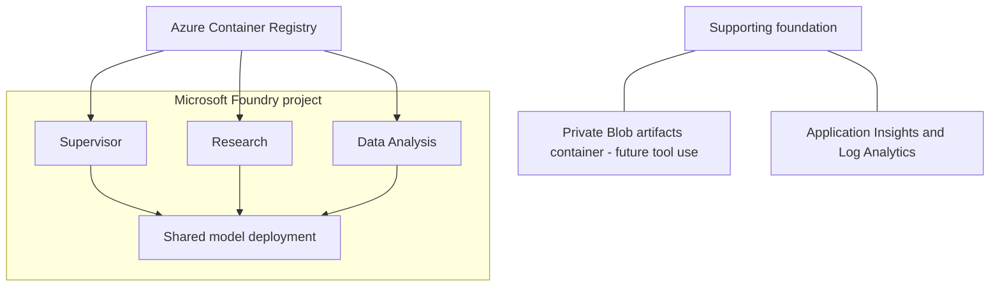
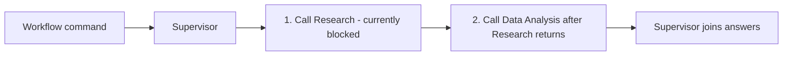
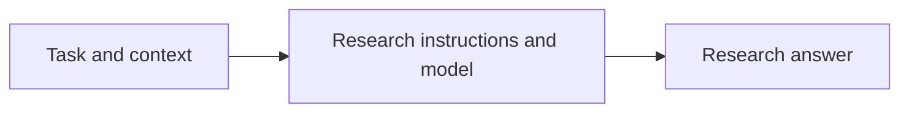
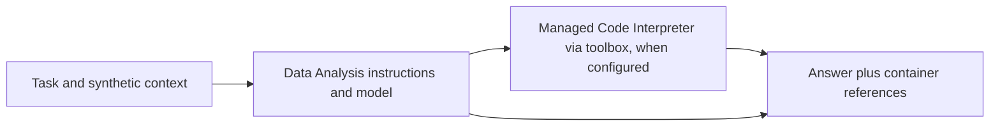

# Hosted Agents POC

A proof of concept for coordinating three separately deployed Microsoft Foundry
Hosted Agents: a Supervisor, Research specialist, and Data Analysis specialist.
It explores task delegation, durable workflow state, user isolation, and recovery.

Built with Python 3.14, uv, and Microsoft Agent Framework (MAF).

See the [decision, feature, and status record](docs/adr/0001-hosted-agents-poc.md).

## 1. Infrastructure diagram

Three separate hosted-agent deployments share one Foundry project and model
deployment. Bicep defines the foundation; agent deployment builds and publishes
the containers separately.

This POC uses authenticated public endpoints. "Private" Blob storage means the
container disallows anonymous access, not that it uses private networking.
Storage uses an enforced Network Security Perimeter with permissive IPv4 ingress,
not a private endpoint. See the [infrastructure boundaries](infra/README.md).



## 2. Business context

This POC explores whether independently hosted agents can coordinate research
and data analysis while preserving workflow state and user isolation. The goal
is repeatable evidence about delegation, persistence, and recovery, not a
production-ready analysis service. Local tests prove application logic;
platform behavior requires separate hosted evidence.

## 3. Agents explanation

All three services in [azure.yaml](azure.yaml) use the same
[Dockerfile](src/backend/Dockerfile), Python dependencies, and application code,
but run as **separate hosted deployments**, not three agents in one container.
The shared entry point reads `POC_AGENT_NAME`; [runtime.py](src/backend/app/runtime.py)
selects instructions and [hosting.py](src/backend/app/hosting.py) selects behavior.
Future tools and custom code can be registered per role without requiring
separate Dockerfiles. Role selection is not authorization; access still requires
verified identity and permissions.

### Supervisor

`POC_AGENT_NAME=supervisor`. Plain chat uses its own model. Explicit
`POC_WORKFLOW` create/continue commands call Research, then Data Analysis with
the same task message, and join their answers; this is not model-driven planning.
**The current hosted workflow stops at our nested-user-ID guard.** Authorization
alignment and end-to-end proof are pending; details belong in the
[ADR](docs/adr/0001-hosted-agents-poc.md#authorization-contract-and-proposed-alignment).

For Story #4, a separate stateless `POC_DELEGATE` command routes one task to one
specialist: the Supervisor model chooses Research or Data Analysis through a
function-tool call (or the client names an allow-listed target), and Supervisor
code invokes that specialist's agent endpoint synchronously or in Responses
background mode, with a selectable identity mode (`agent`, `call-context`, or
`delegated-user`). It never touches the workflow registry, so the guard above is
unchanged. See [Story 4 tasks](#story-4-representative-hosted-agent-patterns).



### Research

`POC_AGENT_NAME=research`. Answers from supplied context using Research-specific
instructions. For Story #4, when `TOOLBOX_ENDPOINT` is set (from
`RESEARCH_TOOLBOX_ENDPOINT`), Research gets the Foundry toolbox
`story4-research-mcp`, which exposes only `microsoft_docs_search` from the public
Microsoft Learn MCP server. No other external search or retrieval tools are connected.



### Data Analysis

`POC_AGENT_NAME=data_analysis`. Without `TOOLBOX_ENDPOINT`, it discusses
supplied synthetic examples using Data Analysis-specific instructions. For
Story #1 the **existing** deployed agent is wired to Microsoft-managed Code
Interpreter through a Foundry toolbox. It then executes Python in the managed
sandbox and returns `poc-artifacts-v1` container references. Generated files
stay in the sandbox and are downloaded by an authenticated client. See
**Agents: Story 1 - 1 Enable Code Interpreter on existing Data Analysis agent**.

To run it, choose **Terminal > Run Task...** in VS Code, select that task,
then select the environment and mode. Use `enable-if-missing` for initial
toolbox/agent wiring, or `verify` to test an already-configured deployment.
Both modes incur sandbox/model usage charges. See the
[Step 1 task guide](docs/tasks-detailed.md#agents-story-1---1-enable-code-interpreter-on-existing-data-analysis-agent)
for prerequisites, execution steps, and the complete output-file inventory.

This is a **local test runner calling remote services**, not a sandbox-only
task: dataset generation, expected checksums, API coordination, and evidence
writing run locally; agent orchestration runs in the deployed Foundry agent;
Code Interpreter executes the probe/analysis Python in the managed sandbox.
There is no implemented "nothing local" mode. The
[cloud-only execution proposal](docs/tasks-detailed.md#cloud-only-execution-proposed-not-implemented)
describes that separate, unimplemented approach.

Results are linked from [the Story 1 evidence index](artifacts/story-1/index.md).
Each run is written to
`artifacts\story-<n>\step-<NN>-<slug>\<YYYYMMDDTHHMMSSZ>-<id8>\report.md`, for example
`artifacts\story-1\step-01-code-interpreter\20261023T120408Z-a1b2c3d4\report.md`.
The step folder groups every rerun of a step, and the Step 1 mode is recorded in
`manifest.json` and the index entry. Runs written before this convention keep
their original folder names and index links. See
[output files](docs/tasks-detailed.md#step-1-output-files) for the full layout.

After Step 1, run **Agents: Story 1 - 2 Analyze data and deliver outputs**
(Story #1 AC2), **Agents: Story 1 - 3 Evaluate dataset sizes** (AC3),
**Agents: Story 1 - 4 Assess sandbox boundaries** (AC4), and
**Agents: Story 1 - 5 Assess state continuity** (AC5). They require the Step 1
baseline, never change the agents or the Step 1 toolbox, and write their
reports under `step-02-analysis-and-outputs\` through `step-05-state-continuity\`. Step 4 can
create and delete a separate probe-only toolbox; Step 5 deletes one sandbox
container and writes, reads, and deletes one synthetic Blob checkpoint. See the
[Step 2](docs/tasks-detailed.md#agents-story-1---2-analyze-data-and-deliver-outputs),
[Step 3](docs/tasks-detailed.md#agents-story-1---3-evaluate-dataset-sizes),
[Step 4](docs/tasks-detailed.md#agents-story-1---4-assess-sandbox-boundaries),
and [Step 5](docs/tasks-detailed.md#agents-story-1---5-assess-state-continuity)
task guides.

### Story 4: representative hosted agent patterns

Story #4 validates Supervisor -> sub-agent delegation, sync/async and failure
handling, a Research tool call, identity paths, identity/correlation tracing with
allowed and denied access, Data Analysis through the Supervisor, and direct
invocation of a sub-agent. Run the tasks in order:

1. **Agents: Story 4 - 1 Demonstrate Supervisor delegation** with
   `prepare-if-missing` once per environment. It creates the Research MCP toolbox,
   sets `RESEARCH_TOOLBOX_ENDPOINT`, and runs `azd deploy --all` (same agents and
   identities) only when the deployed code or wiring is missing, then writes the
   Story 4 baseline. Use `verify` afterwards. Redeploying moves Data Analysis to a
   new version, so rerun **Agents: Story 1 - 1** (`verify`) before Story 1 Steps 2-5.
2. **Agents: Story 4 - 2** through **Agents: Story 4 - 7** reuse that baseline and
   never deploy, grant roles, or change agents.

Reports are written to `artifacts\story-4\step-<NN>-<slug>\<run>\report.md` and linked from
`artifacts\story-4\index.md`, in the same format as Story 1. See the
[Story 4 task guides](docs/tasks-detailed.md#agents-story-4---1-demonstrate-supervisor-delegation)
for each step's checks, outputs, and limitations.

Data Analysis exports hosted request and Agent Framework traces to the
Application Insights resource linked to the Foundry project when
`APPLICATIONINSIGHTS_CONNECTION_STRING` is populated in the selected azd
environment before deployment. The manifest passes the value as
`POC_APPLICATIONINSIGHTS_CONNECTION_STRING` because the standard name is
platform-reserved; a platform-supplied connection is used as the fallback.
Startup uses the hosting SDK's `configure_observability`, which stamps the
Foundry agent name/version on every span (what the Foundry trace view filters
on) and enables Agent Framework instrumentation. Application Insights disables
local auth, so Data Analysis exports with its Entra identity
(`POC_APPLICATIONINSIGHTS_AUTH_MODE=entra`); **Access: Apply hosted agent
permissions** grants it Monitoring Metrics Publisher on that resource only.
The same task also grants the Foundry project's managed identity Monitoring
Reader on that resource, so Foundry Insights can read the exported telemetry.
It checks existing assignments before applying either role.
Prompt/tool-content capture is explicitly disabled. See
[viewing Step 1 traces](docs/tasks-detailed.md#viewing-step-1-traces-in-foundry)
for setup, deployment scope, and verification. Direct operator toolbox probes
are not Data Analysis agent invocations.



## Quick start - run in this order

Use PowerShell at the repository root. Setup uses Python 3.14 and the committed
`uv.lock`; all Python package resolution uses
`https://packagefeedproxy.microsoft.io/pypi/simple/`.

Prerequisites: uv, Azure CLI with Bicep, azd 1.36+ with the Foundry agent
extensions, and PowerShell 7. For an existing deployment, skip resource creation
and use the smoke-only task described below; ordinary testing does not require
provisioning or a new agent version.

1. **Prepare the environment:** run **Setup: Prepare local environment**, or:

   ```powershell
   uv sync --frozen --group validation --inexact
   uv run --frozen --no-sync --group validation python -m scripts.common.validate_environment --mode local --no-color
   ```

   This import/preflight check needs no Azure credentials or resources.
2. **Sign in when needed:** use the same user/tenant in both CLIs:

   ```powershell
   az login
   azd auth login
   az account show --query "{subscription:name,id:id,tenant:tenantId}" --output table
   ```

   Confirm the intended subscription before continuing; change your Azure CLI
   selection first if it is not the target.
3. **Set up azd once:**

   ```powershell
   azd env new hosted-agents-poc-dev
   azd env set AZURE_SUBSCRIPTION_ID (az account show --query id --output tsv)
   azd env set AZURE_LOCATION northcentralus
   ```

   If this environment already exists, use
   `azd env select hosted-agents-poc-dev` instead of `azd env new`; verify its
   existing subscription/region values rather than overwriting them blindly.
   Check model/Hosted Agent availability and quota before choosing a different
   [supported region](docs/deployment.md#select-the-environment).
   Task prompts default to environment `hosted-agents-poc-dev` and subscription
   `lz-app1`; enter your own values when they differ.
4. **Preview the foundation** only if it is new or an infrastructure change is needed:

   ```powershell
   azd provision --preview
   ```

   Review the resource changes. An unsupported/unevaluated result is not
   successful validation. After a partial failure, keep the same environment
   and inspect the
   [recovery notes](infra/README.md#recovery-from-the-initial-partial-deployment).
5. **Explicitly provision after review:**

   ```powershell
   azd provision
   ```

   This creates/changes Azure resources and incurs charges. Skip it when reusing
   an unchanged foundation. If it fails, no outputs are saved and a later deploy
   reports `AZURE_AI_PROJECT_ID is not set`; see
   [provisioning failures](docs/deployment.md#preview-and-provision).
6. **Generate local settings:** use **Setup: Create .env from deployment**, or
   **Setup: Update .env from deployment** for an existing file. The helper finds
   the latest successful deployment for the exact environment and preserves
   unmapped local/identity/telemetry settings.
7. **Preview and explicitly apply developer access:** use
   **Access: Preview developer permissions**, then
   **Access: Apply developer permissions**. Select the same subscription/environment
   and credential source. RBAC is separate from provisioning.
8. **Validate configured settings:**

   ```powershell
   uv run --frozen --no-sync --group validation python -m scripts.common.validate_environment --mode configured
   ```

   This checks settings, not authentication or model inference.
9. **Run locally:** F5 **Supervisor host**, **Research host**, and
   **Data Analysis host**. Wait for ports 8088/8089/8090, then run
   **Agents: Smoke test all local agents**. Hosts are not started by the smoke
   task. See [local debugging details](docs/deployment.md#local-hosts-and-debugging).
10. **Deploy and verify independently hosted agents:** run
    **Agents: Deploy and smoke test all hosted agents**. This explicitly builds
    remotely in ACR, creates hosted versions, runs
    **Access: Apply hosted agent permissions** (agent model access, Data
    Analysis telemetry publishing, project Monitoring Reader), and invokes all
    three agents. It incurs build/session/model usage. For Data Analysis traces,
    set `APPLICATIONINSIGHTS_CONNECTION_STRING` in the azd environment first
    ([details](docs/tasks-detailed.md#viewing-step-1-traces-in-foundry)).
    A `Project not found` error means the Agent Service has not registered the
    project yet; see [troubleshooting](docs/deployment.md#troubleshooting-project-not-found).
11. **Enable Code Interpreter for Story 1:** run
    **Agents: Story 1 - 1 Enable Code Interpreter on existing Data Analysis agent**
    with mode `enable-if-missing` on a new environment, `verify` afterwards.

The [complete task sequence](docs/deployment.md#complete-task-sequence-after-provisioning)
lists every deployment and permission task in order.

For already-deployed agents, **Agents: Smoke test all hosted agents** avoids a
new build/version and requires no local F5 hosts. Use `azd provision` for reviewed
foundation changes and `azd deploy` for code; do not substitute `azd up`.

To demonstrate **direct native-user isolation** on an existing Research deployment:

1. Run **Access: Create isolated user auth profiles** with two full user UPNs.
   Choose `consumer` for the required project-scoped invocation grants, or `none`
   if access is already configured.
2. Run **Agents: Test native Entra user isolation** with those same users and
   choose **Verbose** or **Not verbose**.

This uses real user credentials and synthetic state/history diagnostics, with no
model inference requested. Hosted usage can still incur charges. It tests the
direct Research boundary, not Supervisor-to-specialist user propagation or
downstream user permissions. See the
[native-user test details](docs/deployment.md#test-genuine-native-entra-users).

**Agents: Test hosted workflow state and delegation** is a separate, currently
non-passing scenario. **Agents: Deploy and test hosted delegation** additionally
creates new versions. Read the [current authorization finding](docs/adr/0001-hosted-agents-poc.md#authorization-contract-and-proposed-alignment)
before either. **Agents: Diagnose hosted caller context** is the no-model
presence-only comparison; it does not prove resource authorization.

## What can we validate locally vs. hosted?

| Check | Local | Foundry Hosted Agent |
|---|---|---|
| Settings, imports, startup, request handling | Yes | Confirms deployed compatibility |
| Real model responses | Developer credentials | Agent runtime identity |
| Analysis and delegation logic | Unit tests / local integration | Real deployed-agent integration |
| Owner/session mapping rules | Fake-store unit tests | Real durable persistence and restart continuity |
| User isolation and authorized caller context | Cannot prove | Required |
| Session files across idle/resume | Cannot prove | Required |
| Hosted crash recovery and sandbox capacity | Cannot prove | Required |

Independent smoke is not delegation, isolation, persistence, or recovery proof.
A configured 120-second idle policy is not evidence of an actual lifecycle
transition. The [ADR snapshot](docs/adr/0001-hosted-agents-poc.md#implementation-and-evidence-snapshot)
separates implementation from observed hosted results.

## Documentation

| Document | Purpose |
|---|---|
| [POC ADR](docs/adr/0001-hosted-agents-poc.md) | Accepted architecture, state/identity boundaries, feature adoption, dated progress, and pending experiments |
| [Deployment guide](docs/deployment.md) | Detailed setup, local debugging, tasks, configuration/sizing, diagnostics, evidence, and teardown |
| [Detailed task guide](docs/tasks-detailed.md) | Task purposes, prerequisites, side effects, test use cases, and Mermaid execution flows |
| [Infrastructure guide](infra/README.md) | Bicep contracts, NSP boundaries, outputs, and provisioning/RBAC details |

The published documentation is self-contained. Local working notes and generated
evidence are not prerequisites for using this repository. Architecture acceptance,
platform GA/preview status, implementation, and verification are not interchangeable.

## Tear down

Teardown is manual, destructive, and never part of setup or debugging. It can
permanently remove the POC and supported recovery copies. Confirm the selected
subscription/environment, save anything needed, then follow the
[teardown procedure and warnings](docs/deployment.md#tear-down). To start over,
prefer a new environment name; see
[re-create after teardown](docs/deployment.md#re-create-after-teardown).

## VS Code tasks

Use **Terminal > Run Task**. Task names use `Area: Action + target`.
See [Detailed task guide](docs/tasks-detailed.md) for every task's purpose,
prerequisites, side effects, test steps, and Mermaid interaction diagrams.
Local checks do not deploy, grant permissions, or inject failures. Agent smoke
tests invoke real models and can incur charges. See the
[deployment guide](docs/deployment.md#vs-code-task-and-debugger-reference)
for setup, execution boundaries, and debugger details.

| Selected task | Purpose / boundary |
|---|---|
| **Setup: Prepare local environment** | Locked uv sync plus local import preflight; no Azure access |
| **Setup: Sync dependencies** | `--inexact` preserves installed optional extras |
| **Setup: Sync dependencies with optional integrations** | Installs optional libraries, not resources or enabled integrations |
| **Setup: Check Python environment** | Interpreter/import checks without model invocation |
| **Agents: Smoke test all local agents** | Requires all three local hosts already running; real model calls |
| **Agents: Deploy and smoke test all hosted agents** | Explicit paid build/deploy, scoped model roles, and remote smoke |
| **Agents: Smoke test all hosted agents** | Remote inference without building new versions |
| **Agents: Test hosted identity variants and isolation** | Explicit hosted call-context/user-label experiments and synthetic state/history tests; no models; requires diagnostic opt-in |
| **Agents: Test native Entra user isolation** | Choose verbose request/response panels or shorter output; two native CLI users directly invoke Research, with no delegated labels or models |
| **Agents: Story 1 - 1 Enable Code Interpreter on existing Data Analysis agent** | Reuses the existing agents. `verify` is read-only plus a paid sandbox proof. `enable-if-missing` creates the Story 1 toolbox and updates only the existing Data Analysis agent, once. Writes a Markdown report |
| **Agents: Story 1 - 2 Analyze data and deliver outputs** | Read-only reuse of the Step 1 agents and toolbox. One paid Data Analysis request (model-written filter/group/summarize/chart) validated against a local oracle, downloaded CSVs and chart, and the existing Supervisor workflow path, including files forwarded by container ID through the Supervisor. Writes a report under `step-02-analysis-and-outputs\` |
| **Agents: Story 1 - 3 Evaluate dataset sizes** | Read-only reuse of the Step 1 agents and toolbox. One sequential paid request per size (1k/10k/100k rows), no retries, and stops at the first platform failure. Writes `03-capacity.md` with sandbox measurements and a scoped viability verdict |
| **Agents: Story 1 - 4 Assess sandbox boundaries** | Paid benign sandbox probes (identity, filesystem, network, execution limit, per-call and toolbox-level options), one hosted confirmation, and an optional ~21-minute idle-expiry wait. Can create and then delete a separate probe-only toolbox. Writes `04-sandbox-boundaries.md` |
| **Agents: Story 1 - 5 Assess state continuity** | Four paid hosted requests across three conversations, one sandbox container deletion, and a synthetic checkpoint written to, read from, and deleted in the existing Blob container. Writes `05-state-continuity.md` |
| **Agents: Story 4 - 1 Demonstrate Supervisor delegation** | AC1. `verify` changes nothing; `prepare-if-missing` creates the Research MCP toolbox and runs `azd deploy --all` once if needed. Two paid model-routed delegations. Writes `01-supervisor-delegation.md` and the Story 4 baseline |
| **Agents: Story 4 - 2 Assess sync and async delegation** | AC2. Paid sync and background Supervisor -> Research delegation, each with a simulated sub-agent failure, plus one direct background request. Writes `02-sync-async-and-failure.md` |
| **Agents: Story 4 - 3 Demonstrate Research tool call** | AC3. Direct toolbox probe plus a paid Supervisor -> Research MCP tool call; caller/target/permission/trust-boundary table. Writes `03-research-tool-call.md` |
| **Agents: Story 4 - 4 Evaluate identity paths** | AC4. Reads (never grants) roles; paid agent-owned, call-context, and delegated-user calls. Writes `04-identity-paths.md` |
| **Agents: Story 4 - 5 Trace identity and access** | AC5. Paid traced request and platform/application denials with the enforcing component. Writes `05-trace-and-access.md` |
| **Agents: Story 4 - 6 Demonstrate Data Analysis via Supervisor** | AC6. Reuses the Story 1 toolbox, request, oracle, and evidence; one paid Code Interpreter analysis through the Supervisor. Writes `06-data-analysis-code-interpreter.md` |
| **Agents: Story 4 - 7 Invoke Research directly** | AC7. Two paid requests only to Research in its own conversation; no Supervisor. Writes `07-direct-invocation.md` |
| **Access: Preview hosted agent permissions** | Read-only actual-instance permission inspection |
| **Access: Create isolated user auth profiles** | Prompt for UPNs and optional project-scoped Consumer RBAC; operator grants precede isolated Microsoft sign-in; no agent calls or administrative/impersonation grants |
| **Access: Apply hosted agent permissions** | Explicit scoped grants; not proof of delegation |
| **Quality: Run all local checks** | Lint, format, mypy, and tests; default build task |
