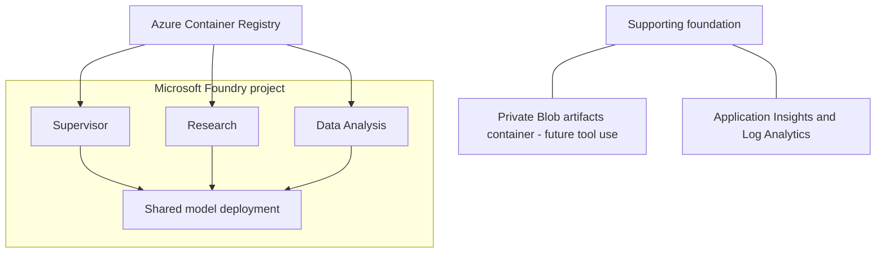
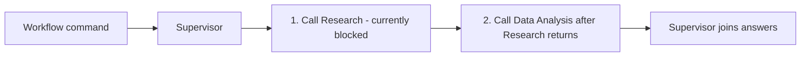
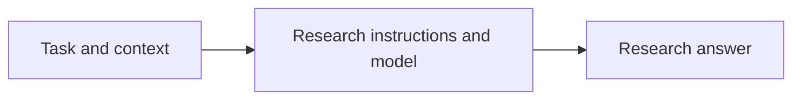
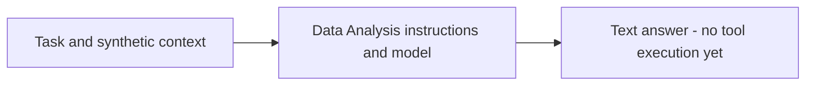

# Hosted Agents POC

A proof of concept for coordinating three separately deployed Microsoft Foundry
Hosted Agents: a Supervisor, Research specialist, and Data Analysis specialist.
It explores task delegation, durable workflow state, user isolation, and recovery.

Built with Python 3.14, uv, and Microsoft Agent Framework (MAF).

See the [decision, feature, and status record](docs/adr/0001-hosted-agents-poc.md).

## 1. Infrastructure diagram

Three separate hosted-agent deployments share one Foundry project and model
deployment. Bicep defines the foundation; agent deployment builds and publishes
the containers separately.

This POC uses authenticated public endpoints. "Private" Blob storage means the
container disallows anonymous access, not that it uses private networking.
Storage uses an enforced Network Security Perimeter with permissive IPv4 ingress,
not a private endpoint. See the [infrastructure boundaries](infra/README.md).



## 2. Business context

This POC explores whether independently hosted agents can coordinate research
and data analysis while preserving workflow state and user isolation. The goal
is repeatable evidence about delegation, persistence, and recovery, not a
production-ready analysis service. Local tests prove application logic;
platform behavior requires separate hosted evidence.

## 3. Agents explanation

All three services in [azure.yaml](azure.yaml) use the same
[Dockerfile](src/backend/Dockerfile), Python dependencies, and application code,
but run as **separate hosted deployments**, not three agents in one container.
The shared entry point reads `POC_AGENT_NAME`; [runtime.py](src/backend/app/runtime.py)
selects instructions and [hosting.py](src/backend/app/hosting.py) selects behavior.
Future tools and custom code can be registered per role without requiring
separate Dockerfiles. Role selection is not authorization; access still requires
verified identity and permissions.

### Supervisor

`POC_AGENT_NAME=supervisor`. Plain chat uses its own model. Explicit
`POC_WORKFLOW` create/continue commands call Research, then Data Analysis with
the same task message, and join their answers; this is not model-driven planning.
**The current hosted workflow stops at our nested-user-ID guard.** Authorization
alignment and end-to-end proof are pending; details belong in the
[ADR](docs/adr/0001-hosted-agents-poc.md#authorization-contract-and-proposed-alignment).



### Research

`POC_AGENT_NAME=research`. Answers from supplied context using Research-specific
instructions. External search and retrieval tools are not connected yet.



### Data Analysis

`POC_AGENT_NAME=data_analysis`. Discusses supplied synthetic examples using
Data Analysis-specific instructions. File analysis, Python execution tools,
and artifact generation are not implemented yet.



## Quick start - run in this order

Use PowerShell at the repository root. Setup uses Python 3.14 and the committed
`uv.lock`; all Python package resolution uses
`https://packagefeedproxy.microsoft.io/pypi/simple/`.

Prerequisites: uv, Azure CLI with Bicep, azd 1.36+ with the Foundry agent
extensions, and PowerShell 7. For an existing deployment, skip resource creation
and use the smoke-only task described below; ordinary testing does not require
provisioning or a new agent version.

1. **Prepare the environment:** run **Setup: Prepare local environment**, or:

   ```powershell
   uv sync --frozen --group validation --inexact
   uv run --frozen --no-sync --group validation python -m scripts.common.validate_environment --mode local --no-color
   ```

   This import/preflight check needs no Azure credentials or resources.
2. **Sign in when needed:** use the same user/tenant in both CLIs:

   ```powershell
   az login
   azd auth login
   az account show --query "{subscription:name,id:id,tenant:tenantId}" --output table
   ```

   Confirm the intended subscription before continuing; change your Azure CLI
   selection first if it is not the target.
3. **Set up azd once:**

   ```powershell
   azd env new hosted-agents-poc-dev
   azd env set AZURE_SUBSCRIPTION_ID (az account show --query id --output tsv)
   azd env set AZURE_LOCATION northcentralus
   ```

   If this environment already exists, use
   `azd env select hosted-agents-poc-dev` instead of `azd env new`; verify its
   existing subscription/region values rather than overwriting them blindly.
   Check model/Hosted Agent availability and quota before choosing a different
   [supported region](docs/deployment.md#select-the-environment).
4. **Preview the foundation** only if it is new or an infrastructure change is needed:

   ```powershell
   azd provision --preview
   ```

   Review the resource changes. An unsupported/unevaluated result is not
   successful validation. After a partial failure, keep the same environment
   and inspect the
   [recovery notes](infra/README.md#recovery-from-the-initial-partial-deployment).
5. **Explicitly provision after review:**

   ```powershell
   azd provision
   ```

   This creates/changes Azure resources and incurs charges. Skip it when reusing
   an unchanged foundation.
6. **Generate local settings:** use **Setup: Create .env from deployment**, or
   **Setup: Update .env from deployment** for an existing file. The helper finds
   the latest successful deployment for the exact environment and preserves
   unmapped local/identity/telemetry settings.
7. **Preview and explicitly apply developer access:** use
   **Access: Preview developer permissions**, then
   **Access: Apply developer permissions**. Select the same subscription/environment
   and credential source. RBAC is separate from provisioning.
8. **Validate configured settings:**

   ```powershell
   uv run --frozen --no-sync --group validation python -m scripts.common.validate_environment --mode configured
   ```

   This checks settings, not authentication or model inference.
9. **Run locally:** F5 **Supervisor host**, **Research host**, and
   **Data Analysis host**. Wait for ports 8088/8089/8090, then run
   **Agents: Smoke test all local agents**. Hosts are not started by the smoke
   task. See [local debugging details](docs/deployment.md#local-hosts-and-debugging).
10. **Deploy and verify independently hosted agents:** run
    **Agents: Deploy and smoke test all hosted agents**. This explicitly builds
    remotely in ACR, creates hosted versions, applies scoped instance model access,
    and invokes all three agents. It incurs build/session/model usage.

For already-deployed agents, **Agents: Smoke test all hosted agents** avoids a
new build/version and requires no local F5 hosts. Use `azd provision` for reviewed
foundation changes and `azd deploy` for code; do not substitute `azd up`.

To demonstrate **direct native-user isolation** on an existing Research deployment:

1. Run **Access: Create isolated user auth profiles** with two full user UPNs.
   Choose `consumer` for the required project-scoped invocation grants, or `none`
   if access is already configured.
2. Run **Agents: Test native Entra user isolation** with those same users and
   choose **Verbose** or **Not verbose**.

This uses real user credentials and synthetic state/history diagnostics, with no
model inference requested. Hosted usage can still incur charges. It tests the
direct Research boundary, not Supervisor-to-specialist user propagation or
downstream user permissions. See the
[native-user test details](docs/deployment.md#test-genuine-native-entra-users).

**Agents: Test hosted workflow state and delegation** is a separate, currently
non-passing scenario. **Agents: Deploy and test hosted delegation** additionally
creates new versions. Read the [current authorization finding](docs/adr/0001-hosted-agents-poc.md#authorization-contract-and-proposed-alignment)
before either. **Agents: Diagnose hosted caller context** is the no-model
presence-only comparison; it does not prove resource authorization.

## What can we validate locally vs. hosted?

| Check | Local | Foundry Hosted Agent |
|---|---|---|
| Settings, imports, startup, request handling | Yes | Confirms deployed compatibility |
| Real model responses | Developer credentials | Agent runtime identity |
| Analysis and delegation logic | Unit tests / local integration | Real deployed-agent integration |
| Owner/session mapping rules | Fake-store unit tests | Real durable persistence and restart continuity |
| User isolation and authorized caller context | Cannot prove | Required |
| Session files across idle/resume | Cannot prove | Required |
| Hosted crash recovery and sandbox capacity | Cannot prove | Required |

Independent smoke is not delegation, isolation, persistence, or recovery proof.
A configured 120-second idle policy is not evidence of an actual lifecycle
transition. The [ADR snapshot](docs/adr/0001-hosted-agents-poc.md#implementation-and-evidence-snapshot)
separates implementation from observed hosted results.

## Documentation

| Document | Purpose |
|---|---|
| [POC ADR](docs/adr/0001-hosted-agents-poc.md) | Accepted architecture, state/identity boundaries, feature adoption, dated progress, and pending experiments |
| [Deployment guide](docs/deployment.md) | Detailed setup, local debugging, tasks, configuration/sizing, diagnostics, evidence, and teardown |
| [Detailed task guide](docs/tasks-detailed.md) | Task purposes, prerequisites, side effects, test use cases, and Mermaid execution flows |
| [Infrastructure guide](infra/README.md) | Bicep contracts, NSP boundaries, outputs, and provisioning/RBAC details |

The published documentation is self-contained. Local working notes and generated
evidence are not prerequisites for using this repository. Architecture acceptance,
platform GA/preview status, implementation, and verification are not interchangeable.

## Tear down

Teardown is manual, destructive, and never part of setup or debugging. It can
permanently remove the POC and supported recovery copies. Confirm the selected
subscription/environment, save anything needed, then follow the
[teardown procedure and warnings](docs/deployment.md#tear-down).

## VS Code tasks

Use **Terminal > Run Task**. Task names use `Area: Action + target`.
See [Detailed task guide](docs/tasks-detailed.md) for every task's purpose,
prerequisites, side effects, test steps, and Mermaid interaction diagrams.
Local checks do not deploy, grant permissions, or inject failures. Agent smoke
tests invoke real models and can incur charges. See the
[deployment guide](docs/deployment.md#vs-code-task-and-debugger-reference)
for setup, execution boundaries, and debugger details.

| Selected task | Purpose / boundary |
|---|---|
| **Setup: Prepare local environment** | Locked uv sync plus local import preflight; no Azure access |
| **Setup: Sync dependencies** | `--inexact` preserves installed optional extras |
| **Setup: Sync dependencies with optional integrations** | Installs optional libraries, not resources or enabled integrations |
| **Setup: Check Python environment** | Interpreter/import checks without model invocation |
| **Agents: Smoke test all local agents** | Requires all three local hosts already running; real model calls |
| **Agents: Deploy and smoke test all hosted agents** | Explicit paid build/deploy, scoped model roles, and remote smoke |
| **Agents: Smoke test all hosted agents** | Remote inference without building new versions |
| **Agents: Test hosted identity variants and isolation** | Explicit hosted call-context/user-label experiments and synthetic state/history tests; no models; requires diagnostic opt-in |
| **Agents: Test native Entra user isolation** | Choose verbose request/response panels or shorter output; two native CLI users directly invoke Research, with no delegated labels or models |
| **Access: Preview hosted agent permissions** | Read-only actual-instance permission inspection |
| **Access: Create isolated user auth profiles** | Prompt for UPNs and optional project-scoped Consumer RBAC; operator grants precede isolated Microsoft sign-in; no agent calls or administrative/impersonation grants |
| **Access: Apply hosted agent permissions** | Explicit scoped grants; not proof of delegation |
| **Quality: Run all local checks** | Lint, format, mypy, and tests; default build task |
