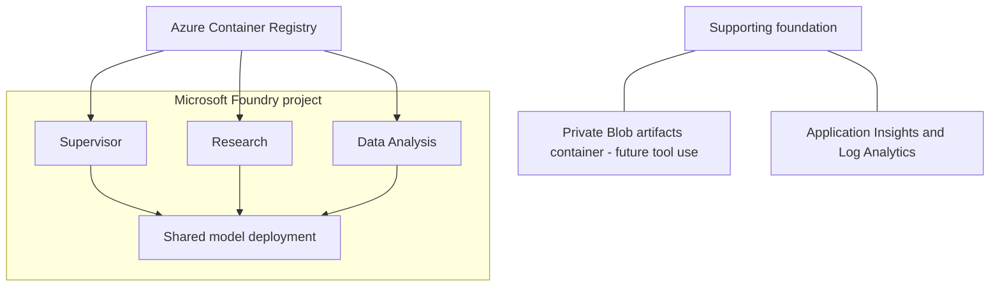
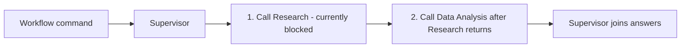
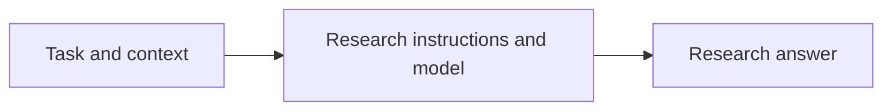
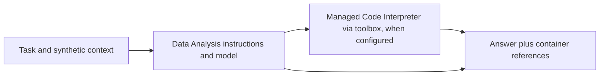

# Hosted Agents POC

A proof of concept for coordinating three separately deployed Microsoft Foundry
Hosted Agents: a Supervisor, Research specialist, and Data Analysis specialist.
It explores task delegation, durable workflow state, user isolation, and recovery.

Built with Python 3.14, uv, and Microsoft Agent Framework (MAF).

See the [decision, feature, and status record](docs/adr/0001-hosted-agents-poc.md).

## 1. Infrastructure diagram

Three separate hosted-agent deployments share one Foundry project and model
deployment. Bicep defines the foundation; agent deployment builds and publishes
the containers separately.

This POC uses authenticated public endpoints. "Private" Blob storage means the
container disallows anonymous access, not that it uses private networking.
Storage uses an enforced Network Security Perimeter with permissive IPv4 ingress,
not a private endpoint. See the [infrastructure boundaries](infra/README.md).



## 2. Business context

This POC explores whether independently hosted agents can coordinate research
and data analysis while preserving workflow state and user isolation. The goal
is repeatable evidence about delegation, persistence, and recovery, not a
production-ready analysis service. Local tests prove application logic;
platform behavior requires separate hosted evidence.

## 3. Agents explanation

All three services in [azure.yaml](azure.yaml) use the same
[Dockerfile](src/backend/Dockerfile), Python dependencies, and application code,
but run as **separate hosted deployments**, not three agents in one container.
The shared entry point reads `POC_AGENT_NAME`; [runtime.py](src/backend/app/runtime.py)
selects instructions and [hosting.py](src/backend/app/hosting.py) selects behavior.
Future tools and custom code can be registered per role without requiring
separate Dockerfiles. Role selection is not authorization; access still requires
verified identity and permissions.

### Supervisor

`POC_AGENT_NAME=supervisor`. Plain chat uses its own model. Explicit
`POC_WORKFLOW` create/continue commands call Research, then Data Analysis with
the same task message, and join their answers; this is not model-driven planning.
**The current hosted workflow stops at our nested-user-ID guard.** Authorization
alignment and end-to-end proof are pending; details belong in the
[ADR](docs/adr/0001-hosted-agents-poc.md#authorization-contract-and-proposed-alignment).

For Story #4, a separate stateless `POC_DELEGATE` command routes one task to one
specialist: the Supervisor model chooses Research or Data Analysis through a
function-tool call (or the client names an allow-listed target), and Supervisor
code invokes that specialist's agent endpoint synchronously or in Responses
background mode, with a selectable identity mode (`agent`, `call-context`, or
`delegated-user`). It never touches the workflow registry, so the guard above is
unchanged. See [Story 4 tasks](#story-4-representative-hosted-agent-patterns).



### Research

`POC_AGENT_NAME=research`. Answers from supplied context using Research-specific
instructions. For Story #4, when `TOOLBOX_ENDPOINT` is set (from
`RESEARCH_TOOLBOX_ENDPOINT`), Research gets the Foundry toolbox
`story4-research-mcp`, which exposes only `microsoft_docs_search` from the public
Microsoft Learn MCP server. No other external search or retrieval tools are connected.



### Data Analysis

`POC_AGENT_NAME=data_analysis`. Story #1 now targets **native Microsoft-managed
Code Interpreter** on the existing `data-analysis-agent`, without a fourth agent
or toolbox wrapper. Fixed synthetic CSV commands use trusted owner/session
bindings and deliver original output bytes through authorized Hosted Session
Files. Selecting the native tool alone is not proof of isolation, and this POC
does not claim confidentiality against privileged project users.

Use the same five **Agents: Story 1** task entries. Each defaults to `preview`,
which is local and credential-free. Select `run` only after approving the bounded
paid validation budget and deploying the reviewed native version. Tasks do not
deploy, grant roles, delete service resources, or fall back to the toolbox.
See [current native task instructions](docs/tasks-detailed.md#native-story-1-validation-current-branch).

This is a **local test runner calling remote services**, not a sandbox-only
task: dataset generation, expected checksums, API coordination, and evidence
writing run locally; agent orchestration runs in the deployed Foundry agent;
Code Interpreter executes the probe/analysis Python in the managed sandbox.
There is no implemented "nothing local" mode. The
[cloud-only execution proposal](docs/tasks-detailed.md#cloud-only-execution-proposed-not-implemented)
describes that separate, unimplemented approach.

Results are linked from [the Story 1 evidence index](artifacts/story-1/index.md).
Each run is written to
`artifacts\story-<n>\step-<NN>-<slug>\<YYYYMMDDTHHMMSSZ>-<id8>\report.md`, for example
`artifacts\story-1\step-01-code-interpreter\20261023T120408Z-a1b2c3d4\report.md`.
The step folder groups every rerun of a step, and the native variant is recorded in
`manifest.json` and the index entry. Runs written before this convention keep
their original folder names and index links. See
[output files](docs/tasks-detailed.md#step-1-output-files) for the full layout.

After Step 1, run **Agents: Story 1 - 2 Analyze data and deliver outputs**
(Story #1 AC2), **Agents: Story 1 - 3 Evaluate dataset sizes** (AC3),
**Agents: Story 1 - 4 Assess sandbox boundaries** (AC4), and
**Agents: Story 1 - 5 Assess state continuity** (AC5). They require the Step 1
native baseline, never change agents, and retain reports under
`step-02-analysis-and-outputs\` through `step-05-state-continuity\`.
Step 4 uses two real existing user profiles. Step 5 retains its Blob checkpoint
and demonstrates runner-driven reconstruction, not surviving interpreter RAM.
Hosted idle/resume has a separate zero-analysis option (`only`) in Step 5, using
platform lifecycle metadata plus process/HOME checks. It passed one bounded v9
cycle. The existing Story 4 Step 6 Supervisor integration remains blocked at
contract preflight; implementation of a redesign still requires explicit approval.

For another computer, use the [repeatable user-access and validation setup](docs/tasks-detailed.md#repeat-the-tests-on-another-computer).
Azure grants persist; local sign-in profiles and version-bound test evidence must
be prepared on that computer.

### Story 3: multi-agent conversation management

Story #3 validates conversation ownership and history hydration across the
Supervisor and a sub-agent: a separate Supervisor-mapped sub-agent conversation,
follow-up history, ownership/identity/access across client-to-agent and
agent-to-agent boundaries, Agent A calling Agent B with A's own conversation ID,
and the shared versus separate comparison. A Supervisor-only `POC_CONVERSE`
command ([conversations.py](src/backend/app/services/conversations.py)) keeps the
Supervisor -> sub-agent mapping in the Supervisor's user-isolated Foundry state
store and sends the sub-agent plain text, so the sub-agent hydrates its own
conversation history. Run the tasks in order:

1. **Agents: Story 3 - 1 Demonstrate separate conversations** with
   `prepare-if-missing` once per environment. It runs `azd deploy supervisor-agent`
   (same identity; Research and Data Analysis are not redeployed) only when the
   Supervisor doesn't yet accept `POC_CONVERSE`, then writes the Story 3
   baseline. Use `verify` afterwards. Redeploying the Supervisor changes its
   version, so rerun **Agents: Story 4 - 1** and **Agents: Story 1 - 1** (both
   `verify`) before the later steps of those stories.
2. **Agents: Story 3 - 2** through **Agents: Story 3 - 5** reuse that baseline and
   never deploy, grant roles, or change agents.

Reports are written to `artifacts\story-3\step-<NN>-<slug>\<run>\report.md` and linked from
`artifacts\story-3\index.md`, in the same format as Story 1 and Story 4. Results
are summarized in the
[#3 status report](docs/issue-3-validate-multi-agent-conversation-management.md). See the
[Story 3 task guides](docs/tasks-detailed.md#agents-story-3---1-demonstrate-separate-conversations)
for each step's checks, outputs, and limitations.

### Story 4: representative hosted agent patterns

Story #4 validates Supervisor -> sub-agent delegation, sync/async and failure
handling, a Research tool call, identity paths, identity/correlation tracing with
allowed and denied access, Data Analysis through the Supervisor, and direct
invocation of a sub-agent. Run the tasks in order:

1. **Agents: Story 4 - 1 Demonstrate Supervisor delegation** with
   `prepare-if-missing` once per environment. It creates the Research MCP toolbox,
   sets `RESEARCH_TOOLBOX_ENDPOINT`, and runs `azd deploy --all` (same agents and
   identities) only when the deployed code or wiring is missing, then writes the
   Story 4 baseline. Use `verify` afterwards. Redeploying moves Data Analysis to a
   new version, so rerun **Agents: Story 1 - 1** (`verify`) before Story 1 Steps 2-5.
2. **Agents: Story 4 - 2** through **Agents: Story 4 - 7** reuse that baseline and
   never deploy, grant roles, or change agents.

Reports are written to `artifacts\story-4\step-<NN>-<slug>\<run>\report.md` and linked from
`artifacts\story-4\index.md`, in the same format as Story 1. See the
[Story 4 task guides](docs/tasks-detailed.md#agents-story-4---1-demonstrate-supervisor-delegation)
for each step's checks, outputs, and limitations.

Data Analysis exports hosted request and Agent Framework traces to the
Application Insights resource linked to the Foundry project when
`APPLICATIONINSIGHTS_CONNECTION_STRING` is populated in the selected azd
environment before deployment. The manifest passes the value as
`POC_APPLICATIONINSIGHTS_CONNECTION_STRING` because the standard name is
platform-reserved; a platform-supplied connection is used as the fallback.
Startup uses the hosting SDK's `configure_observability`, which stamps the
Foundry agent name/version on every span (what the Foundry trace view filters
on) and enables Agent Framework instrumentation. Application Insights disables
local auth, so Data Analysis exports with its Entra identity
(`POC_APPLICATIONINSIGHTS_AUTH_MODE=entra`); **Access: Apply hosted agent
permissions** grants it Monitoring Metrics Publisher on that resource only.
The same task also grants the Foundry project's managed identity Monitoring
Reader on that resource, so Foundry Insights can read the exported telemetry.
It checks existing assignments before applying either role.
Prompt/tool-content capture is explicitly disabled. See
[viewing Step 1 traces](docs/tasks-detailed.md#viewing-step-1-traces-in-foundry)
for setup, deployment scope, and verification. Direct operator toolbox probes
are not Data Analysis agent invocations.

The following diagram illustrates the historical toolbox path, not the native
Story 1 path described above; its earlier reports remain historical evidence.



## Quick start - run in this order

Use PowerShell at the repository root. Setup uses Python 3.14 and the committed
`uv.lock`; all Python package resolution uses
`https://packagefeedproxy.microsoft.io/pypi/simple/`.

Prerequisites: uv, Azure CLI with Bicep, azd 1.36+ with the Foundry agent
extensions, and PowerShell 7. For an existing deployment, skip resource creation
and use the smoke-only task described below; ordinary testing does not require
provisioning or a new agent version.

1. **Prepare the environment:** run **Setup: Prepare local environment**, or:

   ```powershell
   uv sync --frozen --group validation --inexact
   uv run --frozen --no-sync --group validation python -m scripts.common.validate_environment --mode local --no-color
   ```

   This import/preflight check needs no Azure credentials or resources.
2. **Sign in when needed:** use the same user/tenant in both CLIs:

   ```powershell
   az login
   azd auth login
   az account show --query "{subscription:name,id:id,tenant:tenantId}" --output table
   ```

   Confirm the intended subscription before continuing; change your Azure CLI
   selection first if it is not the target.
3. **Set up azd once:**

   ```powershell
   azd env new hosted-agents-poc-dev
   azd env set AZURE_SUBSCRIPTION_ID (az account show --query id --output tsv)
   azd env set AZURE_LOCATION northcentralus
   ```

   If this environment already exists, use
   `azd env select hosted-agents-poc-dev` instead of `azd env new`; verify its
   existing subscription/region values rather than overwriting them blindly.
   Check model/Hosted Agent availability and quota before choosing a different
   [supported region](docs/deployment.md#select-the-environment).
   Task prompts default to environment `hosted-agents-poc-dev` and subscription
   `lz-app1`; enter your own values when they differ.
4. **Preview the foundation** only if it is new or an infrastructure change is needed:

   ```powershell
   azd provision --preview
   ```

   Review the resource changes. An unsupported/unevaluated result is not
   successful validation. After a partial failure, keep the same environment
   and inspect the
   [recovery notes](infra/README.md#recovery-from-the-initial-partial-deployment).
5. **Explicitly provision after review:**

   ```powershell
   azd provision
   ```

   This creates/changes Azure resources and incurs charges. Skip it when reusing
   an unchanged foundation. If it fails, no outputs are saved and a later deploy
   reports `AZURE_AI_PROJECT_ID is not set`; see
   [provisioning failures](docs/deployment.md#preview-and-provision).
6. **Generate local settings:** use **Setup: Create .env from deployment**, or
   **Setup: Update .env from deployment** for an existing file. The helper finds
   the latest successful deployment for the exact environment and preserves
   unmapped local/identity/telemetry settings.
7. **Preview and explicitly apply developer access:** use
   **Access: Preview developer permissions**, then
   **Access: Apply developer permissions**. Select the same subscription/environment
   and credential source. RBAC is separate from provisioning.
8. **Validate configured settings:**

   ```powershell
   uv run --frozen --no-sync --group validation python -m scripts.common.validate_environment --mode configured
   ```

   This checks settings, not authentication or model inference.
9. **Run locally:** F5 **Supervisor host**, **Research host**, and
   **Data Analysis host**. Wait for ports 8088/8089/8090, then run
   **Agents: Smoke test all local agents**. Hosts are not started by the smoke
   task. See [local debugging details](docs/deployment.md#local-hosts-and-debugging).
10. **Deploy and verify independently hosted agents:** run
    **Agents: Deploy and smoke test all hosted agents**. This explicitly builds
    remotely in ACR, creates hosted versions, runs
    **Access: Apply hosted agent permissions** (agent model access, Data
    Analysis telemetry publishing, project Monitoring Reader), and invokes all
    three agents. It incurs build/session/model usage. For Data Analysis traces,
    set `APPLICATIONINSIGHTS_CONNECTION_STRING` in the azd environment first
    ([details](docs/tasks-detailed.md#viewing-step-1-traces-in-foundry)).
    A `Project not found` error means the Agent Service has not registered the
    project yet; see [troubleshooting](docs/deployment.md#troubleshooting-project-not-found).
11. **Validate native Code Interpreter for Story 1:** deploy the reviewed native
    version when approved, then run
    **Agents: Story 1 - 1 Enable Code Interpreter on existing Data Analysis agent**
    in `preview` first and `run` only within the approved paid budget. This task
    does not create a toolbox or deploy a version.

The [complete task sequence](docs/deployment.md#complete-task-sequence-after-provisioning)
lists every deployment and permission task in order.

For already-deployed agents, **Agents: Smoke test all hosted agents** avoids a
new build/version and requires no local F5 hosts. Use `azd provision` for reviewed
foundation changes and `azd deploy` for code; do not substitute `azd up`.

To demonstrate **direct native-user isolation** on an existing Research deployment:

1. Run **Access: Preview isolated user Consumer grants**, then
   **Access: Create isolated user auth profiles** with two full user UPNs.
   Choose `consumer` for the required project-scoped invocation grants, or `none`
   if access is already configured.
2. Run **Agents: Test native Entra user isolation** with those same users and
   choose **Verbose** or **Not verbose**.

This uses real user credentials and synthetic state/history diagnostics, with no
model inference requested. Hosted usage can still incur charges. It tests the
direct Research boundary, not Supervisor-to-specialist user propagation or
downstream user permissions. See the
[native-user test details](docs/deployment.md#test-genuine-native-entra-users).

**Agents: Test hosted workflow state and delegation** is a separate, currently
non-passing scenario. **Agents: Deploy and test hosted delegation** additionally
creates new versions. Read the [current authorization finding](docs/adr/0001-hosted-agents-poc.md#authorization-contract-and-proposed-alignment)
before either. **Agents: Diagnose hosted caller context** is the no-model
presence-only comparison; it does not prove resource authorization.

## What can we validate locally vs. hosted?

| Check | Local | Foundry Hosted Agent |
|---|---|---|
| Settings, imports, startup, request handling | Yes | Confirms deployed compatibility |
| Real model responses | Developer credentials | Agent runtime identity |
| Analysis and delegation logic | Unit tests / local integration | Real deployed-agent integration |
| Owner/session mapping rules | Fake-store unit tests | Real durable persistence and restart continuity |
| User isolation and authorized caller context | Cannot prove | Required |
| Session files across idle/resume | Cannot prove | Required |
| Hosted crash recovery and sandbox capacity | Cannot prove | Required |

Independent smoke is not delegation, isolation, persistence, or recovery proof.
A configured 120-second idle policy is not evidence of an actual lifecycle
transition. The [ADR snapshot](docs/adr/0001-hosted-agents-poc.md#implementation-and-evidence-snapshot)
separates implementation from observed hosted results.

## Generate HTML reports after validation runs

HTML generation is **offline**: it reads saved evidence, not the deployed agents.
It does not rerun tests, call models/Azure, deploy, grant permissions, or turn
partial evidence into a passing story. Use the same workflow for Stories 1, 3 and 4,
and for later stories.

### 1. Select the evidence

Run the relevant existing validation tasks first. Each run normally retains
`manifest.json`, `results.jsonl`, `events.jsonl`, and a Markdown report under
`artifacts\story-<n>\step-<NN>-<slug>\<run-folder>`.
For a current-execution report, select the latest execution of each relevant
task, including its actual failed, blocked, or partial results. Exclude superseded
attempts from the HTML and downloads; retain their original local artifacts
separately. Do not mix versions or environments without identifying each run's scope.

Create a local JSON bundle, for example
`artifacts\story-4\report-input.json`:

```json
{
  "schema": "story-report-bundle-v1",
  "story": 4,
  "title": "Story 4 - Hosted Agent Patterns",
  "environment": "hosted-agents-poc-dev",
  "runs": [
    {
      "key": "routing",
      "label": "Supervisor routing",
      "run_dir": "artifacts\\story-4\\step-01-supervisor-delegation\\<run-folder>",
      "scope": "Routing and text delivery only; not native code execution."
    }
  ],
  "decisions": [],
  "traceability": [
    {
      "requirement": "Supervisor routing",
      "status": "Recorded evidence",
      "summary": "Interpret the selected run's checks within its actual version and scope.",
      "run_keys": ["routing"]
    }
  ]
}
```

Replace `<run-folder>` with an actual run directory. Add one `runs` entry per
selected run, with a unique lowercase slug `key` (for example `research-tool`);
use those keys in `traceability[].run_keys`.
This one-run example is not a complete Story 4 report. Choose the title, story
number, scope, and requirements for the evidence being reported.

| Bundle field | Purpose |
|---|---|
| `story` | Story number; selects supported story-specific context, never a pass/fail policy |
| `runs` | Explicit saved run directories and descriptions; no automatic assumption that all required tasks ran |
| `traceability` | Requirement, scoped status/interpretation, and supporting run keys; use this when a Markdown summary is historical or not current |
| `decisions` | Optional acceptance decisions as `area`, `status`, `detail`, and `evidence_keys`; keep sponsor acceptance separate from measured results |
| `runs[].kind` | Optional run category. In the new schema, use `cross-story-reference` explicitly when including a run from another story, and explain its limited relevance in `scope` |

Relative paths resolve from the command's current directory. Run from the
repository root. Input bundles and original evidence are local/ignored; a fresh
clone does not contain them. Use the locked environment from **Setup: Prepare
local environment** and prepare an input bundle from evidence available on that
computer. Never copy authentication caches as report inputs.

### 2. Generate and open the HTML

Use the shared [report entry point](scripts/story_report.py):

```powershell
# Story 1: use the existing local bundle, or prepare one from the relevant runs.
uv run --frozen --no-sync --group validation python -m scripts.story_report --input artifacts\story-1\report-input.json --output artifacts\story-1\html-report\<snapshot-name>

# Story 4: use the same command with the Story 4 bundle.
uv run --frozen --no-sync --group validation python -m scripts.story_report --input artifacts\story-4\report-input.json --output artifacts\story-4\html-report\<snapshot-name>

# Story 3: bind saved conversation-management runs, including blockers.
uv run --frozen --no-sync --group validation python -m scripts.story_report --input artifacts\story-3\report-input.json --output artifacts\story-3\html-report\<snapshot-name>
```

Replace `<snapshot-name>` with a new dated/descriptive directory, such as
`2026-10-28-current`. Open the printed `index.html` path in a browser. The report
is self-contained, uses local sanitized downloads, and requires no web server,
JavaScript, or CDN. Review the report's warnings and exit code as well as the
page itself: generating HTML is not validation success.

For the shared report command, exit codes describe **report generation**, not
the outcome of the tests:

| Exit code | Meaning |
|---|---|
| `0` | Evidence rendered without input errors; recorded failed/blocked checks may still be present |
| `1` | I/O failure; check local files and output permissions |
| `2` | Invalid configuration or evidence; an HTML report may still have been written with invalid bindings explicitly identified |

The existing [Story 1 command](scripts/story1_report.py) and
`story1-report-bundle-v1` inputs remain supported. Story 1's optional
`summary_source` can bind its current Markdown Summary; only use a genuinely
current summary in the supported Story 1 table format. Both `summary_source`
and chart imports are Story 1-specific; other stories use explicit
`traceability` instead. An optional synthetic chart must be bound to its original
hash and review receipt, not substituted with a newly regenerated image.

### What each task validates: shared flow diagrams

Expand **What this task validates — flow diagram and evidence mapping** inside
each recorded run. Both the shared bundle and single-run reports reuse the
[task-flow definitions and SVG renderer](scripts/report_task_flows.py) and the
[same Jinja fragment](scripts/report_assets/task_flow.html).

The diagram shows reviewed actors, plan actions, and their relationships.
Its badges describe exact linked check records—not automatically inferred
execution, identity propagation, or distributed trace spans. `NOT RECORDED`
does not mean an action ran or failed; `MIXED` preserves conflicting check
outcomes rather than converting them into a task pass.

Definitions cover the selected Story 1 native tasks, all five Story 3 conversation
tasks, and Story 4 task paths. Story 3 has its own architecture/API context and
sanitized mapping/history counters; raw history, code words, and conversation
identifiers are not published. Passing shared-ID evaluation checks can record
HTTP 404 outcomes, not successful shared history. Unexpected allowed reads retain
their original failed checks.
Offline chart review, Blob reconstruction, and metadata-only Hosted observation
have separate plans. The native Supervisor preflight depicts its blocker, not
an implemented analytical delivery path. Unknown scenarios/variants receive an
explicit unmapped notice instead of a guessed diagram.

For a future task, add a reviewed `TaskFlow` using the existing `FlowStep` /
`FlowEdge` structure and exact recorded-check selectors, register its scenario
and variant, and add an offline mapping test. Reuse the renderer; do not write
another drawing engine or infer behavior by parsing arbitrary Python code.
Versioned definitions describe current reviewed code; historical run outcomes
remain separate. No visualization libraries or live service calls are required.

### 3. Interpret, retain, and optionally publish

| Story/context | Reporting boundary |
|---|---|
| Story 1 | Show native analytical originals, memory/capacity, and Hosted/Blob observations when recorded. Keep the accepted capacity envelope distinct from the original unreached pressure threshold |
| Story 4 | Show routing, background behavior, Research tool use, identity/access observations, and direct invocation. Text delegation is not native Code Interpreter evidence; correlation is not a verified distributed trace or OAuth OBO |
| Future stories | Reuse the same run/requirement/decision bundle. Unknown story numbers use neutral evidence views; add reviewed story-specific context only when that story actually needs it |

- Keep each run's source/version binding and original PASS/FAIL/BLOCKED/SKIP
  observations. Missing finish records, timings, or trace links remain missing;
  the renderer must not manufacture them.
- The shared command enforces output under the repository working directory's
  ignored `artifacts` folder, outside every selected source run directory.
  Choose a new output directory when inputs change. `--overwrite` permits
  regeneration only for an existing snapshot whose input/evidence fingerprint
  is unchanged.
- Review sanitized HTML/JSON/downloads before sharing. Do not publish raw reports,
  user/session/native identifiers, credentials, private paths, original CSV
  payloads, or generated interpreter code. Sanitization is not a substitute for
  reviewing what a report claims.
- If publication is requested, copy only the reviewed sanitized snapshot and
  its relative assets to a tracked reports directory. Add an HTML Preview link
  in the corresponding story document. GitHub preview requires a committed,
  pushed snapshot; generation does not commit or push automatically.
- Existing published reports are dated snapshots, not living pages. Updating
  documentation or running new tests does not silently rewrite an old report.

For a single saved run, the legacy
[single-run renderer](scripts/generate_report.py) is also available:

```powershell
uv run --frozen --no-sync --group validation python -m scripts.generate_report --run-dir artifacts\story-4\step-01-supervisor-delegation\<run-folder> --title "Story 4 - Supervisor routing"
```

Unlike the shared bundle command, the single-run renderer prints a new report
directory within that source run. `--allow-incomplete` permits a truncated final
JSONL record for inspection with disclosed gaps; it does not accept arbitrary
malformed evidence or turn an incomplete test into a pass.

### Troubleshooting report generation

| Problem | What to check |
|---|---|
| Run directory or evidence file missing | Original evidence and input bundles are ignored/local. Select an existing retained run; do not invent missing results. Run commands from the repository root, not the bundle's directory |
| Output location rejected | For the shared command, choose a directory under `artifacts` that is not a selected source run or nested inside one |
| Output already exists or fingerprint changed | Choose a new snapshot directory. Use `--overwrite` only for unchanged inputs/evidence; do not delete original runs to bypass the check |
| Run belongs to another story | In the shared schema, explicitly set that run's `kind` to `cross-story-reference` and explain its limited relevance in `scope` |
| `summary_source` or chart import rejected | Those inputs are Story 1-only. Use explicit `traceability` for Story 4/future stories; Story 1 Markdown summaries must retain the supported table structure |
| HTML exists but the command returned `2` | Inspect the report's invalid-input warnings and terminal error. Fix the selected evidence/configuration and use a new snapshot directory; do not interpret the page as a successful validation |
| Task diagram is unavailable | The scenario/variant has no reviewed flow definition. The evidence is still shown; add a reviewed definition and mapping test rather than guessing an execution flow |

## Documentation

| Document | Purpose |
|---|---|
| [POC ADR](docs/adr/0001-hosted-agents-poc.md) | Accepted architecture, state/identity boundaries, feature adoption, dated progress, and pending experiments |
| [Deployment guide](docs/deployment.md) | Detailed setup, local debugging, tasks, configuration/sizing, diagnostics, evidence, and teardown |
| [Detailed task guide](docs/tasks-detailed.md) | Task purposes, prerequisites, side effects, test use cases, and Mermaid execution flows |
| [Validate Hosted Agent Memory and Data Analysis Capacity (#1)](docs/issue-1-validate-hosted-agent-memory-and-data-analysis-capacity.md) | Status report: what works, what doesn't and why, and next steps |
| [Validate Multi-Agent Conversation Management (#3)](docs/issue-3-validate-multi-agent-conversation-management.md) | Status report: what works, what doesn't and why, and next steps (hosted runs pending) |
| [Validate Representative Hosted Agent Patterns (#4)](docs/issue-4-validate-representative-hosted-agent-patterns.md) | Status report: what works, what doesn't and why, and next steps |
| [Infrastructure guide](infra/README.md) | Bicep contracts, NSP boundaries, outputs, and provisioning/RBAC details |

The published documentation is self-contained. Local working notes and generated
evidence are not prerequisites for using this repository. Architecture acceptance,
platform GA/preview status, implementation, and verification are not interchangeable.

## Tear down

Teardown is manual, destructive, and never part of setup or debugging. It can
permanently remove the POC and supported recovery copies. Confirm the selected
subscription/environment, save anything needed, then follow the
[teardown procedure and warnings](docs/deployment.md#tear-down). To start over,
prefer a new environment name; see
[re-create after teardown](docs/deployment.md#re-create-after-teardown).

## VS Code tasks

Use **Terminal > Run Task**. Task names use `Area: Action + target`.
See [Detailed task guide](docs/tasks-detailed.md) for every task's purpose,
prerequisites, side effects, test steps, and Mermaid interaction diagrams.
Local checks do not deploy, grant permissions, or inject failures. Agent smoke
tests invoke real models and can incur charges. See the
[deployment guide](docs/deployment.md#vs-code-task-and-debugger-reference)
for setup, execution boundaries, and debugger details.

| Selected task | Purpose / boundary |
|---|---|
| **Setup: Prepare local environment** | Locked uv sync plus local import preflight; no Azure access |
| **Setup: Sync dependencies** | `--inexact` preserves installed optional extras |
| **Setup: Sync dependencies with optional integrations** | Installs optional libraries, not resources or enabled integrations |
| **Setup: Check Python environment** | Interpreter/import checks without model invocation |
| **Agents: Smoke test all local agents** | Requires all three local hosts already running; real model calls |
| **Agents: Deploy and smoke test all hosted agents** | Explicit paid build/deploy, scoped model roles, and remote smoke |
| **Agents: Smoke test all hosted agents** | Remote inference without building new versions |
| **Agents: Test hosted identity variants and isolation** | Explicit hosted call-context/user-label experiments and synthetic state/history tests; no models; requires diagnostic opt-in |
| **Agents: Test native Entra user isolation** | Choose verbose request/response panels or shorter output; two native CLI users directly invoke Research, with no delegated labels or models |
| **Agents: Story 1 - 1 Enable Code Interpreter on existing Data Analysis agent** | Preview locally; approved run validates native execution on the same Data Analysis agent and records a distinct native baseline. No toolbox or deployment |
| **Agents: Story 1 - 2 Analyze data and deliver outputs** | Native model-written CSV analysis, independent oracle and original session-file downloads. Chart meaning is reviewed offline against the PNG hash |
| **Agents: Story 1 - 3 Evaluate dataset sizes** | Finite baseline or opt-in pressure ladder; observed interpreter memory, no retries, stop at first failure/unavailable metric or 75% target |
| **Agents: Story 1 - 4 Assess sandbox boundaries** | Two-real-user native application/session isolation checks, owner controls, and original file access. No privileged-native-file confidentiality claim |
| **Agents: Story 1 - 5 Assess state continuity** | `skip`: Blob reconstruction; `observe`: Blob then Hosted; `only`: zero-analysis Hosted active/idle/active metadata and process/HOME proof. Bounded read-only state checks; no forced stop/delete or local Blob fallback |
| **Agents: Story 3 - 1 Demonstrate separate conversations** | AC1. `verify` changes nothing; `prepare-if-missing` runs `azd deploy supervisor-agent` once if needed. One paid Supervisor -> Research turn in a Supervisor-created conversation and a model-free mapping re-read. Writes a report under `step-01-separate-conversations\` and the Story 3 baseline |
| **Agents: Story 3 - 2 Verify sub-agent follow-up history** | AC2. Two paid turns through the Supervisor into one mapped Research conversation; the follow-up never resends the code word. Writes a report under `step-02-follow-up-history\` |
| **Agents: Story 3 - 3 Assess conversation ownership and access** | AC3. Reads (never grants) roles; one paid turn, then model-free allowed/denied conversation reads and Supervisor mapping denials. Writes a report under `step-03-ownership-and-access\` |
| **Agents: Story 3 - 4 Evaluate shared conversation ID** | AC4. Paid: the Supervisor calls Research with its own conversation ID (`agent` and `call-context`), then a model-free history inspect and a direct client control. Writes a report under `step-04-shared-conversation-id\` |
| **Agents: Story 3 - 5 Compare shared and separate conversations** | AC5. Up to four paid variants classified as result, placeholder, or full history. Writes a report under `step-05-shared-vs-separate\` |
| **Agents: Story 4 - 1 Demonstrate Supervisor delegation** | AC1. `verify` changes nothing; `prepare-if-missing` creates the Research MCP toolbox and runs `azd deploy --all` once if needed. Two paid model-routed delegations. Writes `01-supervisor-delegation.md` and the Story 4 baseline |
| **Agents: Story 4 - 2 Assess sync and async delegation** | AC2. Paid sync and background Supervisor -> Research delegation, each with a simulated sub-agent failure, plus one direct background request. Writes `02-sync-async-and-failure.md` |
| **Agents: Story 4 - 3 Demonstrate Research tool call** | AC3. Direct toolbox probe plus a paid Supervisor -> Research MCP tool call; caller/target/permission/trust-boundary table. Writes `03-research-tool-call.md` |
| **Agents: Story 4 - 4 Evaluate identity paths** | AC4. Reads (never grants) roles; paid agent-owned, call-context, and delegated-user calls. Writes `04-identity-paths.md` |
| **Agents: Story 4 - 5 Trace identity and access** | AC5. Paid traced request and platform/application denials with the enforcing component. Writes `05-trace-and-access.md` |
| **Agents: Story 4 - 6 Demonstrate Data Analysis via Supervisor** | AC6. Bounded best-effort native stateless compatibility probe using reviewed Story 1 evidence. Unsupported identity/protocol contract is blocked; redesign requires approval |
| **Agents: Story 4 - 7 Invoke Research directly** | AC7. Two paid requests only to Research in its own conversation; no Supervisor. Writes `07-direct-invocation.md` |
| **Access: Preview hosted agent permissions** | Read-only actual-instance permission inspection |
| **Access: Preview isolated user Consumer grants** | Read-only project-scoped test-user grant plan; no sign-in, role writes, or agent calls. Reuses covering grants |
| **Access: Create isolated user auth profiles** | Prompt for UPNs and optional project-scoped Consumer RBAC; operator grants precede isolated Microsoft sign-in; no agent calls or administrative/impersonation grants |
| **Access: Apply hosted agent permissions** | Explicit scoped grants; not proof of delegation |
| **Quality: Run all local checks** | Lint, format, mypy, and tests; default build task |
