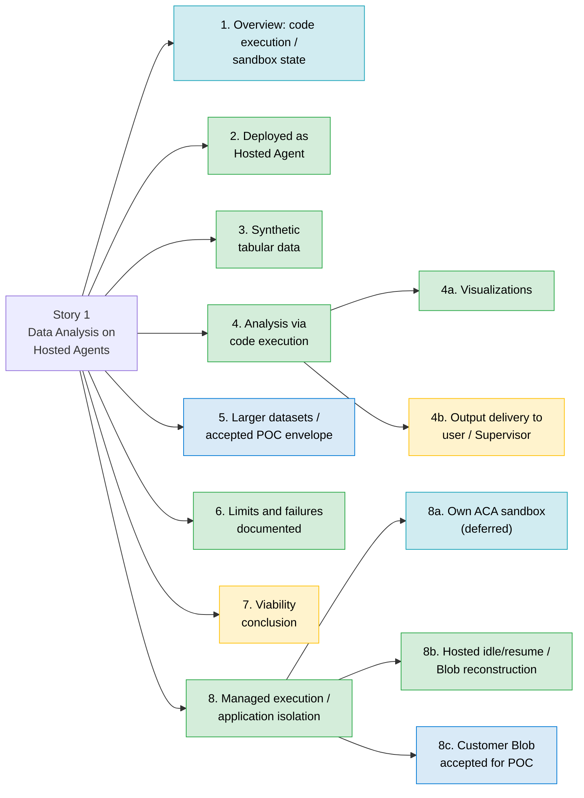

# Validate Hosted Agent Memory and Data Analysis Capacity (#1)

> **Disclaimer**
>
> This document is provided "as is" for general informational purposes and reflects a point-in-time reading of public Microsoft documentation. It is not official Microsoft guidance, a warranty, or a commitment.
>
> Azure features and GA/preview status are subject to change; verify capabilities against [Microsoft Learn](https://learn.microsoft.com/) before making any technical or purchasing decision, and treat those sources as authoritative if they conflict with this document. Service availability is governed solely by the applicable [SLAs for Microsoft Online Services](https://www.microsoft.com/licensing/docs/view/Service-Level-Agreements-SLA-for-Online-Services); nothing here constitutes an SLA or contractual commitment. No liability is accepted for any action taken, or not taken, based on this content.

Status report: what works, what doesn't and why, and what to do next, for
each requirement of issue #1 (Story 1 tasks in this repository).

**Detailed HTML report with task flows (generated 2026-10-28; evidence 2026-10-27):**
[View with HTML Preview](https://htmlpreview.github.io/?https://github.com/wxifaras/hosted-agents-poc/blob/feature/hosted-agents-enhancements/docs/reports/story-1/story1-improvements/2026-10-28-task-flows/index.html).
Regenerated from the same retained results; no validation was rerun. Expand each
run's task-flow section for the reviewed plan and its linked recorded checks,
not an inferred execution trace. The new GitHub preview requires this snapshot
and link update to be committed and pushed.

| Field | Value |
|---|---|
| Current status reviewed | 2026-10-28 documentation review; Story 1 evidence remains bound to its 2026-10-27 runs |
| Native POC environment | `hosted-agents-poc-dev`, `northcentralus`, model `gpt-5-mini` |
| Latest deployment validated for Story 1 | Supervisor v14, Research v9, Data Analysis v9; not a claim about a newer deployment or a combined rerun of every criterion |
| Evidence bindings | Analysis/chart review, two-user isolation, and Blob reconstruction: native v8. Larger datasets and Hosted idle/resume: native v9. These are separate observations, not a combined rerun on v9 |
| Code execution | Native Microsoft-managed Code Interpreter on the existing Data Analysis agent; no toolbox fallback or local generated-code execution |
| Historical baseline | 2026-10-26 toolbox evaluation in `hosted-agents-poc-dev-001`; retained in the historical appendix, not today's backlog |
| Detailed run history | [Native validation history](#native-validation-history-2026-10-27) at the end; original partial reports and measurements remain unchanged |

**Legend:** ✅ Works (tested within the stated binding) / Accepted for POC
(explicit scope acceptance, not achievement of every original benchmark) ·
⚠️ Partial (remaining integration or broader untested claim) · ❌ Gap
(not demonstrated) · ℹ️ Reference / deferred (documented or outside current scope).
Historical statuses apply only to their named evaluation.

## 1. Overview: code execution and sandbox state - ℹ️ Reference

This section summarizes Microsoft documentation; it isn't a test result.
Where this POC has tested a point, the relevant section is linked. In this
report, the **agent session sandbox** is where the hosted agent's own
container runs, and the **Code Interpreter sandbox** is where model-written
Python runs. The [Summary](#summary) reports the latest native POC position;
the [historical appendix](#historical-appendix-toolbox-evaluation-2026-10-26)
retains the toolbox evaluation, and the
[dated native appendix](#native-validation-history-2026-10-27) records the newer runs.

There are **two separate execution environments**:

1. **Hosted Agent session (agent session sandbox)**: Foundry runs the agent
   container in a stateful, per-session VM-isolated sandbox. The platform
   persists `$HOME` and files uploaded through `/files` across turns and
   idle periods, and deletes a session after 30 days of inactivity.
2. **Built-in Code Interpreter (Code Interpreter sandbox)**: Python runs in
   a separate Microsoft-managed sandbox. Treat this environment as
   temporary, not as the durable system of record. The historical toolbox path
   kept no state between calls (see 8b). Native interpreter RAM is not treated
   as durable; reconstruction and Hosted filesystem continuity are separate proofs.

### Where are the sandboxes created?

- The **agent session sandbox** is provisioned and managed by Foundry Agent
  Service for each agent session.
- The **Code Interpreter sandbox** is Microsoft-managed: Hyper-V-isolated
  ACA dynamic sessions in the project's region. Customers do not create or
  manage its underlying session pool (see 8).
- If more runtime control is required, Foundry also supports a **custom
  code interpreter** (preview) using a customer-configured Azure Container
  Apps environment.

### Can Hosted Agents access ACA dynamic sessions or an ACA sandbox?

- **ACA dynamic sessions:** Yes, as documented. A Hosted Agent can use a
  customer-created session pool through the custom code interpreter
  (preview; requires the Standard agent setup and the
  `SessionPoolsSupportMCP` feature registration) or a custom integration
  that calls the pool management API. Dynamic sessions provide isolated,
  ephemeral execution environments allocated from a prewarmed session pool.
  **Not tested here:** this POC uses the Basic setup (see 8a).
- **Other ACA-hosted sandboxes:** the Foundry pages reviewed (hosted
  agents, Code Interpreter, custom code interpreter) describe only ACA
  dynamic session pools. Any other ACA-hosted execution endpoint needs a
  custom integration (for example, exposed as an MCP tool). It isn't
  attached to a Hosted Agent automatically.

### How does state rehydration work?

For an agent session sandbox, Foundry persists the filesystem and restores
it when the same session is used again. However:

- Sending `agent_session_id` binds a call to the same agent session
  sandbox, which restores `$HOME` and `/files`. A Responses call without it
  lands in a new sandbox, unless it passes a `conversation` ID, which binds
  a session automatically.
- Conversation continuity is maintained separately through
  `previous_response_id` or a conversation ID.
- In-memory variables, processes, and open connections should not be
  treated as durable.
- ACA dynamic sessions are ephemeral and are destroyed after their
  lifecycle or cooldown period.
- **Now tested in the native POC:** one v9 Hosted session reported
  `active -> idle/new stop -> active`, with a changed process marker and retained
  HOME sentinel. See [the scoped proof](#verified-hosted-lifecycle-observation-2026-10-27).
  The configured 120 s timeout is not treated as an exact observable stop deadline;
  the final probe witnessed idle after 332.861 seconds. The documented default
  remains 15 minutes.

For reliable recovery, store checkpoints, file references, and business
state outside the execution sandbox (this POC's design is in 8b).

### Can we store state in our own network?

Use customer-owned services such as Azure Blob Storage, Cosmos DB, Azure
SQL, or PostgreSQL as the durable system of record, secured with the
appropriate private networking and identity controls.

The storage behind the agent session sandbox and the Code Interpreter
sandbox is platform-managed (see 8c). If customer control of the execution
environment, network, packages, or compute is required, use a **custom code
interpreter or customer-managed ACA dynamic sessions pool**.

### Recommended pattern

- Use **agent session storage** for resumable working files (documented;
  one native v9 HOME-sentinel idle/resume cycle is validated).
- Use **customer-owned storage/database** for durable business state and
  artifacts.
- Use the **built-in Code Interpreter** for the simplest managed
  experience.
- Use **custom Code Interpreter / ACA dynamic sessions** when
  customer-controlled runtime or networking is required.

For the evaluated result, see the [current validated outcomes](#current-validated-outcomes)
and [Summary](#summary). Historical execution-boundary and storage observations
remain in the [toolbox appendix](#historical-appendix-toolbox-evaluation-2026-10-26);
they are not current implementation instructions.

### Microsoft documentation

- [Hosted agents in Foundry Agent Service](https://learn.microsoft.com/en-us/azure/foundry/agents/concepts/hosted-agents)
- [Manage hosted agent sessions](https://learn.microsoft.com/en-us/azure/foundry/agents/how-to/manage-hosted-sessions)
- [Use Code Interpreter with Microsoft Foundry agents](https://learn.microsoft.com/en-us/azure/foundry/agents/how-to/tools/code-interpreter)
- [Configure a custom code interpreter for agents](https://learn.microsoft.com/en-us/azure/foundry/agents/how-to/tools/custom-code-interpreter)
- [Dynamic sessions in Azure Container Apps](https://learn.microsoft.com/en-us/azure/container-apps/sessions)

## Status map

Latest scoped native POC status; the accepted-capacity node is a sponsor decision,
not a claim that the original 75% pressure benchmark was reached.

## Summary

Section numbers are this report's own. Section 1 is reference material;
sections 2 to 8c cover the issue #1 requirements. This table is the **current
native POC status as of 2026-10-27**, with each result kept within its evaluated
environment/version. The historical detailed findings follow; today's
[run history and acceptance decisions](#native-validation-history-2026-10-27)
are at the end.

| # | Requirement | Status | What works | What isn't working, and why | Next step |
|---|---|---|---|---|---|
| 1 | Overview: code execution and sandbox state | ℹ️ Reference | Distinguishes Hosted session compute/filesystem from managed Code Interpreter and customer-owned checkpoints | Platform architecture guidance is not itself a test result | Use the scoped evidence below; do not infer RAM survival from filesystem continuity |
| 2 | Data Analysis Agent deployed as a Foundry Hosted Agent | ✅ Works | Existing native Data Analysis v9 passed refreshed readiness; Supervisor v14 and Research v9 remained the same three agents | No remaining readiness gap; native and historical toolbox baselines are distinct | Refresh Step 1 only after a future deployment/version change |
| 3 | Synthetic tabular data, no customer data | ✅ Works | Seeded CSVs from 1k through 1M rows passed checksum and independent-oracle checks | Coverage is the fixed synthetic CSV workload, not arbitrary customer datasets or XLSX | No additional fixture work required for the accepted POC |
| 4 | Filter, group, summarize, analyze with code execution | ✅ Works | Native v8 Step 2 model-written analysis passed; v9 size runs through 1M passed row/cell/group/integer-cents checks | General-purpose analytics beyond the selected case is not claimed | Preserve the oracle and version-bound evidence; no blanket Step 2 rerun is pending |
| 4a | Generating visualizations | ✅ Works, scoped | Native v8's representative chart received user approval tied to its original hash; v9 size-run PNG originals passed structural checks | Larger-case PNGs were not additional human chart-meaning reviews | Review new chart meanings only if the scope requires them; do not equate PNG validity with semantic approval |
| 4b | Output delivery to the Supervisor or user | ⚠️ Partial | Native user delivery returns authorized original CSV/PNG session files; v8 two-user owner/foreign controls passed | Supervisor lacks the trusted native session/file contract. Long-term output archiving is deferred; a Blob checkpoint is not a full artifact archive | Approve the minimal stateless Supervisor adapter and validate its authorized end-to-end file delivery |
| 5 | Progressively larger datasets to exercise memory pressure | ✅ Accepted for POC | All approved sizes through 1M rows / 54.68 MiB input passed; highest process peak was 805.59 MiB, 39.34% of the observed 2 GiB limit | The original 75% target and an OOM/failure boundary were not reached; the sponsor explicitly accepted this measured envelope | No further pressure escalation for the current POC; preserve the original diagnostic verdict and limitation |
| 6 | Resource limits, failures, constraints documented | ✅ Works | Native measurements, fixed ceilings, failed/partial runs, SDK lifecycle snapshots, and acceptance decisions are recorded with version/run bindings | Historical toolbox runtime/network/4g-option findings are not automatically native findings or resolved platform discrepancies | Keep bindings current and retain original evidence; no broad retest is pending |
| 7 | Clear viability conclusion | ⚠️ Partial overall | Direct native analysis/user delivery is viable in the accepted tested envelope; scoped isolation and both recovery tracks have evidence | A combined conclusion including Supervisor delivery is still pending; production multi-tenant certification is outside scope | Finalize per-workload/per-delivery-path viability after the Supervisor result or explicit deferral |
| 8 | Secured code execution: where the sandbox runs | ✅ Works, scoped | Python executes in managed Code Interpreter, not a local fallback; v8 native application/session isolation passed with two genuine Consumer callers | This does not establish privileged project-user native-file confidentiality. Hyper-V/ACA implementation is documented, not physically verified by the POC | Preserve owner/session guards and review effective role context before future authorization-sensitive changes |
| 8a | Access to ACA dynamic sessions or an ACA sandbox | ℹ️ Deferred | Managed Code Interpreter already uses Microsoft's documented execution service; no customer session pool is needed for this POC | Customer-managed ACA/custom interpreter is not provisioned and is intentionally outside the current scope | No new infrastructure; revisit only for an approved runtime/network/compute requirement |
| 8b | State consistency and sandbox rehydration | ✅ Works, scoped | Native v8 Blob write/readback and recomputation passed in a new binding/interpreter; v9 Hosted active/idle/active metadata, changed process, and retained HOME sentinel passed | These separate proofs do not establish native interpreter RAM survival, indefinite storage, or full crash/fault recovery | Reuse Step 5's Blob and metadata-only tracks; no additional recovery test is required for the accepted scope |
| 8c | State storage location in the customer network | ✅ Works, accepted for POC | Customer-owned Azure Blob checkpoint write/readback and reconstruction passed using an authenticated public endpoint; the sponsor accepts this storage scope for the POC | This proves customer-owned persistence, not private-network placement. Private endpoints and Standard setup/BYO files/conversations remain untested and deferred; public endpoint access does not mean anonymous Blob access | No additional storage/network work for the accepted POC; validate private connectivity separately only if later required |

**Storage acceptance note:** the POC used customer-owned Blob Storage through an
authenticated public endpoint, not a private endpoint. The tested checkpoint
behavior is accepted without requiring private networking. This does not claim
that public and private connectivity have identical security, routing, DNS, or
access requirements, or that all platform-managed state moved into the customer's
network. Historical findings and original test verdicts remain unchanged.

**Remaining planned technical work: Supervisor integration.** Deferred custom
ACA, private networking, permanent output archives, and production certification
are not additional blockers for the agreed POC. Capacity is accepted with its
measured limitation; it is not relabeled as a successful 75% pressure test.

---

## Current validated outcomes

### Representative analysis and user delivery - works

Native v8 model-written analysis, exact row/cell/group/integer-cents checks,
authorized original-file downloads, and the user-approved representative chart
are demonstrated. Two genuine Consumer callers passed the scoped workflow and
session-file isolation checks. These are direct-user results, not native
Supervisor delivery or privileged project-user native-file confidentiality.

### Progressively larger datasets to exercise memory pressure - accepted for POC

The approved 1k through 1M-row workloads produced correct analytical originals.
At 1M rows (57,340,679 input bytes / 54.68 MiB), process peak RSS was
844,718,080 bytes (805.59 MiB), **39.34% of the observed 2 GiB limit**.
The sponsor accepted this tested envelope as sufficient for the POC; no further
pressure escalation is pending.

The original **75% target was not reached**, and no OOM/failure boundary or
platform maximum was measured. Preserve the runner's Not evaluated result for
that diagnostic objective; it does not negate the accepted workload validation.
See the [measurements](#bounded-native-pressure-batch-2026-10-27) and
[acceptance decision](#poc-capacity-acceptance-decision-2026-10-27).

### Recovery and customer-owned storage - works within accepted scope

- **Blob reconstruction (native v8):** authenticated checkpoint write/readback
  and recomputation into a new authorized session/distinct interpreter passed.
  Public-endpoint customer Blob is accepted for the POC. This is not a full
  Hosted session backup, restored interpreter RAM, or private-network proof.
- **Hosted idle/resume (native v9):** platform state
  `active -> idle/new stop -> active`, a changed process marker, and the retained
  HOME sentinel passed on the same binding. Earlier fixed-interval checks remain
  partial history, not outstanding retests.

These are separate, version-bound proofs; they were not a combined rerun on
every subsequent deployment. Private endpoints, BYO platform stores, permanent
output archives, and broader crash/fault recovery remain deferred.

### Supervisor native analysis and file delivery - pending

Basic routing/text delegation does not satisfy this requirement. The remaining
work is the smallest supported trusted native child-session/file adapter, followed
by an authorized original-output and foreign-user validation. No identity guard
should be bypassed and no interpreter toolbox fallback should be restored.

## Prioritized next steps

| Priority | Action | Closes | Scope / gate |
|---|---|---|---|
| 1 | Establish the supported trusted nested caller/session/file contract and approve the smallest stateless Supervisor/native adapter | 4b, 7 | Design/local proof first; any metadata hop or permission change requires its named approval |
| 2 | Once supported, use existing **Story 4 Step 6** for original-file delivery and a foreign-user negative; refresh version-bound prerequisites for the selected deployment | 4b, 7 | Separately approved deployment and bounded end-to-end testing; no old result is relabeled as a current rerun |
| 3 | Finalize per-workload/per-delivery-path viability after the Supervisor result or explicit deferral | 7 | Documentation; preserve accepted capacity/storage and separate isolation/recovery bindings |

No additional pressure escalation, Hosted lifecycle test, or customer-Blob
validation is pending for the accepted scope. Custom ACA, Standard/private-network
migration, permanent archives, stateful `POC_WORKFLOW` redesign, and production
certification are not automatic follow-on tasks.

## Open Questions

Only questions needed for the remaining native POC integration are active here.
They are contract/design questions, not all assumed to require a Microsoft
support case.

| Question | Why it remains open | Next evidence / decision |
|---|---|---|
| What supported mechanism binds the Supervisor's native child session/conversation/files to the verified originating caller? | Direct-user native isolation does not establish trusted nested identity or ownership. Forwarded labels and correlation values are not authorization | Review the installed SDK/service contract; use a separately approved presence-only hop if needed. Retain the blocker if the contract is unsupported |
| How will the approved adapter deliver original analytical receipts/files to the authorized user without exposing native project-file authority? | The existing stateless text protocol does not carry the owner-bound native session/file contract | Define the minimal backend adapter and test same-owner success plus foreign-user denial through existing Step 6 before claiming analytical delivery |

The older toolbox/platform questions are retained as
[historical or deferred topics](#historical-and-deferred-platform-topics), not as
unresolved blockers for accepted capacity, storage, or Hosted continuity.

## Evidence notes

Findings summarize retained, version-bound runs. Per
[ADR-0001](adr/0001-hosted-agents-poc.md#recovery-and-validation), original
reports remain local. The published
[HTML report](https://htmlpreview.github.io/?https://github.com/wxifaras/hosted-agents-poc/blob/feature/hosted-agents-enhancements/docs/reports/story-1/story1-improvements/2026-10-28-task-flows/index.html)
preserves the detailed run ledger, original statuses, measurements, and sponsor
decisions. The sponsor requested this new task-flow edition from the same saved
results: its generation date changed, not the tested environment/version or
acceptance evidence. The superseded published folder is removed; original local
runs and their partial/blocked results are retained unchanged, and the previous
snapshot remains available in Git history.

For native reproduction, use the
[current task guide](tasks-detailed.md#native-story-1-validation-current-branch)
and an approved current version-bound baseline. Do not execute historical
toolbox rerun/deletion instructions simply because they are retained below.
The appendices preserve successful and failed observations at the sponsor's
request, but neutral historical headings do not represent today's gaps.

## Historical appendix: toolbox evaluation (2026-10-26)

The following numbered details preserve the original toolbox observations.
Their headings are neutral historical labels, not current failure statuses.
They are **not the current native task instructions or
backlog**. In particular, historical deletion, permission, and rerun proposals
must not be applied blindly to today's tasks. Use the current [Summary](#summary),
[prioritized next steps](#prioritized-next-steps), and
[native task guide](tasks-detailed.md#native-story-1-validation-current-branch).
Successful native results and acceptance decisions supersede the corresponding
old missing-run/capacity follow-ups; unresolved historical discrepancies are not
silently treated as platform fixes.

### Historical toolbox evaluation

| Field | Value |
|---|---|
| Report date | 2026-10-26 (overview added and accuracy review 2026-10-27) |
| Environment evaluated | `hosted-agents-poc-dev-001` (northcentralus, model `gpt-5-mini`) |
| Agents at evaluation | `supervisor-agent` v3, `research-agent` v3, `data-analysis-agent` v4 (all active, `@latest` 100%) |
| Hosted agent configuration | 0.5 vCPU / 1 GiB container, 120 s session idle timeout ([azure.yaml](../azure.yaml)) |
| Code execution | Microsoft-managed Code Interpreter via toolbox `story1-data-analysis-ci` v1 |
| Evidence | Local sanitized runs and dated [ADR-0001](adr/0001-hosted-agents-poc.md#recovery-and-validation) entries; this is not the native v8/v9 result set |

The original `hosted-agents-poc-dev-001` task index is retained for provenance:

| Step | Date | Original verdict, not current native status |
|---|---|---|
| Story 1 Step 1 | 2026-10-26 | Met |
| Story 1 Step 2 | 2026-10-26 | Not evaluated; ran before the baseline existed |
| Story 1 Step 3 | 2026-10-26 | Met for the original small dataset ladder |
| Story 1 Step 4 | 2026-10-26 | Met within the tested toolbox boundary |
| Story 1 Step 5 | - | Not run in that environment |
| Story 4 Step 6 | 2026-10-26 | Met per ADR on older Supervisor 2 / Research 2 / Data Analysis 3 |

### Historical and deferred platform topics

These subjects remain relevant only if their specific path/requirement is
reopened. They are not answered merely by switching to native execution, but
they do not block the sponsor-accepted POC.

| Earlier topic | Current relevance and disposition |
|---|---|
| Toolbox `memory_limit` above 2 GiB was not applied | Historical configuration discrepancy. Native runs also observed 2 GiB, but did not prove larger supported allocations. No larger allocation is required for the accepted 1M-row envelope; investigate only for a newly approved compute requirement |
| Organization policy rejected toolbox network allowlisting | Historical egress restriction, not a current need to enable interpreter networking. Blob I/O is performed by the authorized backend/runner, not the interpreter. Revisit only if approved interpreter egress becomes required |
| Conflicting 20/30-minute interpreter expiry and 90/220-second execution descriptions | Historical path/version-dependent limits. Preserve observations without declaring a universal timeout. Hosted idle/resume is a different state layer and does not resolve native interpreter expiry or maximum execution duration |
| Per-user isolation roadmap for the interpreter toolbox | Not the selected architecture: native application-mediated user/session/file access was demonstrated. A general platform roadmap question is not a current action; privileged project-user confidentiality remains outside the claim |
| Custom ACA session `identifier` behavior | Deferred with the unprovisioned customer-managed interpreter alternative. Determine it only if that architecture is explicitly selected |
| Standard setup/BYO Cosmos placement for Hosted conversations | Deferred with BYO platform storage/private networking. Customer-owned Blob checkpoint persistence is already accepted; it does not answer placement of every Foundry state layer |

### 2. Hosted agent deployment (historical toolbox)

**What works**

- `data-analysis-agent` v4 is active as a hosted agent with its own
  managed identity. It is wired to toolbox `story1-data-analysis-ci` v1
  through the `TOOLBOX_ENDPOINT` setting. Only Data Analysis gets the Code
  Interpreter toolbox; Research gets a separate Microsoft Learn MCP toolbox
  for Story 4 ([runtime.py](../src/backend/app/runtime.py)).
- Story 1 Step 1 on 2026-10-26 was **Met**. In
  23.49 s, the hosted agent returned the SHA-256 that the sandbox computed
  for the 1k-row input, plus a `poc-artifacts-v1` container reference.
- Supervisor and Research were unchanged by the wiring. The run saved a
  baseline of all three agents (`agents-baseline.json`) that later steps
  check before running.

**What isn't working:** nothing for this requirement.

**Next steps:** none. Rerun **Agents: Story 1 - 1** in `verify` mode after
any redeploy to refresh the baseline.

### 3. Synthetic tabular data (historical toolbox)

**What works**

- [synthetic_data.py](../scripts/common/synthetic_data.py) generates
  deterministic sales data with a fixed seed of `20261022`. It has 8
  columns: `row_id`, `order_date`, `region`, `category`, `units`,
  `unit_price_cents`, `revenue_cents`, and `status`. About 2% of `units`
  values are blank, which tests null handling.
- Each smaller dataset is the first rows of the larger one. An independent
  stdlib calculation in integer cents produces the expected filtered rows
  and totals.
- The three CSVs are uploaded with `purpose=assistants` and mounted under
  `/mnt/data`. The sandbox's SHA-256 for each file matched the local one,
  so no customer data is involved.

| Dataset | Rows | Size | Expected filtered rows |
|---|---|---|---|
| `story1-sales-1000.csv` | 1,000 | 53.2 KiB | 113 |
| `story1-sales-10000.csv` | 10,000 | 540.1 KiB | 1,249 |
| `story1-sales-100000.csv` | 100,000 | 5.4 MiB | 12,361 |

**What isn't working:** nothing for this requirement.

**Next steps:** optional. Add an XLSX variant, which the ADR's CSV/XLSX
capability row mentions.

### 4. Analytical workload and missing-run observations (historical toolbox)

**What works**

- **Fixed analysis code (Step 3, Met).** The agent ran the
  supplied Python verbatim. It filtered `status == 'completed' and region ==
  'West'`, grouped by category (row count plus integer sums of `units` and
  `revenue_cents`), and wrote `filtered.csv` and `by_category.csv`. At 1k,
  10k, and 100k rows, the filtered row IDs and every category total matched
  the local calculation exactly.
- **Model-written analysis (Step 2)** is implemented in
  [story1_data_analysis.py](../scripts/run_scenario/story1_data_analysis.py).
  The model writes its own pandas/matplotlib code, and the runner checks
  only the outputs against the local calculation.

**What isn't working and why**

- Step 2 has **no valid run in `hosted-agents-poc-dev-001`**. Both runs
  (17:20 and 17:21 UTC) were `Not evaluated`, because the Step 1 baseline
  didn't exist until 17:22 UTC.
- The ADR records Step 2 as Met on 2026-10-24 in the older
  `hosted-agents-poc-dev` environment (Data Analysis v6). That report isn't
  retained locally.

**Next steps**

1. Run **Agents: Story 1 - 2 Analyze data and deliver outputs** against
   `hosted-agents-poc-dev-001`. It no longer blocks, because the baseline
   now exists.

### 4a. Visualization observations (historical toolbox)

**What works**

- Step 3: the sandbox wrote a `revenue_by_category.png` (1000x600) at every
  size. The runner downloaded each one through the authenticated container
  files API and validated its PNG signature.
- Step 1: a probe PNG generated in the sandbox was downloaded and validated
  the same way.

**What isn't working:** the `container_file_citation` annotations that
Microsoft documents for generated files appeared inconsistently. The POC
relies on its own `poc-artifacts-v1` container reference instead.

**Next steps:** none required. The Step 2 rerun also covers a chart drawn
by model-written code.

### 4b. User and Supervisor delivery observations (historical toolbox)

**How each output type is delivered (as built)**

| Output type | Delivery mechanism | Status |
|---|---|---|
| Text summary | Plain-language text in the agent's answer | ✅ Tested in Step 3 |
| Structured results | A `json` fenced block in the answer. The authoritative copy is `story1-step3-result.json`, downloaded from the sandbox | ✅ Tested in Step 3 |
| Files (CSV) and visuals (PNG) | Stay in the sandbox. The answer carries a `poc-artifacts-v1` block with container IDs, taken from tool results only, never from model-written text ([code_interpreter.py](../src/backend/app/services/code_interpreter.py)). The caller lists and downloads the files through the container files API | ✅ Tested in Steps 1 and 3 (user path) |
| Files via Supervisor (`POC_WORKFLOW`) | Data Analysis puts container IDs in the `containers` field of its `poc-workflow-v1` report, and the Supervisor forwards them ([delegation.py](../src/backend/app/services/delegation.py)) | ⚠️ Unit-tested only, not end-to-end |
| Files via Supervisor (`POC_DELEGATE`, Story 4 Step 6) | Stateless delegation to `data_analysis` ([orchestration.py](../src/backend/app/services/orchestration.py)). The operator downloads and validates the outputs | ⚠️ ADR records Met on earlier agent versions (Supervisor 2, Research 2, Data Analysis 3). No report retained |

**What isn't working and why**

- **Stateful Supervisor path blocked.** The `POC_WORKFLOW create` path stops
  at the nested caller guard: the hop to Research arrives without a verified
  user ID. Microsoft documents `x-ms-user-identity` for your own users, but
  not passing it through nested agent-to-agent calls. The guard is
  intentionally not bypassed. See
  [ADR-0001: Authorization contract](adr/0001-hosted-agents-poc.md#authorization-contract-and-proposed-alignment).
- **Files are temporary.** Sandbox containers report a 20-minute idle
  expiry. The idle wait wasn't run here; in the older
  `hosted-agents-poc-dev` environment (2026-10-24), a container expired
  after 21.5 min idle. Durable delivery to Blob ("ArtifactStore") is not
  implemented.
- **No per-user file isolation.** Any principal with project access can
  read sandbox outputs through the containers API (tested in Step 4).

**Next steps**

1. Rerun Story 1 Step 2. Then run **Agents: Story 4 - 6 Demonstrate Data
   Analysis via Supervisor**, which is `BLOCKED` unless Story 1 Steps 1 and
   2 are Met.
2. Implement durable delivery. Copy generated files to customer Blob under
   a per-user prefix with ABAC, return Blob references, and delete the
   sandbox container.
3. Resolve the nested caller guard (ADR next increment 1), then rerun
   Step 2 to show `containers` forwarding end to end.

### 5. Dataset-size baseline (historical toolbox)

**What works**

- Step 3 ran 1k → 10k → 100k rows in order, one attempt per size, stopping
  at the first platform failure. Every size produced exact results and all
  output files.

| Rows | Input | Sandbox time | End-to-end | Peak RSS | % of 2 GiB limit |
|---|---|---|---|---|---|
| 1,000 | 53.2 KiB | 1.75 s | 37.17 s | 145.8 MiB | 7% |
| 10,000 | 540.1 KiB | 2.20 s | 39.11 s | 147.2 MiB | 7% |
| 100,000 | 5.4 MiB | 1.92 s | 42.41 s | 160.5 MiB | 8% |

**What isn't working and why**

- **Memory pressure was not reached.** At the largest size, peak memory
  was 8% of the 2 GiB sandbox limit, and most of that is the pandas and
  matplotlib import baseline (about 146 MiB).
- **No failure point found.** The test intentionally doesn't search for a
  crash limit, and the agreed sizes stop at 100k.
- **More sandbox memory not available.** `memory_limit` 4g, set per call
  or on the toolbox, didn't change the enforced 2 GiB (Step 4). No
  Microsoft page explains this.
- **The hosted agent's own container is not stressed.** Analysis runs in
  the sandbox, not in the 0.5 vCPU / 1 GiB agent container. The ADR's
  capacity harness (0.5/1, 1/2, 2/4 vCPU/GiB) is not implemented.

**Next steps**

1. Agree on larger sizes and add them to `DATASET_SIZES`, for example 1M,
   5M, and 10M rows, or add wider rows. The goal is to approach and exceed
   2 GiB. Each size needs a new upload and toolbox version through Step 1
   `enable-if-missing`.
2. Watch the 220 s per-execution limit and upload limits. They may be hit
   before memory.
3. Ask Microsoft why `memory_limit` above 2 GiB isn't applied. If larger
   memory is required, evaluate a custom code interpreter (see 8a).
4. Record peak RSS against the limit and the first failure type for each
   size. Step 3 already stops at the first failure and writes a partial
   report.

### 6. Resource limitations and constraints (historical toolbox)

**What's documented (from Step 3 and Step 4 runs, 2026-10-26)**

| Constraint | Observed | Microsoft documentation says |
|---|---|---|
| Sandbox memory | 2.0 GiB enforced (cgroup); `memory_limit` 4g ignored | 1g / 4g / 16g / 64g are allowed values |
| Sandbox CPU | 1 CPU enforced; Python reports 4 | - |
| Sandbox disk | About 14.3 GiB free on `/mnt/data` | - |
| Execution time | A 100 s run completed (101.84 s) | Tool description says 90 s; ACA documents 220 s |
| Container lifetime | Containers report a 20 min idle-expiry policy; idle wait not run here. In the older `hosted-agents-poc-dev` environment (2026-10-24), a container expired after 21.5 min idle | Code Interpreter page says 30 min idle, 1 h active; Responses API says 20 min |
| Container reuse | New container on every call; `container` reuse ignored | Separate sessions per conversation |
| Network egress | No DNS or egress: public, raw IP, and customer storage all blocked | "Dynamic sessions can't make outbound network requests" |
| Network allowlist | Rejected: "organization policy disables container network access" | `allowlist` is a supported value |
| Per-user isolation | Not supported: another principal read the agent's sandbox output | "All users in the same project share the same container context" |
| Runtime | Python 3.11.15, pandas 1.5.3, numpy 1.24.0, matplotlib 3.6.3; package install impossible (no egress) | - |
| Hosted agent container | 0.5 vCPU / 1 GiB, 120 s idle timeout; separate from the sandbox | Sizes 0.5/1, 1/2, 2/4 vCPU/GiB |

**What isn't working and why**

- The ADR's 2026-10-24 results for Steps 2 and 5 come from the older
  `hosted-agents-poc-dev` environment (Data Analysis v6) and haven't been
  reproduced in `hosted-agents-poc-dev-001`.
- Run reports stay local by design (ADR-0001), so only the summarized
  findings here and in the ADR are shared.

**Next steps**

1. Rerun Steps 2 and 5 in `hosted-agents-poc-dev-001`.
2. Record the summarized results, with environment, agent versions, and
   date, in the
   [ADR snapshot](adr/0001-hosted-agents-poc.md#implementation-and-evidence-snapshot).
3. Ask Microsoft about three discrepancies: the 20 vs 30 min expiry,
   `memory_limit` not being applied, and the 90 s vs 220 s execution limit.

### 7. Original viability assessment (historical toolbox)

**What works:** Step 3 states its conclusion scoped to what was tested:

> The tested workload is viable in the evaluated configuration up to
> 100,000 rows (5.4 MiB): every size produced exact results and all output
> files. This is the tested envelope, not the platform maximum.

**What isn't working and why:** no single conclusion yet covers:

- How close a workload can get to the 2 GiB sandbox limit (see 5).
- Model-written analysis in this environment (see 4).
- Delivery through the Supervisor (see 4b).
- Multi-user use. Shared sandbox access makes the managed toolbox setup
  **unsuitable for sensitive multi-tenant data** until an isolation option
  is proven (see 8).

**Next steps:** after the Steps 2, 3 (extended sizes), and 5 reruns, add a
final verdict to this report. State it per workload size, per delivery
path, and per tenancy model.

### 8. Execution and isolation boundary observations (historical toolbox)

**How it works**

- The hosted agent calls Code Interpreter as a tool through a Foundry
  toolbox (an MCP endpoint). The code doesn't run in the agent's container;
  there is no local `exec` or subprocess fallback.
- The sandbox is **Microsoft-managed**. The
  [Code Interpreter page](https://learn.microsoft.com/azure/foundry/agents/how-to/tools/code-interpreter#sandboxed-execution-environment)
  documents it as **Azure Container Apps dynamic sessions (code interpreter
  sessions), each isolated by a Hyper-V boundary**, running in the same
  Azure region as the Foundry project. It doesn't inherit the agent's
  subnet and can't make outbound network requests. No ACA resource for it
  exists in our subscription.
- The probe saw platform variable names `CAAS_PROXY_POOL_NAME`,
  `SESSIONS_INSTANCE`, and `CAAS_PROXY_MGMT_AUTH_ENABLED`. These are
  consistent with the documented ACA sessions. Step 4 tests the observable
  boundaries below, not the isolation technology itself.

**Tested boundaries (Step 4, Met)**

| Area | Observed |
|---|---|
| Identity | User `sandbox` (uid/gid 1001), non-root |
| Privileges | No capabilities (`CapEff` 0000000000000000), `NoNewPrivs` 1, seccomp mode 0 |
| Filesystem | Root is read-only; only `/tmp` and `/mnt/data` are writable |
| Network | No DNS; public host, raw IP, and customer storage all blocked |
| Per-call isolation | New container per call; a file from call A isn't visible in call B |
| Hosted agent's own sandbox | Same boundaries as the direct operator probe (no differences) |
| Kernel | `6.6.150.1-1.azl3` |

**What isn't working and why**

- **No per-user isolation** when Code Interpreter is used through a
  toolbox in a hosted agent. This is documented and was tested: the
  operator read the agent's sandbox output.
- **Network allowlist blocked** by organization policy, so no package
  install or controlled egress.
- **No control over limits:** memory is fixed at 2 GiB and the runtime is
  pinned.

**Next steps:** test the isolation options in the order recommended in
[ADR-0001: per-user isolation options](adr/0001-hosted-agents-poc.md#per-user-code-interpreter-isolation-options-to-investigate):

1. Pass the end user's Entra token to the toolbox.
2. A custom code interpreter on our own ACA session pool.
3. Code Interpreter as a direct Responses API tool.
4. The hosted-agent session sandbox, only after a security review.

Acceptance test: the Step 4 cross-principal probe, using two real Entra
users.

### 8a. Customer-managed ACA alternative (historical assessment)

**What works**

- Indirectly, yes: the managed Code Interpreter runs on ACA dynamic
  sessions owned and run by Microsoft (documented, see 8).

**What isn't working and why**

- **Our own ACA session pool is not tested.** Microsoft documents a
  [custom code interpreter](https://learn.microsoft.com/azure/foundry/agents/how-to/tools/custom-code-interpreter)
  (preview): an MCP server backed by our own ACA dynamic session pool. It
  would give control of the runtime, memory, network egress, packages, and
  the session `identifier`, which could be per user. It requires:
  - The `SessionPoolsSupportMCP` preview feature registration.
  - The Standard agent setup.
  - A paid ACA environment.
  - The *Azure ContainerApps Session Executor* and *Contributor* roles on
    the session pool, for the calling identity.

  None of these are provisioned.
- **Open question:** how the Foundry MCP path sets the ACA session
  `identifier` (per agent, per conversation, or per caller). If it can't be
  controlled, Data Analysis could call the pool management API directly,
  with an identifier derived from the verified user.

**Next steps**

1. Provision a proof-of-concept ACA session pool with the custom code
   interpreter in a Standard-setup project.
2. Rerun Steps 3, 4, and 5 against it: memory above 2 GiB, network
   allowlist, per-user isolation, and identifier behavior.

### 8b. Continuity and reconstruction design (historical toolbox)

**How sandbox state behaves (tested in Step 4)**

- State does **not** carry over between tool calls. Every call gets a new
  container: files, variables, and kernel state are lost. Even within one
  conversation the `container` reuse option is ignored.
- Containers expire 20 minutes after last activity, and deleted containers
  return 404.
- Treat the sandbox as stateless. Anything needed later must be stored
  outside it and rebuilt.

**Historical rehydration design (Step 5; not the current non-destructive task behavior)**

- [story1_sandbox.py](../scripts/run_scenario/story1_sandbox.py) `--step 5`:
  1. R1 computes state in the sandbox.
  2. R2 (same conversation) and R3 (new conversation) check what survived.
  3. The runner saves a small, versioned, **SHA-256-sealed checkpoint** to
     customer Blob at `artifacts/story1/checkpoints/<run-id>.json`. It holds
     the dataset ID, checksum, transform spec, and aggregates, but no data
     rows.
  4. The runner deletes the sandbox container and confirms 404.
  5. R4 rebuilds the state from the checkpoint plus the re-mounted input.
     Missing, corrupt, wrong-schema, or stale checkpoints are rejected.
- Conversation history (not sandbox state) is the platform's continuity
  layer. A conversation ID is a durable record stored in Foundry.

**What isn't working and why**

- **Step 5 has never run in `hosted-agents-poc-dev-001`.** It's not in the
  evidence index and there's no report.
- The ADR records Step 5 as Met on 2026-10-24 in another environment, but
  that report isn't retained.
- Not implemented: agent-framework checkpoints, session filesystem
  idle/resume, and crash or process-loss recovery (see the ADR snapshot).

**Next steps**

1. Run **Access: Apply developer permissions** if needed; it grants the
   Blob data role. Then run **Agents: Story 1 - 5 Assess state
   continuity**.
2. Optionally rerun Story 1 Step 4 with idle wait `wait` to confirm expiry
   in this environment.
3. Plan the agent-framework checkpoint and process-loss experiments (ADR
   next increment 4).

### 8c. Storage placement assessment (historical toolbox)

**Placement assessment (built into Step 5)**

| State layer | Where it lives in this POC | Can it be in the customer network? | Basis |
|---|---|---|---|
| Code Interpreter sandbox (variables, `/mnt/data`) | Microsoft-managed sandbox | **No.** It doesn't inherit the agent's network and can't make outbound requests | Tested (Step 4) and documented |
| Agent session sandbox (`$HOME`, `/files`) | Foundry-managed session storage; deleted after 30 days of inactivity | **No** bring-your-own option documented | Documented, not tested (session idle/resume not yet validated) |
| Uploaded files (toolbox inputs) | Foundry project storage (Basic setup, Microsoft-managed) | **Yes, with the Standard agent setup** (bring-your-own Azure Storage) | Documented, not tested |
| Conversations and responses | Foundry (Basic setup) | **Yes, with the Standard agent setup** (bring-your-own Cosmos DB). Whether the hosted-agent runtime uses it isn't stated | Documented, not tested |
| Hosted workflow state (`POC_WORKFLOW` registry) | Foundry-managed hosted agent state store | **No** bring-your-own option documented | Documented |
| Custom checkpoint | Customer `artifacts` Blob container (network security perimeter, no private endpoint) | **Yes.** A private endpoint should also work, because the agent or client reads and writes it (the sandbox can't reach it) | Coded in Step 5, not run here. Private endpoint is an architectural assessment |

**What isn't working and why**

- Nothing in this table has been observed here, because Step 5 hasn't run
  in this environment.
- The POC uses the Basic agent setup, so bring-your-own storage for files
  and conversations is untested.
- The POC storage uses a network security perimeter (NSP), not a private
  endpoint.

**Next steps**

1. Run Story 1 Step 5 to confirm the customer-Blob checkpoint.
2. Stand up a Standard agent setup project with bring-your-own Storage and
   Cosmos DB. Confirm where uploaded files, conversations, and hosted-agent
   conversations actually land.
3. Add a private endpoint to the checkpoint storage and confirm
   read/write from the hosted agent.

---

## Native validation history, 2026-10-27

This appendix preserves the chronological deployment, validation, and acceptance
record. Statements such as pressure being disabled or Hosted evidence being
incomplete describe that stage, not the latest status in the [Summary](#summary).
Historical toolbox findings and native results must not be merged into a
version-independent pass.

### Native implementation and initial deployment, 2026-10-27

**Implementation update, 2026-10-27:** `story1-improvements` moves the existing
Data Analysis agent to a fixed native managed Code Interpreter path without a
fourth agent. The same task entries now default to a credential-free preview;
see [current native validation instructions](tasks-detailed.md#native-story-1-validation-current-branch).
The historical toolbox results are retained unchanged and are not passes for
this native implementation. Native live validation, deployment, and paid
requests require separate approval. Supervisor and Hosted idle/resume were
bounded best-effort probes; a failed probe could lead to a redesign proposal,
implemented only with explicit user approval.

**Native deployment/readiness checkpoint, 2026-10-27:** the existing deploy-all
task deployed Supervisor v13, Research v8, and Data Analysis v8 to
`hosted-agents-poc-dev` (`northcentralus`, `gpt-5-mini`). All were active.
Native Step 1 run `20261027T201528Z-b1f35aca` passed the 1,000-row independent
analytical/original-output checks and wrote a distinct native baseline.
One actual native model analysis was submitted, without retry. This was separate
from the historical toolbox environment; it did not yet close two-user
isolation, memory pressure, chart-meaning review, Blob recovery, or Supervisor
delivery. No infrastructure reprovisioning or permission changes were performed.

### Native validation continuation, 2026-10-27

These results apply to `hosted-agents-poc-dev`, Supervisor v13, Research v8,
and Data Analysis v8. They do not replace the earlier historical toolbox findings.

| Native track | Result at this stage | Scope and evidence |
|---|---|---|
| Step 2 analysis and user-approved chart review | Met | Original analysis `20261027T202108Z-aea1fafe`; offline review `20261027T204940Z-3411caf3` rechecked retained hashes/oracle and the user's PNG review. No repeat model analysis for review. |
| Step 3 baseline capacity | Tested envelope passed; pressure target not reached | `20261027T202247Z-02a3faba`: 1k, 10k, and 100k rows produced correct originals. At 100k, process peak RSS was 261,029,888 bytes (about 249 MiB), 12.16% of the observed 2,147,483,648-byte limit. Cgroup peak was separately 505,753,600 bytes. |
| Step 4 application/session isolation | Met for tested users and operations | `20261027T204412Z-37747689`: both genuine users' analyses/original downloads succeeded; foreign workflow and session-file requests were denied in both directions with successful owner controls; a distinct same-user session could not inherit the workflow. |
| Step 5 required Blob reconstruction | Met | `20261027T202731Z-435a6d1f`: authenticated checkpoint write/readback and recomputation passed in a new authorized session with a distinct native interpreter fingerprint. Checkpoint and original interpreter were not deleted. |
| Step 5 optional Hosted observation | Partial at this stage | `20261027T204719Z-b842688c`: process marker changed and HOME sentinel persisted after a 180-second quiet interval; zero native analyses. Independent platform idle-boundary evidence was still missing, so this was not a full idle/resume pass. |
| Story 4 Step 6 Supervisor integration | Blocked before inference | `20261027T205517Z-f2ce64f3`: the existing stateless protocol lacks the trusted native session/file contract. Zero model submissions; redesign requires explicit approval. |

Before Step 4, operator-side role reads and separate cached-profile/Graph checks
verified the two selected users and distinct identities. With sponsor approval,
two direct project-scoped Foundry Agent Consumer grants were added. Readback also
showed inherited resource-group Consumer grants; no different role types were
observed. These are scoped application-access results, not privileged
project-user native-file confidentiality or a complete permissions certification.

For repeatable setup, use **Access: Preview isolated user Consumer grants**, then
the existing **Access: Create isolated user auth profiles** task if grants or
local sign-in profiles need preparing. See
[another-computer instructions](tasks-detailed.md#repeat-the-tests-on-another-computer).
The six native validation task entries remain unchanged in number.

At this stage pressure was disabled. This run made no automatic retries,
permission escalation beyond approved Consumer grants, forced lifecycle faults,
resource deletions, or redesign. The failed offline chart-review invocation with
an incorrect receipt path was retained; correcting that local path made no model
call. The pressure profile and final Hosted lifecycle proof followed below.

### Bounded native pressure batch, 2026-10-27

The sponsor approved the existing 250k/500k/1M profile, with at most four analyses
including refreshed readiness. Only the backend pressure flag was enabled;
input/output/token/tool-call/time ceilings were not raised. The existing
deploy-all task produced Supervisor v14, Research v9, and Data Analysis v9 in
`hosted-agents-poc-dev`. The prior baseline was preserved before refreshing it.

Readiness run `20261027T213235Z-e0429591` passed and wrote the new native baseline.
Pressure run `20261027T213414Z-3f842cb4` completed every approved case:

| Rows | Input bytes | Process peak RSS (MiB) | % of observed limit | End-to-end seconds |
|---|---|---|---|---|
| 250,000 | 14,250,540 | 335.85 | 16.40% | 49.414 |
| 500,000 | 28,613,347 | 338.25 | 16.52% | 60.408 |
| 1,000,000 | 57,340,679 | 805.59 | 39.34% | 77.702 |

The observed interpreter cgroup limit was 2,147,483,648 bytes (2 GiB) for all
three cases; no telemetry fields were unavailable. At 1M rows, cgroup peak was
separately 1,140,195,328 bytes (1,087.38 MiB, 53.09% of the limit). Do not add
process RSS to cgroup usage or confuse either with Hosted agent memory.

JSON/CSV results and original file checks passed at each size; PNG checks were
structural, not additional human chart-meaning reviews. There was no observed
failure boundary. The 75% process-memory target was **not reached**, so the
runner correctly returned exit 2 / Not evaluated for that objective despite
eight passing checks. This establishes a tested 1M-row / 54.68 MiB input envelope,
not the platform maximum or an OOM threshold.

The harness used the approved four analyses and did not add cases or retry
submissions. SDK retries remain configured to zero; the saved run does not
provide independent provider-internal retry telemetry. Further escalation needs
an approved new workload/limit profile: the current CSV already approaches the
64 MiB input cap and the fixed row ceiling is 1M.

Pressure remains explicitly enabled in the POC deployment; baseline/preview
remain the task defaults. No new test task was added. See
[the existing-task procedure](tasks-detailed.md#pressure-testing-with-the-existing-tasks).
The older isolation/Blob results above remain bound to their v8 deployment and
were not rerun or relabeled as v9 evidence in this batch.

### POC capacity acceptance decision, 2026-10-27

The requesting sponsor accepted the measured 1M-row / 54.68 MiB input envelope
as sufficient for this POC. Its highest process peak was 805.59 MiB, 39.34% of
the observed 2 GiB limit, with correct analytical originals and no observed
failure boundary.

**Status: accepted for POC scope; no further pressure escalation is required.**
This is an acceptance decision with a known limitation, not evidence that the
original 75% target was reached. The original pressure report, exit 2, measurements,
and runner threshold remain unchanged. No platform-maximum, OOM-threshold, or
production-capacity claim is added.

At this decision point, Hosted lifecycle evidence was next by complexity;
its completion is recorded below. **Supervisor integration (high)** remains
the planned technical gap and requires approval of its minimal trusted-context
adapter. Larger pressure workloads are outside the accepted current scope unless
newly approved.

### Verified Hosted lifecycle observation, 2026-10-27

The Hosted evidence item is now demonstrated for one scoped v9 session.
Run `20261027T232927Z-0cfaf4c1` used the existing Step 5 task's new `only` option:
zero native analyses, zero Blob requests, and no forced stop/delete, deployment,
or permission changes. The deployment stayed Supervisor v14 / Research v9 /
Data Analysis v9 throughout.

| Witness | Observed |
|---|---|
| Before quiet | SDK state `active`, no stop timestamp, same bound v9 session |
| First metadata check | Still `active` after 301.988 seconds; retained as a pending observation, not a lifecycle pass |
| Second metadata check | `idle` with fresh `stopped_at=1793143990` after 332.861 seconds |
| Before any resume request | Idle/stop was independently read from platform metadata, not inferred from a timer or assistant text |
| After authorized observe | Same session creation binding/version, SDK state `active`, cleared stop timestamp |
| Process/HOME | Changed process boot marker and the original HOME sentinel retained |
| Verdict | Met; all seven checks PASS, using two of the six permitted idle metadata checks |

This closes the missing same-cycle platform state witness together with the
process/HOME result. It does not prove a specific VM technology, native Code
Interpreter RAM survival, an unexposed provider stop reason, all possible recovery
faults, or permanent customer-owned storage. The existing Blob reconstruction
proof is still a separate track.

Earlier reports remain unchanged: `20261027T204719Z-b842688c` lacked the
independent lifecycle witness; `20261027T225046Z-4950fd16` and
`20261027T230727Z-8f00f334` stopped safely when fixed-interval checks read active.
Read-only investigation found the configured idle timeout was 120 seconds, but
later metadata reported stop timestamps not visible in those checks. It also
found session-correlated telemetry, while system-log reads for the already
stopped historical session did not supply the transition. No client timeout was
treated as proof of platform failure or idle.

Each revised probe was separately approved. The final controller uses a
five-minute minimum quiet interval, at most six read-only checks 30 seconds apart,
an eight-minute quiet cap, and a 15-minute overall approved limit. Every safe
snapshot is retained in `hosted-lifecycle-metadata.jsonl`; no raw session IDs are
published. No automatic probe escalation or backend redesign was performed.

Use [the repeatable metadata-only procedure](tasks-detailed.md#metadata-only-hosted-lifecycle-evidence)
on another computer; no additional validation task was added. With capacity
accepted for the POC and this Hosted item demonstrated, **Supervisor integration
is the remaining planned technical gap** and still needs an approved minimal
trusted-context adapter.
