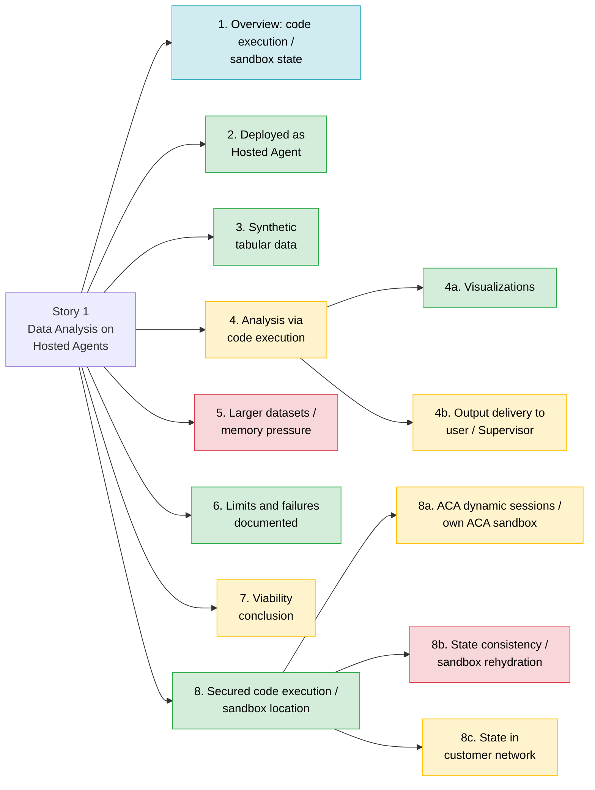

# Validate Hosted Agent Memory and Data Analysis Capacity (#1)

> **Disclaimer**
>
> This document is provided "as is" for general informational purposes and reflects a point-in-time reading of public Microsoft documentation. It is not official Microsoft guidance, a warranty, or a commitment.
>
> Azure features and GA/preview status are subject to change; verify capabilities against [Microsoft Learn](https://learn.microsoft.com/) before making any technical or purchasing decision, and treat those sources as authoritative if they conflict with this document. Service availability is governed solely by the applicable [SLAs for Microsoft Online Services](https://www.microsoft.com/licensing/docs/view/Service-Level-Agreements-SLA-for-Online-Services); nothing here constitutes an SLA or contractual commitment. No liability is accepted for any action taken, or not taken, based on this content.

Status report: what works, what doesn't and why, and what to do next, for
each requirement of issue #1 (Story 1 tasks in this repository).

**Implementation update, 2026-10-27:** `story1-improvements` moves the existing
Data Analysis agent to a fixed native managed Code Interpreter path without a
fourth agent. The same task entries now default to a credential-free preview;
see [current native validation instructions](tasks-detailed.md#native-story-1-validation-current-branch).
The evaluated toolbox results below are retained unchanged and are not passes
for this native implementation. Native live validation, deployment, and paid
requests require separate approval. Supervisor and Hosted idle/resume are
bounded best-effort probes; a failed probe may lead to a redesign proposal,
implemented only with explicit user approval.

**Native deployment/readiness checkpoint, 2026-10-27:** the existing deploy-all
task deployed Supervisor v13, Research v8, and Data Analysis v8 to
`hosted-agents-poc-dev` (`northcentralus`, `gpt-5-mini`). All are active.
Native Step 1 run `20261027T201528Z-b1f35aca` passed the 1,000-row independent
analytical/original-output checks and wrote a distinct native baseline.
One actual native model analysis was submitted, without retry. This is separate
from the historical evaluated environment below; it does not close two-user
isolation, memory pressure, chart-meaning review, Blob recovery, or Supervisor
delivery. No infrastructure reprovisioning or permission changes were performed.

### Native validation continuation, 2026-10-27

These results apply to `hosted-agents-poc-dev`, Supervisor v13, Research v8,
and Data Analysis v8. They do not replace the historical toolbox findings below.

| Native track | Result | Scope and evidence |
|---|---|---|
| Step 2 analysis and user-approved chart review | Met | Original analysis `20261027T202108Z-aea1fafe`; offline review `20261027T204940Z-3411caf3` rechecked retained hashes/oracle and the user's PNG review. No repeat model analysis for review. |
| Step 3 baseline capacity | Tested envelope passed; pressure target not reached | `20261027T202247Z-02a3faba`: 1k, 10k, and 100k rows produced correct originals. At 100k, process peak RSS was 261,029,888 bytes (about 249 MiB), 12.16% of the observed 2,147,483,648-byte limit. Cgroup peak was separately 505,753,600 bytes. |
| Step 4 application/session isolation | Met for tested users and operations | `20261027T204412Z-37747689`: both genuine users' analyses/original downloads succeeded; foreign workflow and session-file requests were denied in both directions with successful owner controls; a distinct same-user session could not inherit the workflow. |
| Step 5 required Blob reconstruction | Met | `20261027T202731Z-435a6d1f`: authenticated checkpoint write/readback and recomputation passed in a new authorized session with a distinct native interpreter fingerprint. Checkpoint and original interpreter were not deleted. |
| Step 5 optional Hosted observation | Partial | `20261027T204719Z-b842688c`: process marker changed and HOME sentinel persisted after a 180-second quiet interval; zero native analyses. Independent platform idle-boundary evidence is still missing, so this is not a full idle/resume pass. |
| Story 4 Step 6 Supervisor integration | Blocked before inference | `20261027T205517Z-f2ce64f3`: the existing stateless protocol lacks the trusted native session/file contract. Zero model submissions; redesign requires explicit approval. |

Before Step 4, operator-side role reads and separate cached-profile/Graph checks
verified the two selected users and distinct identities. With sponsor approval,
two direct project-scoped Foundry Agent Consumer grants were added. Readback also
showed inherited resource-group Consumer grants; no different role types were
observed. These are scoped application-access results, not privileged
project-user native-file confidentiality or a complete permissions certification.

For repeatable setup, use **Access: Preview isolated user Consumer grants**, then
the existing **Access: Create isolated user auth profiles** task if grants or
local sign-in profiles need preparing. See
[another-computer instructions](tasks-detailed.md#repeat-the-tests-on-another-computer).
The six native validation task entries remain unchanged in number.

Pressure remains disabled. This run made no automatic retries, permission
escalation beyond approved Consumer grants, forced lifecycle faults, resource
deletions, or redesign. The failed offline chart-review invocation with an
incorrect receipt path was retained; correcting that local path made no model
call. Remaining decisions are a separately approved pressure profile and any
minimal Supervisor/lifecycle-evidence work.

### Historical toolbox evaluation

| Field | Value |
|---|---|
| Report date | 2026-10-26 (overview added and accuracy review 2026-10-27) |
| Environment evaluated | `hosted-agents-poc-dev-001` (northcentralus, model `gpt-5-mini`) |
| Agents at evaluation | `supervisor-agent` v3, `research-agent` v3, `data-analysis-agent` v4 (all active, `@latest` 100%) |
| Hosted agent configuration | 0.5 vCPU / 1 GiB container, 120 s session idle timeout ([azure.yaml](../azure.yaml)) |
| Code execution | Microsoft-managed Code Interpreter via toolbox `story1-data-analysis-ci` v1 |
| Evidence | Summarized from local task runs (reports stay local and sanitized, per [ADR-0001](adr/0001-hosted-agents-poc.md#recovery-and-validation)) and the dated ADR entries. See [Evidence notes](#evidence-notes) |

**Legend:** ✅ Works (tested in the evaluated environment) · ⚠️ Partial
(works with gaps, or documented but not tested) · ❌ Gap (not
demonstrated in the evaluated environment) · ℹ️ Reference (documented
Microsoft guidance, not a test result)

## 1. Overview: code execution and sandbox state - ℹ️ Reference

This section summarizes Microsoft documentation; it isn't a test result.
Where this POC has tested a point, the relevant section is linked. In this
report, the **agent session sandbox** is where the hosted agent's own
container runs, and the **Code Interpreter sandbox** is where model-written
Python runs. Sections 2 to 8c test the Code Interpreter sandbox unless they
say otherwise.

There are **two separate execution environments**:

1. **Hosted Agent session (agent session sandbox)**: Foundry runs the agent
   container in a stateful, per-session VM-isolated sandbox. The platform
   persists `$HOME` and files uploaded through `/files` across turns and
   idle periods, and deletes a session after 30 days of inactivity.
2. **Built-in Code Interpreter (Code Interpreter sandbox)**: Python runs in
   a separate Microsoft-managed sandbox. Treat this environment as
   temporary, not as the durable system of record. In this POC it keeps no
   state between calls (tested, see 8b).

### Where are the sandboxes created?

- The **agent session sandbox** is provisioned and managed by Foundry Agent
  Service for each agent session.
- The **Code Interpreter sandbox** is Microsoft-managed: Hyper-V-isolated
  ACA dynamic sessions in the project's region. Customers do not create or
  manage its underlying session pool (see 8).
- If more runtime control is required, Foundry also supports a **custom
  code interpreter** (preview) using a customer-configured Azure Container
  Apps environment.

### Can Hosted Agents access ACA dynamic sessions or an ACA sandbox?

- **ACA dynamic sessions:** Yes, as documented. A Hosted Agent can use a
  customer-created session pool through the custom code interpreter
  (preview; requires the Standard agent setup and the
  `SessionPoolsSupportMCP` feature registration) or a custom integration
  that calls the pool management API. Dynamic sessions provide isolated,
  ephemeral execution environments allocated from a prewarmed session pool.
  **Not tested here:** this POC uses the Basic setup (see 8a).
- **Other ACA-hosted sandboxes:** the Foundry pages reviewed (hosted
  agents, Code Interpreter, custom code interpreter) describe only ACA
  dynamic session pools. Any other ACA-hosted execution endpoint needs a
  custom integration (for example, exposed as an MCP tool). It isn't
  attached to a Hosted Agent automatically.

### How does state rehydration work?

For an agent session sandbox, Foundry persists the filesystem and restores
it when the same session is used again. However:

- Sending `agent_session_id` binds a call to the same agent session
  sandbox, which restores `$HOME` and `/files`. A Responses call without it
  lands in a new sandbox, unless it passes a `conversation` ID, which binds
  a session automatically.
- Conversation continuity is maintained separately through
  `previous_response_id` or a conversation ID.
- In-memory variables, processes, and open connections should not be
  treated as durable.
- ACA dynamic sessions are ephemeral and are destroyed after their
  lifecycle or cooldown period.
- **Not tested here:** session filesystem idle/resume isn't validated yet.
  This POC's 120 s idle timeout is the minimum allowed; the default is
  15 minutes.

For reliable recovery, store checkpoints, file references, and business
state outside the execution sandbox (this POC's design is in 8b).

### Can we store state in our own network?

Use customer-owned services such as Azure Blob Storage, Cosmos DB, Azure
SQL, or PostgreSQL as the durable system of record, secured with the
appropriate private networking and identity controls.

The storage behind the agent session sandbox and the Code Interpreter
sandbox is platform-managed (see 8c). If customer control of the execution
environment, network, packages, or compute is required, use a **custom code
interpreter or customer-managed ACA dynamic sessions pool**.

### Recommended pattern

- Use **agent session storage** for resumable working files (documented;
  not yet validated in this POC).
- Use **customer-owned storage/database** for durable business state and
  artifacts.
- Use the **built-in Code Interpreter** for the simplest managed
  experience.
- Use **custom Code Interpreter / ACA dynamic sessions** when
  customer-controlled runtime or networking is required.

Detailed findings for these questions are in sections
[8](#8-secured-code-execution-where-the-sandbox-is-created----works),
[8a](#8a-can-hosted-agents-use-aca-dynamic-sessions-or-an-aca-sandbox----partial),
[8b](#8b-state-consistency-and-sandbox-rehydration----gap), and
[8c](#8c-can-state-be-stored-in-our-own-network----partial).

### Microsoft documentation

- [Hosted agents in Foundry Agent Service](https://learn.microsoft.com/en-us/azure/foundry/agents/concepts/hosted-agents)
- [Manage hosted agent sessions](https://learn.microsoft.com/en-us/azure/foundry/agents/how-to/manage-hosted-sessions)
- [Use Code Interpreter with Microsoft Foundry agents](https://learn.microsoft.com/en-us/azure/foundry/agents/how-to/tools/code-interpreter)
- [Configure a custom code interpreter for agents](https://learn.microsoft.com/en-us/azure/foundry/agents/how-to/tools/custom-code-interpreter)
- [Dynamic sessions in Azure Container Apps](https://learn.microsoft.com/en-us/azure/container-apps/sessions)

## Status map

## Summary

Section numbers are this report's own. Section 1 is reference material;
sections 2 to 8c cover the issue #1 requirements.

| # | Requirement | Status | What works | What isn't working, and why | Next step |
|---|---|---|---|---|---|
| 1 | Overview: code execution and sandbox state | ℹ️ | Summarizes Microsoft guidance on where code runs, sandbox state, and customer-network storage | Documented guidance, not test results; see 8 to 8c for what was tested | None |
| 2 | Data Analysis Agent deployed as a Foundry Hosted Agent | ✅ | Agent v4 runs Python in managed Code Interpreter and returned the sandbox-computed SHA-256 | - | None |
| 3 | Synthetic tabular data, no customer data | ✅ | Seeded synthetic sales CSVs (1k/10k/100k rows) whose content the sandbox verified by checksum | - | Optional: add XLSX |
| 4 | Filter, group, summarize, analyze with code execution | ⚠️ | The agent ran the supplied fixed Python with exact results at every size (Step 3) | Model-written analysis (Step 2) has no valid run in this environment. Both attempts were blocked because they ran before the Step 1 baseline existed | Rerun Story 1 Step 2 |
| 4a | Generating visualizations | ✅ | The sandbox generated a PNG chart at every size; each was downloaded and validated | - | None |
| 4b | Output delivery to the Supervisor or user | ⚠️ | User path: text summary, JSON totals, and files retrieved by container ID | The stateful Supervisor path is blocked by the nested caller guard. Files expire after about 20 minutes, and any principal in the project can read them | Rerun Story 4 Step 6, add durable Blob delivery, resolve the guard |
| 5 | Progressively larger datasets to exercise memory pressure | ❌ | 1k → 100k rows all passed | Peak memory was 160.5 MiB of the 2 GiB limit (8%), so memory pressure was never reached. `memory_limit` 4g was ignored | Add sizes that approach and exceed 2 GiB |
| 6 | Resource limits, failures, constraints documented | ✅ | Step 3 and 4 runs and the ADR record the limits and constraints | Some ADR claims (Steps 2 and 5, 2026-10-24) come from an older environment and aren't reproduced here | Rerun Steps 2 and 5; record results in the ADR |
| 7 | Clear viability conclusion | ⚠️ | Step 3 states: viable up to 100k rows (5.4 MiB) in the evaluated configuration | No overall verdict covering memory limits, Supervisor delivery, or multi-user use | Write one after the reruns |
| 8 | Secured code execution: where the sandbox runs | ✅ | Microsoft-managed ACA dynamic sessions, Hyper-V isolated (documented). Non-root, no capabilities, read-only root, no egress (tested) | No per-user isolation. Network allowlist blocked by org policy | Test the isolation options |
| 8a | Access to ACA dynamic sessions or an ACA sandbox | ⚠️ | The managed Code Interpreter already runs on Microsoft-owned ACA dynamic sessions (documented) | Bringing your own ACA session pool (custom code interpreter, preview) is documented only, not provisioned | Proof of concept: custom code interpreter on your own pool |
| 8b | State consistency and sandbox rehydration | ❌ | Step 4 tested that sandbox state doesn't carry over between calls. The Step 5 checkpoint rehydration is fully coded | Step 5 has never run in this environment. The ADR records it as Met on 2026-10-24 in an older environment, but that report isn't retained. Agent-framework checkpoints are not implemented | Run Story 1 Step 5 |
| 8c | State storage location in the customer network | ⚠️ | Step 5 includes a placement assessment for each state layer | Placement is unverified here because Step 5 hasn't run. The Code Interpreter sandbox can't be placed in our network. Files and conversations need the Standard setup (untested; POC uses Basic). Workflow state and the agent session filesystem have no bring-your-own option | Run Step 5. Test the Standard setup and a private endpoint |

---

## 2. Data Analysis Agent deployed as a Foundry Hosted Agent - ✅ Works

**What works**

- `data-analysis-agent` v4 is active as a hosted agent with its own
  managed identity. It is wired to toolbox `story1-data-analysis-ci` v1
  through the `TOOLBOX_ENDPOINT` setting. Only Data Analysis gets the Code
  Interpreter toolbox; Research gets a separate Microsoft Learn MCP toolbox
  for Story 4 ([runtime.py](../src/backend/app/runtime.py)).
- Story 1 Step 1 on 2026-10-26 was **Met**. In
  23.49 s, the hosted agent returned the SHA-256 that the sandbox computed
  for the 1k-row input, plus a `poc-artifacts-v1` container reference.
- Supervisor and Research were unchanged by the wiring. The run saved a
  baseline of all three agents (`agents-baseline.json`) that later steps
  check before running.

**What isn't working:** nothing for this requirement.

**Next steps:** none. Rerun **Agents: Story 1 - 1** in `verify` mode after
any redeploy to refresh the baseline.

## 3. Synthetic tabular data - ✅ Works

**What works**

- [synthetic_data.py](../scripts/common/synthetic_data.py) generates
  deterministic sales data with a fixed seed of `20261022`. It has 8
  columns: `row_id`, `order_date`, `region`, `category`, `units`,
  `unit_price_cents`, `revenue_cents`, and `status`. About 2% of `units`
  values are blank, which tests null handling.
- Each smaller dataset is the first rows of the larger one. An independent
  stdlib calculation in integer cents produces the expected filtered rows
  and totals.
- The three CSVs are uploaded with `purpose=assistants` and mounted under
  `/mnt/data`. The sandbox's SHA-256 for each file matched the local one,
  so no customer data is involved.

| Dataset | Rows | Size | Expected filtered rows |
|---|---|---|---|
| `story1-sales-1000.csv` | 1,000 | 53.2 KiB | 113 |
| `story1-sales-10000.csv` | 10,000 | 540.1 KiB | 1,249 |
| `story1-sales-100000.csv` | 100,000 | 5.4 MiB | 12,361 |

**What isn't working:** nothing for this requirement.

**Next steps:** optional. Add an XLSX variant, which the ADR's CSV/XLSX
capability row mentions.

## 4. Representative analysis using code execution - ⚠️ Partial

**What works**

- **Fixed analysis code (Step 3, Met).** The agent ran the
  supplied Python verbatim. It filtered `status == 'completed' and region ==
  'West'`, grouped by category (row count plus integer sums of `units` and
  `revenue_cents`), and wrote `filtered.csv` and `by_category.csv`. At 1k,
  10k, and 100k rows, the filtered row IDs and every category total matched
  the local calculation exactly.
- **Model-written analysis (Step 2)** is implemented in
  [story1_data_analysis.py](../scripts/run_scenario/story1_data_analysis.py).
  The model writes its own pandas/matplotlib code, and the runner checks
  only the outputs against the local calculation.

**What isn't working and why**

- Step 2 has **no valid run in `hosted-agents-poc-dev-001`**. Both runs
  (17:20 and 17:21 UTC) were `Not evaluated`, because the Step 1 baseline
  didn't exist until 17:22 UTC.
- The ADR records Step 2 as Met on 2026-10-24 in the older
  `hosted-agents-poc-dev` environment (Data Analysis v6). That report isn't
  retained locally.

**Next steps**

1. Run **Agents: Story 1 - 2 Analyze data and deliver outputs** against
   `hosted-agents-poc-dev-001`. It no longer blocks, because the baseline
   now exists.

## 4a. Generating visualizations - ✅ Works

**What works**

- Step 3: the sandbox wrote a `revenue_by_category.png` (1000x600) at every
  size. The runner downloaded each one through the authenticated container
  files API and validated its PNG signature.
- Step 1: a probe PNG generated in the sandbox was downloaded and validated
  the same way.

**What isn't working:** the `container_file_citation` annotations that
Microsoft documents for generated files appeared inconsistently. The POC
relies on its own `poc-artifacts-v1` container reference instead.

**Next steps:** none required. The Step 2 rerun also covers a chart drawn
by model-written code.

## 4b. How outputs reach the Supervisor or user - ⚠️ Partial

**How each output type is delivered (as built)**

| Output type | Delivery mechanism | Status |
|---|---|---|
| Text summary | Plain-language text in the agent's answer | ✅ Tested in Step 3 |
| Structured results | A `json` fenced block in the answer. The authoritative copy is `story1-step3-result.json`, downloaded from the sandbox | ✅ Tested in Step 3 |
| Files (CSV) and visuals (PNG) | Stay in the sandbox. The answer carries a `poc-artifacts-v1` block with container IDs, taken from tool results only, never from model-written text ([code_interpreter.py](../src/backend/app/services/code_interpreter.py)). The caller lists and downloads the files through the container files API | ✅ Tested in Steps 1 and 3 (user path) |
| Files via Supervisor (`POC_WORKFLOW`) | Data Analysis puts container IDs in the `containers` field of its `poc-workflow-v1` report, and the Supervisor forwards them ([delegation.py](../src/backend/app/services/delegation.py)) | ⚠️ Unit-tested only, not end-to-end |
| Files via Supervisor (`POC_DELEGATE`, Story 4 Step 6) | Stateless delegation to `data_analysis` ([orchestration.py](../src/backend/app/services/orchestration.py)). The operator downloads and validates the outputs | ⚠️ ADR records Met on earlier agent versions (Supervisor 2, Research 2, Data Analysis 3). No report retained |

**What isn't working and why**

- **Stateful Supervisor path blocked.** The `POC_WORKFLOW create` path stops
  at the nested caller guard: the hop to Research arrives without a verified
  user ID. Microsoft documents `x-ms-user-identity` for your own users, but
  not passing it through nested agent-to-agent calls. The guard is
  intentionally not bypassed. See
  [ADR-0001: Authorization contract](adr/0001-hosted-agents-poc.md#authorization-contract-and-proposed-alignment).
- **Files are temporary.** Sandbox containers report a 20-minute idle
  expiry. The idle wait wasn't run here; in the older
  `hosted-agents-poc-dev` environment (2026-10-24), a container expired
  after 21.5 min idle. Durable delivery to Blob ("ArtifactStore") is not
  implemented.
- **No per-user file isolation.** Any principal with project access can
  read sandbox outputs through the containers API (tested in Step 4).

**Next steps**

1. Rerun Story 1 Step 2. Then run **Agents: Story 4 - 6 Demonstrate Data
   Analysis via Supervisor**, which is `BLOCKED` unless Story 1 Steps 1 and
   2 are Met.
2. Implement durable delivery. Copy generated files to customer Blob under
   a per-user prefix with ABAC, return Blob references, and delete the
   sandbox container.
3. Resolve the nested caller guard (ADR next increment 1), then rerun
   Step 2 to show `containers` forwarding end to end.

## 5. Progressively larger datasets to exercise memory pressure - ❌ Gap

**What works**

- Step 3 ran 1k → 10k → 100k rows in order, one attempt per size, stopping
  at the first platform failure. Every size produced exact results and all
  output files.

| Rows | Input | Sandbox time | End-to-end | Peak RSS | % of 2 GiB limit |
|---|---|---|---|---|---|
| 1,000 | 53.2 KiB | 1.75 s | 37.17 s | 145.8 MiB | 7% |
| 10,000 | 540.1 KiB | 2.20 s | 39.11 s | 147.2 MiB | 7% |
| 100,000 | 5.4 MiB | 1.92 s | 42.41 s | 160.5 MiB | 8% |

**What isn't working and why**

- **Memory pressure was not reached.** At the largest size, peak memory
  was 8% of the 2 GiB sandbox limit, and most of that is the pandas and
  matplotlib import baseline (about 146 MiB).
- **No failure point found.** The test intentionally doesn't search for a
  crash limit, and the agreed sizes stop at 100k.
- **More sandbox memory not available.** `memory_limit` 4g, set per call
  or on the toolbox, didn't change the enforced 2 GiB (Step 4). No
  Microsoft page explains this.
- **The hosted agent's own container is not stressed.** Analysis runs in
  the sandbox, not in the 0.5 vCPU / 1 GiB agent container. The ADR's
  capacity harness (0.5/1, 1/2, 2/4 vCPU/GiB) is not implemented.

**Next steps**

1. Agree on larger sizes and add them to `DATASET_SIZES`, for example 1M,
   5M, and 10M rows, or add wider rows. The goal is to approach and exceed
   2 GiB. Each size needs a new upload and toolbox version through Step 1
   `enable-if-missing`.
2. Watch the 220 s per-execution limit and upload limits. They may be hit
   before memory.
3. Ask Microsoft why `memory_limit` above 2 GiB isn't applied. If larger
   memory is required, evaluate a custom code interpreter (see 8a).
4. Record peak RSS against the limit and the first failure type for each
   size. Step 3 already stops at the first failure and writes a partial
   report.

## 6. Observed resource limitations, failures, constraints documented - ✅ Works

**What's documented (from Step 3 and Step 4 runs, 2026-10-26)**

| Constraint | Observed | Microsoft documentation says |
|---|---|---|
| Sandbox memory | 2.0 GiB enforced (cgroup); `memory_limit` 4g ignored | 1g / 4g / 16g / 64g are allowed values |
| Sandbox CPU | 1 CPU enforced; Python reports 4 | - |
| Sandbox disk | About 14.3 GiB free on `/mnt/data` | - |
| Execution time | A 100 s run completed (101.84 s) | Tool description says 90 s; ACA documents 220 s |
| Container lifetime | Containers report a 20 min idle-expiry policy; idle wait not run here. In the older `hosted-agents-poc-dev` environment (2026-10-24), a container expired after 21.5 min idle | Code Interpreter page says 30 min idle, 1 h active; Responses API says 20 min |
| Container reuse | New container on every call; `container` reuse ignored | Separate sessions per conversation |
| Network egress | No DNS or egress: public, raw IP, and customer storage all blocked | "Dynamic sessions can't make outbound network requests" |
| Network allowlist | Rejected: "organization policy disables container network access" | `allowlist` is a supported value |
| Per-user isolation | Not supported: another principal read the agent's sandbox output | "All users in the same project share the same container context" |
| Runtime | Python 3.11.15, pandas 1.5.3, numpy 1.24.0, matplotlib 3.6.3; package install impossible (no egress) | - |
| Hosted agent container | 0.5 vCPU / 1 GiB, 120 s idle timeout; separate from the sandbox | Sizes 0.5/1, 1/2, 2/4 vCPU/GiB |

**What isn't working and why**

- The ADR's 2026-10-24 results for Steps 2 and 5 come from the older
  `hosted-agents-poc-dev` environment (Data Analysis v6) and haven't been
  reproduced in `hosted-agents-poc-dev-001`.
- Run reports stay local by design (ADR-0001), so only the summarized
  findings here and in the ADR are shared.

**Next steps**

1. Rerun Steps 2 and 5 in `hosted-agents-poc-dev-001`.
2. Record the summarized results, with environment, agent versions, and
   date, in the
   [ADR snapshot](adr/0001-hosted-agents-poc.md#implementation-and-evidence-snapshot).
3. Ask Microsoft about three discrepancies: the 20 vs 30 min expiry,
   `memory_limit` not being applied, and the 90 s vs 220 s execution limit.

## 7. Viability conclusion - ⚠️ Partial

**What works:** Step 3 states its conclusion scoped to what was tested:

> The tested workload is viable in the evaluated configuration up to
> 100,000 rows (5.4 MiB): every size produced exact results and all output
> files. This is the tested envelope, not the platform maximum.

**What isn't working and why:** no single conclusion yet covers:

- How close a workload can get to the 2 GiB sandbox limit (see 5).
- Model-written analysis in this environment (see 4).
- Delivery through the Supervisor (see 4b).
- Multi-user use. Shared sandbox access makes the managed toolbox setup
  **unsuitable for sensitive multi-tenant data** until an isolation option
  is proven (see 8).

**Next steps:** after the Steps 2, 3 (extended sizes), and 5 reruns, add a
final verdict to this report. State it per workload size, per delivery
path, and per tenancy model.

## 8. Secured code execution: where the sandbox is created - ✅ Works

**How it works**

- The hosted agent calls Code Interpreter as a tool through a Foundry
  toolbox (an MCP endpoint). The code doesn't run in the agent's container;
  there is no local `exec` or subprocess fallback.
- The sandbox is **Microsoft-managed**. The
  [Code Interpreter page](https://learn.microsoft.com/azure/foundry/agents/how-to/tools/code-interpreter#sandboxed-execution-environment)
  documents it as **Azure Container Apps dynamic sessions (code interpreter
  sessions), each isolated by a Hyper-V boundary**, running in the same
  Azure region as the Foundry project. It doesn't inherit the agent's
  subnet and can't make outbound network requests. No ACA resource for it
  exists in our subscription.
- The probe saw platform variable names `CAAS_PROXY_POOL_NAME`,
  `SESSIONS_INSTANCE`, and `CAAS_PROXY_MGMT_AUTH_ENABLED`. These are
  consistent with the documented ACA sessions. Step 4 tests the observable
  boundaries below, not the isolation technology itself.

**Tested boundaries (Step 4, Met)**

| Area | Observed |
|---|---|
| Identity | User `sandbox` (uid/gid 1001), non-root |
| Privileges | No capabilities (`CapEff` 0000000000000000), `NoNewPrivs` 1, seccomp mode 0 |
| Filesystem | Root is read-only; only `/tmp` and `/mnt/data` are writable |
| Network | No DNS; public host, raw IP, and customer storage all blocked |
| Per-call isolation | New container per call; a file from call A isn't visible in call B |
| Hosted agent's own sandbox | Same boundaries as the direct operator probe (no differences) |
| Kernel | `6.6.150.1-1.azl3` |

**What isn't working and why**

- **No per-user isolation** when Code Interpreter is used through a
  toolbox in a hosted agent. This is documented and was tested: the
  operator read the agent's sandbox output.
- **Network allowlist blocked** by organization policy, so no package
  install or controlled egress.
- **No control over limits:** memory is fixed at 2 GiB and the runtime is
  pinned.

**Next steps:** test the isolation options in the order recommended in
[ADR-0001: per-user isolation options](adr/0001-hosted-agents-poc.md#per-user-code-interpreter-isolation-options-to-investigate):

1. Pass the end user's Entra token to the toolbox.
2. A custom code interpreter on our own ACA session pool.
3. Code Interpreter as a direct Responses API tool.
4. The hosted-agent session sandbox, only after a security review.

Acceptance test: the Step 4 cross-principal probe, using two real Entra
users.

## 8a. Can hosted agents use ACA dynamic sessions or an ACA sandbox? - ⚠️ Partial

**What works**

- Indirectly, yes: the managed Code Interpreter runs on ACA dynamic
  sessions owned and run by Microsoft (documented, see 8).

**What isn't working and why**

- **Our own ACA session pool is not tested.** Microsoft documents a
  [custom code interpreter](https://learn.microsoft.com/azure/foundry/agents/how-to/tools/custom-code-interpreter)
  (preview): an MCP server backed by our own ACA dynamic session pool. It
  would give control of the runtime, memory, network egress, packages, and
  the session `identifier`, which could be per user. It requires:
  - The `SessionPoolsSupportMCP` preview feature registration.
  - The Standard agent setup.
  - A paid ACA environment.
  - The *Azure ContainerApps Session Executor* and *Contributor* roles on
    the session pool, for the calling identity.

  None of these are provisioned.
- **Open question:** how the Foundry MCP path sets the ACA session
  `identifier` (per agent, per conversation, or per caller). If it can't be
  controlled, Data Analysis could call the pool management API directly,
  with an identifier derived from the verified user.

**Next steps**

1. Provision a proof-of-concept ACA session pool with the custom code
   interpreter in a Standard-setup project.
2. Rerun Steps 3, 4, and 5 against it: memory above 2 GiB, network
   allowlist, per-user isolation, and identifier behavior.

## 8b. State consistency and sandbox rehydration - ❌ Gap

**How sandbox state behaves (tested in Step 4)**

- State does **not** carry over between tool calls. Every call gets a new
  container: files, variables, and kernel state are lost. Even within one
  conversation the `container` reuse option is ignored.
- Containers expire 20 minutes after last activity, and deleted containers
  return 404.
- Treat the sandbox as stateless. Anything needed later must be stored
  outside it and rebuilt.

**Rehydration design (Step 5, implemented)**

- [story1_sandbox.py](../scripts/run_scenario/story1_sandbox.py) `--step 5`:
  1. R1 computes state in the sandbox.
  2. R2 (same conversation) and R3 (new conversation) check what survived.
  3. The runner saves a small, versioned, **SHA-256-sealed checkpoint** to
     customer Blob at `artifacts/story1/checkpoints/<run-id>.json`. It holds
     the dataset ID, checksum, transform spec, and aggregates, but no data
     rows.
  4. The runner deletes the sandbox container and confirms 404.
  5. R4 rebuilds the state from the checkpoint plus the re-mounted input.
     Missing, corrupt, wrong-schema, or stale checkpoints are rejected.
- Conversation history (not sandbox state) is the platform's continuity
  layer. A conversation ID is a durable record stored in Foundry.

**What isn't working and why**

- **Step 5 has never run in `hosted-agents-poc-dev-001`.** It's not in the
  evidence index and there's no report.
- The ADR records Step 5 as Met on 2026-10-24 in another environment, but
  that report isn't retained.
- Not implemented: agent-framework checkpoints, session filesystem
  idle/resume, and crash or process-loss recovery (see the ADR snapshot).

**Next steps**

1. Run **Access: Apply developer permissions** if needed; it grants the
   Blob data role. Then run **Agents: Story 1 - 5 Assess state
   continuity**.
2. Optionally rerun Story 1 Step 4 with idle wait `wait` to confirm expiry
   in this environment.
3. Plan the agent-framework checkpoint and process-loss experiments (ADR
   next increment 4).

## 8c. Can state be stored in our own network? - ⚠️ Partial

**Placement assessment (built into Step 5)**

| State layer | Where it lives in this POC | Can it be in the customer network? | Basis |
|---|---|---|---|
| Code Interpreter sandbox (variables, `/mnt/data`) | Microsoft-managed sandbox | **No.** It doesn't inherit the agent's network and can't make outbound requests | Tested (Step 4) and documented |
| Agent session sandbox (`$HOME`, `/files`) | Foundry-managed session storage; deleted after 30 days of inactivity | **No** bring-your-own option documented | Documented, not tested (session idle/resume not yet validated) |
| Uploaded files (toolbox inputs) | Foundry project storage (Basic setup, Microsoft-managed) | **Yes, with the Standard agent setup** (bring-your-own Azure Storage) | Documented, not tested |
| Conversations and responses | Foundry (Basic setup) | **Yes, with the Standard agent setup** (bring-your-own Cosmos DB). Whether the hosted-agent runtime uses it isn't stated | Documented, not tested |
| Hosted workflow state (`POC_WORKFLOW` registry) | Foundry-managed hosted agent state store | **No** bring-your-own option documented | Documented |
| Custom checkpoint | Customer `artifacts` Blob container (network security perimeter, no private endpoint) | **Yes.** A private endpoint should also work, because the agent or client reads and writes it (the sandbox can't reach it) | Coded in Step 5, not run here. Private endpoint is an architectural assessment |

**What isn't working and why**

- Nothing in this table has been observed here, because Step 5 hasn't run
  in this environment.
- The POC uses the Basic agent setup, so bring-your-own storage for files
  and conversations is untested.
- The POC storage uses a network security perimeter (NSP), not a private
  endpoint.

**Next steps**

1. Run Story 1 Step 5 to confirm the customer-Blob checkpoint.
2. Stand up a Standard agent setup project with bring-your-own Storage and
   Cosmos DB. Confirm where uploaded files, conversations, and hosted-agent
   conversations actually land.
3. Add a private endpoint to the checkpoint storage and confirm
   read/write from the hosted agent.

---

## Prioritized next steps

| Priority | Action | Closes | Effort / cost |
|---|---|---|---|
| 1 | Run **Story 1 - 2** in `hosted-agents-poc-dev-001` | 4, 4a, 7 | Two paid hosted requests |
| 2 | Run **Story 1 - 5** (Blob data role required) | 8b, 8c | Four paid requests and one Blob checkpoint |
| 3 | Run **Story 4 - 6** (requires 1) | 4b | One paid request through the Supervisor |
| 4 | Extend `DATASET_SIZES` toward and past 2 GiB, then rerun Step 1 `enable-if-missing` and Step 3 | 5, 7 | New uploads and toolbox version; code change |
| 5 | Record rerun results in the ADR snapshot (environment, versions, date) | 6 | Documentation |
| 6 | Durable Blob delivery for generated files (per-user prefix, ABAC) | 4b | Code change |
| 7 | Proof of concept: custom code interpreter on our own ACA session pool (Standard setup) | 8, 8a, 5 | New paid infrastructure; preview registration |
| 8 | Standard setup with bring-your-own Storage and Cosmos DB, plus a private endpoint for checkpoints | 8c | New infrastructure |
| 9 | Resolve the nested caller guard for `POC_WORKFLOW` | 4b | Design work (ADR increment 1) |
| 10 | Write the final viability verdict in this report | 7 | Documentation |

## Questions for Microsoft

1. Why isn't `memory_limit` above 2 GiB applied, per call or on the toolbox?
2. Which organization policy rejects the `allowlist` network policy, and
   can it be scoped?
3. Which is authoritative: the 20 min container expiry or the documented
   30 min idle timeout? And the 90 s or the 220 s execution limit?
4. Is per-user isolation for Code Interpreter used through a toolbox on the
   roadmap?
5. With a custom code interpreter, how does the Foundry MCP path set the
   ACA session `identifier`?
6. With the Standard agent setup, do hosted-agent conversations use the
   bring-your-own Cosmos DB?

## Evidence notes

Findings are summarized from local task runs. Per
[ADR-0001](adr/0001-hosted-agents-poc.md#recovery-and-validation), generated
run reports stay local and sanitized, and this report doesn't depend on them.
To reproduce a result, run the named VS Code task against
`hosted-agents-poc-dev-001`.

| Step (VS Code task) | Date | Verdict in `hosted-agents-poc-dev-001` |
|---|---|---|
| **Agents: Story 1 - 1** Enable Code Interpreter | 2026-10-26 | Met |
| **Agents: Story 1 - 2** Analyze data and deliver outputs | 2026-10-26 | Not evaluated (blocked: ran before the Step 1 baseline existed) |
| **Agents: Story 1 - 3** Evaluate dataset sizes | 2026-10-26 | Met |
| **Agents: Story 1 - 4** Assess sandbox boundaries | 2026-10-26 | Met |
| **Agents: Story 1 - 5** Assess state continuity | - | Not run in this environment |
| **Agents: Story 4 - 6** Demonstrate Data Analysis via Supervisor | 2026-10-26 | Met per the ADR, on earlier versions (Supervisor 2, Research 2, Data Analysis 3) |

Task procedures: [Detailed task guide](tasks-detailed.md#agents-story-1---1-enable-code-interpreter-on-existing-data-analysis-agent).
Architecture and decisions: [ADR-0001](adr/0001-hosted-agents-poc.md).
