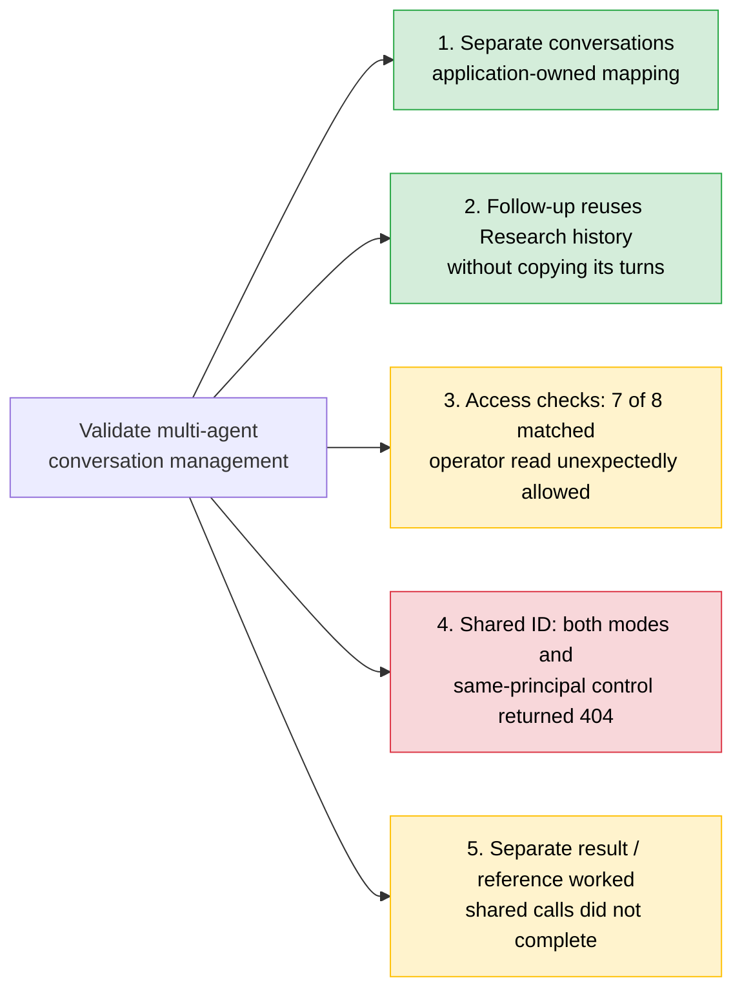

# Validate Multi-Agent Conversation Management (#3)

> **Disclaimer**
>
> This document is provided "as is" for general informational purposes and reflects a point-in-time reading of public Microsoft documentation. It is not official Microsoft guidance, a warranty, or a commitment.
>
> Azure features and GA/preview status are subject to change; verify capabilities against [Microsoft Learn](https://learn.microsoft.com/) before making any technical or purchasing decision, and treat those sources as authoritative if they conflict with this document. Service availability is governed solely by the applicable [SLAs for Microsoft Online Services](https://www.microsoft.com/licensing/docs/view/Service-Level-Agreements-SLA-for-Online-Services); nothing here constitutes an SLA or contractual commitment. No liability is accepted for any action taken, or not taken, based on this content.

Status report: what was done, what worked, what didn't and why, and what to
do next, for each requirement of issue #3 (Story 3 tasks in this repository).

**Detailed HTML evidence report (2026-10-28):**
[View with HTML Preview](https://htmlpreview.github.io/?https://raw.githubusercontent.com/wxifaras/hosted-agents-poc/refs/heads/main/docs/reports/story-3/conversation-management/2026-10-28/index.html).
The preview will only become available if this local integration branch and snapshot
are committed and pushed; neither is implied by report generation.

The new report uses **hosted-agents-poc-dev**, Supervisor **v16**, Research **v10**,
and Data Analysis **v10** (baseline-only). Only Supervisor was redeployed.
It shows only the **latest execution of each of the five tasks**, with per-task
flow diagrams and **46 recorded checks: 45 PASS and 1 FAIL**. Superseded attempts
are excluded from the HTML and its downloads; original local artifacts are retained.
Steps 1 and 2 were Met; Step 3 was Partially met because
the operator unexpectedly read the Supervisor-created Research conversation.
Steps 4 and 5 met their evaluation/comparison criteria, but shared-ID calls
returned HTTP 404 and did not demonstrate shared-history delivery.

The **2026-10-27 historical findings below remain unchanged** and refer to a
different environment and versions. Their original artifacts were not available
locally and were not reconstructed. The new Story 3 evidence is not a rerun of
Story 1 or Story 4, nor proof of least-privileged two-user isolation.

| Field | Value |
|---|---|
| Report date | 2026-10-27; all five hosted steps completed |
| Environment evaluated | `hosted-agents-poc-dev-001` (northcentralus, model `gpt-5-mini`) |
| Agents at evaluation | `supervisor-agent` v4, `research-agent` v3, `data-analysis-agent` v4; all active, `@latest` 100% |
| Agent reuse | Step 1 recorded the baseline; Steps 2-5 matched it. Versions, identities, and toolbox wiring were unchanged during the recorded runs |
| Hosted agent configuration | Three separate hosted deployments of one image, each 0.5 vCPU / 1 GiB, 120 s session idle timeout ([azure.yaml](../azure.yaml)) |
| Protocol tested | Supervisor-only `POC_CONVERSE`: separate and shared conversation patterns, plus model-free inspection ([conversations.py](../src/backend/app/services/conversations.py)). Story 4's `POC_DELEGATE` and `POC_WORKFLOW` are separate paths |
| Test scope | Synthetic messages and code words; Supervisor → Research. Data Analysis was included in baseline checks, not exercised as a specialist |
| Evidence | Five local sanitized hosted-run reports and their recorded checks, summarized here so this document stands alone. Run identifiers and verdicts are in [Evidence notes](#evidence-notes) |

**Legend:** ✅ Works (tested on hosted agents) · ⚠️ Partial (some behavior
worked, but a discrepancy or support question remains) · ❌ Did not work
(tested operation failed in this configuration).

**Acceptance verdicts are not capability statuses.** Steps 1, 2, 4, and 5
were **Met**; Step 3 was **Partially met**. Steps 4 and 5 required evaluating
and recording shared-ID outcomes, so they were Met even though every tested
shared-ID sub-agent call returned HTTP 404 (`not_found`).

## Status map

## Summary

| # | Requirement | Status | What works | What isn't working, and why | Next step |
|---|---|---|---|---|---|
| 1 | Supervisor and separate sub-agent conversations; mapping ownership and storage | ✅ | Distinct conversations; Supervisor wrote and re-read their mapping in a user-isolated Foundry state store; custom parent metadata returned | Conversation creation and mapping write are separate operations; interrupted creation can leave an unmapped conversation | Add recovery and cleanup before production use |
| 2 | Follow-up to the same sub-agent conversation; independent prior history | ✅ | Supervisor reused the mapped Research conversation; Research recalled the earlier code word without it being forwarded again; history grew from 2 to 4 items | Crash recovery was not tested; model recall alone is not deterministic evidence, so item counts were checked too | Retain separate histories; test interruption and recovery |
| 3 | Ownership, principal binding, permissions, access, and correlation | ⚠️ | 7 of 8 access cases matched expectations; Supervisor user binding, mapping guards, and correlation checks passed | Operator read the Supervisor-created Research conversation when denial was expected. Operator had elevated project roles; the run did not establish the reason for access | Reproduce with least-privileged, distinct users and confirm the access contract |
| 4 | Invoke B with A's conversation ID; read, append, and later hydration | ❌ (evaluation Met) | Both identity modes and a same-principal control produced explicit outcomes; later Supervisor history was inspected | All calls using the Supervisor ID on Research returned 404 (`not_found`); no Research turns were appended. Exact cause unverified | Use separate IDs; confirm cross-endpoint conversation scope with Microsoft |
| 5 | Compare shared and separate IDs: result, placeholder, or full history | ⚠️ (comparison Met) | Separate IDs delivered a result or placeholder as selected; Research history stayed separate | Shared-ID calls failed in both identity modes; no sub-agent result or history was delivered | Use explicit result/reference delivery; do not rely on shared-ID history |

---

## 1. Supervisor conversation and a separate sub-agent conversation - ✅ Works

**Question (AC1):** Demonstrate a supervisor conversation and a separate
sub-agent conversation. Identify who owns and stores their mapping.

**What was done:** **Agents: Story 3 - 1 Demonstrate separate conversations**
ran in `prepare-if-missing` mode. The client created a Supervisor conversation
S and sent `POC_CONVERSE` with the separate pattern. The Supervisor created a
Research conversation C with `agent` identity, stored S → C, and invoked
Research in C. A later model-free inspect re-read the mapping and C's metadata.
Supervisor v4 already supported the protocol; the recorded before/after agent
snapshots showed no changes.

**Answer: separate conversations and an application-owned mapping worked.**
Acceptance verdict: **Met**.

| Check | Finding |
|---|---|
| Supervisor turn | Completed in the client-created Supervisor conversation |
| Separate Research conversation | Different ID from S; Research's first turn produced 2 stored items |
| Mapping ownership | Supervisor application created and maintained the record |
| Mapping persistence | Later inspect found the same C and listed its 2 history items |
| Parent metadata | Foundry returned the application-written parent digest, correlation ID, creator, and target |

### Who owns and stores what

| Item | Created / controlled by | Stored in | Binding / classification |
|---|---|---|---|
| Supervisor conversation S | Client using the operator's Entra token | Foundry conversations | Operator caller on the Supervisor endpoint; Foundry-managed storage |
| Research conversation C | Supervisor application using agent identity | Foundry conversations | Created through the Supervisor's agent call on Research; exact access semantics require the AC3 qualification below |
| S → C mapping | Supervisor application | Foundry state store `hosted-agents-poc-supervisor-registry-v1` | User-isolated partition; key `conversation-map/<digest of S>`; custom schema and lookup |
| Parent link on C | Supervisor application | Free-form conversation metadata | Custom correlation, not evidence of a native parent/child relationship |
| History hydration | Each agent's SDK adapter (`context.get_history()`) | History supplied for the request's conversation | Agent Framework / SDK-managed |

**What isn't working or remains unproven**

- Creating C and writing its mapping are separate operations. A failure between
  them can leave an unmapped conversation; retries and cleanup are not implemented.
- This demonstrates the application's mapping, not a platform-managed
  parent/child conversation feature. No such native feature was demonstrated;
  absence from the cited documentation is not proof that none can exist.
- The same specialist code path exists for Data Analysis, but only Research was
  exercised in Story 3.

**Next step:** add interrupted-creation recovery and orphan cleanup; keep the
mapping under application control.

## 2. Follow-up to the same sub-agent conversation - ✅ Works

**Question (AC2):** Send a follow-up request to the same sub-agent
conversation and verify that its prior history is independently available.

**What was done:** **Agents: Story 3 - 2 Verify sub-agent follow-up history**
sent a "remember this code word" turn through the Supervisor, followed by a
question asking for that word. Only the new message was forwarded on the
second turn; it did not include the word. The run checked mapping reuse,
Research's stored item counts, recall, and the Supervisor's hydrated history.
A new Supervisor conversation was inspected as a control.

**Answer: the mapped conversation and its independent history were reused.**
Acceptance verdict: **Met**.

| Check | Finding |
|---|---|
| First Research turn | Created C, stored its mapping, and added 2 items |
| Follow-up routing | Found the mapping and reused the same C; no new Research conversation |
| Stored history | 2 items before the follow-up, 4 after |
| Recall | Research answered with the first turn's code word despite it being absent from the forwarded follow-up |
| Supervisor history | No Research hop inputs or Research-authored outputs found; Research's own turns were not copied |
| New Supervisor conversation | No mapping and no inherited Research history |

**What remains unproven:** recall is model-based, while item counts provide
the deterministic persistence check. This was normal multi-turn continuity,
not recovery after a crash, deployment, or interrupted mapping write.

**Next step:** retain the separate-conversation pattern and test recovery
explicitly rather than infer it from successful follow-up.

## 3. Ownership, identity binding, permissions, and access - ⚠️ Partial

**Question (AC3):** Document conversation-ID ownership, authenticated
user/principal binding, required permissions, and access enforcement across
supervisor/sub-agent boundaries. Exercise representative allowed/denied access,
distinguish client-to-agent from agent-to-agent calls, and identify custom
correlation required.

**What was done:** **Agents: Story 3 - 3 Assess conversation ownership and
access** created a mapped Research conversation with one paid turn. It then
ran eight access cases without further model inference, compared the
Supervisor's salted user fingerprint with the operator, checked correlation,
and read project role assignments without granting anything.

**Answer: application guards and correlation worked, but the expected
principal-isolation result did not.** Acceptance verdict: **Partially met**;
7 of 8 access cases matched their expectations.

### Actual access results

| Case | Invocation | Expected | Observed | Enforcement / interpretation |
|---|---|---|---|---|
| Operator lists its Supervisor conversation | Client → Supervisor endpoint | Allowed | Allowed, 2 items | Foundry |
| Operator lists the same conversation through Research's endpoint | Client → Research endpoint | Record endpoint scope | HTTP 404 (`not_found`) | Observed cross-endpoint failure |
| Operator lists the Supervisor-created Research conversation | Client → Research endpoint | Denied | **Allowed, 2 items; failed expectation** | Platform access was broader than the test assumed |
| Supervisor lists C with `agent` identity | Agent → Research endpoint | Allowed | Allowed, 2 items | Foundry |
| Supervisor lists C with forwarded `call-context` | Agent + forwarded call ID → Research endpoint | Record binding behavior | Allowed, 2 items | Does not by itself identify the effective owning principal |
| Client supplies an unmapped Research ID | Client → Supervisor | Denied before outbound call | Denied; no outbound call | Supervisor mapping guard |
| Another Supervisor conversation claims C | Client → Supervisor, same operator | Denied | Denied; no outbound call | Mapping is specific to the Supervisor conversation |
| `POC_CONVERSE` without a Supervisor conversation | Client → Supervisor | Rejected before state/outbound work | Rejected with explicit-conversation error | Supervisor request guard |

### Principal binding and permissions

- The Supervisor's platform-user fingerprint matched the operator; a call ID
  was present.
- C was created using the Supervisor's agent identity. However, both the
  Supervisor and the operator could list it. **Creation identity is not proof
  of exclusive access**, and forwarding a call ID plus observing a successful
  list does not prove which identity Foundry used for authorization.
- The mapping was stored in the calling user's state-store partition.

| Principal | Project roles observed | Purpose in this test |
|---|---|---|
| Operator | Foundry User, Owner, User Access Administrator | Invoke agents and perform client access checks |
| Supervisor agent identity | Foundry User | Invoke Research, create/list C, access mapping state |
| Research agent identity | Foundry User | Model inference |

These are role-assignment readbacks, **not a minimum-permission proof**.
The operator's elevated roles are a relevant confounder, not an established
explanation for the unexpected read. The run did not determine whether roles,
caller resolution, or another platform rule caused access to be allowed.

### Correlation findings

The client's `x-client-correlation-id` reached the Supervisor and matched the
value stored in the mapping. The application also wrote correlation and parent
information into C's metadata.

| Relationship | What the POC used |
|---|---|
| S → C routing and reuse | Supervisor-owned state-store mapping |
| C → S parent reference | Application-written parent digest in conversation metadata |
| Client request → mapping | `x-client-correlation-id`, checked against the mapping record |
| Original user → Research execution | Not established by this step; successful access with forwarded context is insufficient proof |

**What isn't working and why**

- The expected denial of the operator's direct read of C failed. Do not claim
  that a Supervisor-created conversation is readable only by the Supervisor.
  The reason for the broader access remains unverified.
- No second Entra user or least-privileged comparison was used in this run.
  Earlier native-user isolation evidence is separate, not a replacement for
  this missing control.
- Delegated-user (`x-ms-user-identity`) conversation ownership was not tested.
  Required roles were read, not varied to establish authorization boundaries.

**Next steps:** reproduce with two distinct, minimally privileged users;
vary role scope and forwarded context separately; ask Microsoft to confirm
the ownership and authorization contract before relying on it for isolation.
Retain the application's mapping guards, but do not describe them as protection
against direct calls to Research.

## 4. Agent A invokes Agent B with the same conversation ID - ❌ Did not work

**Question (AC4):** Evaluate Agent A invoking Agent B through the Responses
API with the same conversation ID. Record whether B can read and append
history and whether a later A invocation sees B's messages.

**What was done:** **Agents: Story 3 - 4 Evaluate shared conversation ID**
seeded the Supervisor's conversation S with a code word. The Supervisor then
invoked Research with `conversation = S`, once with `agent` identity and once
with forwarded `call-context`, requesting placeholder delivery. A later
model-free inspect counted the Supervisor's history. Finally, the operator
called Research directly with S as a same-principal control.

| Invocation | Research call | Research read S | Research input / output appended to S |
|---|---|---|---|
| Supervisor → Research, `agent` | HTTP 404 (`not_found`) | Not observed; call failed | Neither |
| Supervisor → Research, `call-context` | HTTP 404 (`not_found`) | Not observed; call failed | Neither |
| Operator → Research with S (same-principal control) | HTTP 404 (`not_found`) | Not observed; call rejected | No successful Research turn |

The error identified S as not found on the Research path. Later Supervisor
inspection found **0 Research hop inputs and no Research turns**. Its 6
history items were the 3 client messages and 3 Supervisor replies, including
the Supervisor's reports of the failed nested calls.

**Why it did not work:** Foundry did not resolve/accept the Supervisor's
conversation ID for those Research operations and returned 404 before a
successful Research turn. The same-principal control also failed, so changing
from an agent caller to the original operator did not make S usable on
Research. This is evidence of a cross-endpoint limitation in the tested setup,
not proof of the exact internal scoping or authorization rule.

**Support boundary:** run-report labels such as NOT SUPPORTED mean the
operation did not work with these endpoints, identities, and SDK versions.
The 404 alone does not distinguish an unavailable conversation from one hidden
by access rules. The cited hydration and user-isolation documentation does not
establish a universal prohibition on shared IDs. Research's ability to read S
was **not observed**, rather than successfully tested and shown false.

**Acceptance verdict: Met**, because both identity modes produced explicit
outcomes and later history was inspected. This is an evaluation verdict,
not a successful shared-history capability.

**Next steps:** use separate IDs. Confirm the cross-endpoint support contract
with Microsoft using both the agent-to-agent failures and same-principal
control. Concurrent shared turns, locking/steering, and delegated-user identity
were not tested here.

## 5. Shared versus separate conversation IDs - ⚠️ Separate works; shared calls fail

**Question (AC5):** Compare shared and separate conversation IDs. Record
whether the supervisor receives the sub-agent's result, a placeholder, or
full history.

**What was done:** **Agents: Story 3 - 5 Compare shared and separate
conversations** ran four variants, each in a new Supervisor conversation and
each followed by a model-free inspect. Classification used persisted
Supervisor content, not merely the requested delivery mode.

| Pattern / delivery / identity | Sub-agent call | Received by Supervisor in the call | Persisted in Supervisor conversation | Research history |
|---|---|---|---|---|
| separate / result / `agent` | Allowed | Research's answer | Result in Supervisor's own reply | Separate Research conversation |
| separate / placeholder / `agent` | Allowed | Research's answer | Placeholder reference, not the answer | Separate Research conversation |
| shared / placeholder / `agent` | HTTP 404 (`not_found`) | No Research result | Supervisor's own failure report; no Research turns | No Research history added to Supervisor conversation |
| shared / placeholder / `call-context` | HTTP 404 (`not_found`) | No Research result | Supervisor's own failure report; no Research turns | No Research history added to Supervisor conversation |

**Answer:** with separate IDs, the Supervisor receives Research's answer in
both delivery modes. Whether it keeps that answer or only a reference in its
own reply is an **application choice**, not a Foundry setting. Foundry stores
the content the Supervisor writes. Neither separate variant copied Research's
own input/output turns into the Supervisor conversation.

Shared IDs did not deliver a sub-agent result, placeholder from a completed
sub-agent call, or full Research history: the nested calls returned 404.
The Supervisor's outer requests still completed. The failure and its uncertain
root cause have the same scope as [Section 4](#4-agent-a-invokes-agent-b-with-the-same-conversation-id----did-not-work).

**Acceptance verdict: Met**, because the comparison recorded each outcome.
Passing shared-variant checks mean the failures were classified, not that
the shared-ID pattern succeeded.

**Verified alternative:** give Research a separate conversation ID, maintain
the mapping, and explicitly deliver a result or reference to the Supervisor.
Copying full Research history as an alternative was not tested. Streaming,
background delivery, and Data Analysis container artifacts in a shared
conversation were also not tested.

**Next step:** use the demonstrated separate-ID flow for further evaluation;
do not design around automatic cross-agent full-history sharing.

---

## Capability classification

| Capability | Owner / classification | Evidence and limit |
|---|---|---|
| Distinct durable conversations | Foundry-managed | Tested, Steps 1-2: separate IDs and stored history |
| Request history hydration | Agent Framework / SDK-managed | Research recall and item counts; Supervisor model-free inspection |
| Supervisor → Research mapping and reuse | Custom implementation (Dev Team) | Tested, Steps 1-2; not an automatic platform relationship |
| Mapping storage and user partition | Foundry-managed state store (preview), custom keys/schema | Written and re-read in Step 1; not a new two-user isolation test |
| Parent/correlation metadata | Custom implementation on Foundry-managed storage | Written and returned in Step 1; correlation matched in Step 3 |
| Mapping-based access guards | Custom implementation (Dev Team) | Step 3 rejected unmapped and cross-conversation claims before outbound calls |
| Conversation access between principals | Foundry-managed; incompletely characterized | Step 3: operator read unexpectedly allowed; elevated roles and caller resolution not isolated |
| Result versus placeholder persistence | Custom implementation (Dev Team) | Step 5: both separate-ID modes worked |
| One conversation ID reused across these agent endpoints | Did not work in evaluated configuration | Steps 3-5: cross-endpoint 404s; same-principal control failed too; general support unverified |
| Native parent/child conversation feature | Unverified, not demonstrated | POC used custom mapping/metadata; no explicit prohibition established by the cited documentation |

## Prioritized next steps

| Priority | Action | Why |
|---|---|---|
| 1 | Reproduce Step 3 with distinct least-privileged users and controlled role/context changes | Resolve unexpected read access before relying on a conversation ownership boundary |
| 2 | Ask Microsoft to confirm cross-endpoint ID scope and supported caller/context combinations | Shared-ID calls and same-principal control returned 404; exact platform contract remains unknown |
| 3 | Continue with separate conversations and explicit result/reference delivery | This is the end-to-end pattern demonstrated by Steps 1, 2, and 5 |
| 4 | Add interrupted-creation recovery, retry policy, and orphan cleanup | Mapping write and conversation creation are not atomic |
| 5 | Extend validation to Data Analysis, recovery, and delivery modes as needed | These results do not cover artifacts, crash recovery, streaming, or background delivery |

### Questions for Microsoft

1. What governs access to a conversation created by a hosted agent on another
   agent's endpoint? Why could the operator read it in Step 3, and what roles
   and effective caller identity authorize that operation?
2. Is a conversation scoped to its creating agent endpoint, caller, project,
   or a combination? Why did even the original operator receive 404 when
   using the Supervisor conversation ID on Research?
3. Is cross-agent conversation-ID reuse supported? If so, which endpoint and
   identity/context combinations are required, and how are concurrent turns
   handled?
4. Is there a platform-managed parent/child conversation relationship, or is
   an application-owned mapping the intended pattern?

## Microsoft documentation context

These references explain the platform concepts used by the POC. They are
not substitutes for the observed results and do not establish the cause of
the unexpected access or 404 responses.

| Microsoft reference | Relevance / evidence boundary |
|---|---|
| [Hosted agents: sessions, conversations, and the state store](https://learn.microsoft.com/azure/foundry/agents/concepts/hosted-agents#sessions-conversations-and-the-state-store) | Conversation/session management and per-user state-store partitions; the POC supplied its own cross-conversation mapping |
| [Durable state store (preview)](https://learn.microsoft.com/azure/foundry/agents/concepts/agent-state-store) | Managed storage used for the Supervisor's mapping |
| [Hosted agent contract: Responses protocol](https://learn.microsoft.com/azure/foundry/agents/concepts/hosted-agent-contract#responses-protocol) | Automatic conversation-history hydration by the SDK adapter; not proof that another agent endpoint accepts the same ID |
| [Hosted agent contract: platform request headers](https://learn.microsoft.com/azure/foundry/agents/concepts/hosted-agent-contract#platform-request-headers-container-protocol-200) | Forwarded call-context identity resolution; Step 3 did not fully characterize authorization from that context |
| [Per-user isolation](https://learn.microsoft.com/azure/foundry/agents/how-to/isolate-sessions-per-user#understand-per-user-isolation) | Documents user isolation; Step 3's privileged operator/agent case does not establish that boundary for distinct end users |
| [Agent identity concepts](https://learn.microsoft.com/azure/foundry/agents/concepts/agent-identity) | Default agent-identity tokens; creation identity alone does not explain all observed access |
| [Forward custom request headers](https://learn.microsoft.com/azure/foundry/agents/concepts/hosted-agent-contract#forward-custom-request-headers-to-your-container) | `x-client-*` forwarding; correlation values and their meaning are application-defined |

## Evidence notes

This report summarizes all five completed hosted runs, not an implementation
plan. Local generated reports remain sanitized and uncommitted by design
([ADR-0001](adr/0001-hosted-agents-poc.md#recovery-and-validation)); the essential
results are preserved above without requiring those files to be available.
No new hosted calls or role changes were made to produce this summary.

### Run log

All runs were on 2026-10-27 in `hosted-agents-poc-dev-001`, with Supervisor v4 /
Research v3 / Data Analysis v4. Times below are recorded UTC start times.

| Step | UTC start | Run ID | Acceptance verdict | Finding |
|---|---|---|---|---|
| 1 | 21:01:18 | `90af4a8b1cff40ff868475ff7f8c209e` | Met | Separate conversations, persisted mapping, returned parent metadata |
| 2 | 21:02:42 | `ba4dd9104027498280dca484ace8fbd4` | Met | Same Research conversation reused; history 2 → 4 items; code word recalled |
| 3 | 21:05:08 | `cde064ac09bc48d0a5853727cb6dff3c` | Partially met | 7/8 access cases matched; operator's direct read unexpectedly allowed |
| 4 | 21:12:19 | `27e58231fdad4817b8bc4a5ea569ab9d` | Met (evaluation) | Shared-ID calls and same-principal control returned 404; no Research turns appended |
| 5 | 21:14:27 | `a17b8f9067364b8c8c3067fdcc4a2a46` | Met (comparison) | Separate result/reference worked; shared calls returned 404 |

Recorded toolchain: azd 1.37.1; `agent-framework-core` 1.19.0;
`agent-framework-foundry` 1.13.1; `agent-framework-foundry-hosting`
1.0.0b260918; `azure-ai-projects` 2.6.1;
`azure-ai-agentserver-responses` 2.2.0b1; Toolbox MCP API v1.

**Related prior evidence, not rerun by Story 3:** the 2026-10-21 native-user
Research isolation control in `hosted-agents-poc-dev` passed 22/22 assertions
on Research v6 (another user's response chain returned 404; another user's
session returned 403). Earlier Story 4 experiments found no user context at
Research on the nested path. Those different versions and scenarios do not
resolve Step 3's unexpected access. See the dated entries in
[ADR-0001](adr/0001-hosted-agents-poc.md) and the
[Issue 4 report](issue-4-validate-representative-hosted-agent-patterns.md).

Task procedures:
[Detailed task guide - Story 3](tasks-detailed.md#agents-story-3---1-demonstrate-separate-conversations).
Implementation: [story3_conversations.py](../scripts/run_scenario/story3_conversations.py),
[conversations.py](../src/backend/app/services/conversations.py).
