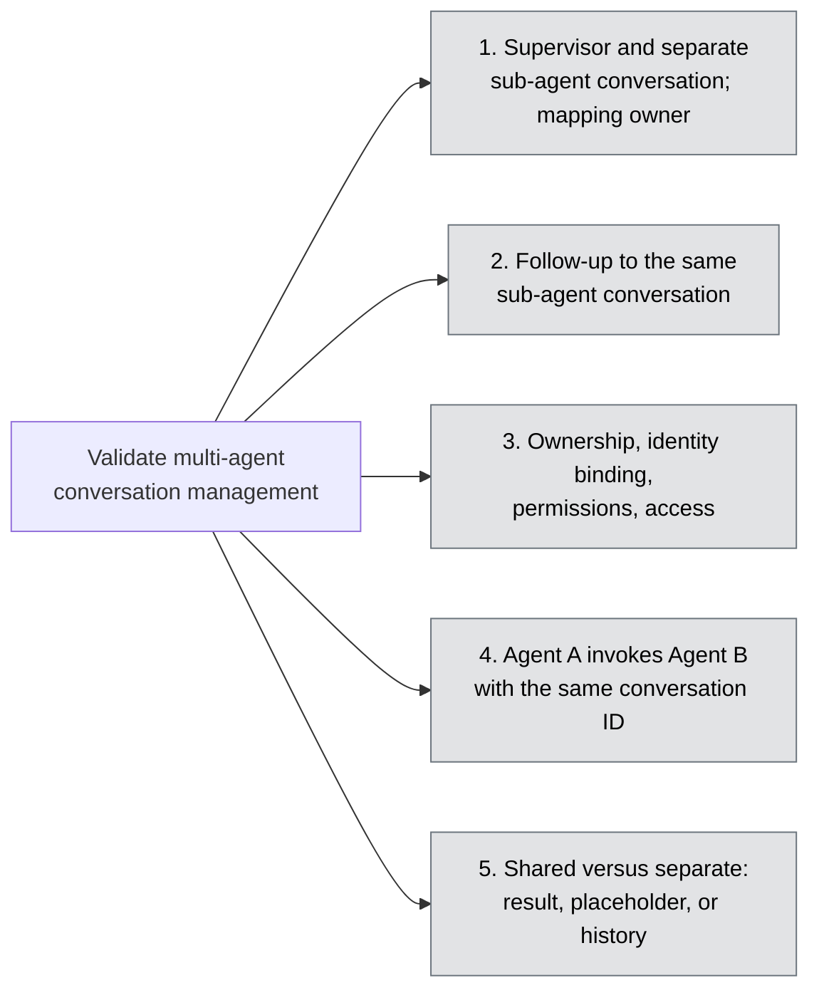

# Validate Multi-Agent Conversation Management (#3)

> **Disclaimer**
>
> This document is provided "as is" for general informational purposes and reflects a point-in-time reading of public Microsoft documentation. It is not official Microsoft guidance, a warranty, or a commitment.
>
> Azure features and GA/preview status are subject to change; verify capabilities against [Microsoft Learn](https://learn.microsoft.com/) before making any technical or purchasing decision, and treat those sources as authoritative if they conflict with this document. Service availability is governed solely by the applicable [SLAs for Microsoft Online Services](https://www.microsoft.com/licensing/docs/view/Service-Level-Agreements-SLA-for-Online-Services); nothing here constitutes an SLA or contractual commitment. No liability is accepted for any action taken, or not taken, based on this content.

Status report: what works, what doesn't and why, and what to do next, for
each requirement of issue #3 (Story 3 tasks in this repository).

| Field | Value |
|---|---|
| Report date | 2026-10-27 (implementation complete; hosted runs pending) |
| Environment to evaluate | `hosted-agents-poc-dev-001` (northcentralus, model `gpt-5-mini`) |
| Agents before Story 3 | `supervisor-agent` v3, `research-agent` v3, `data-analysis-agent` v4 |
| Agents when Story 3 ran | *To be recorded after **Agents: Story 3 - 1** (`prepare-if-missing` deploys a new Supervisor version only)* |
| Hosted agent configuration | Three separate hosted deployments of one image, each 0.5 vCPU / 1 GiB, 120 s session idle timeout ([azure.yaml](../azure.yaml)) |
| Protocol tested | Supervisor-only `POC_CONVERSE` ([conversations.py](../src/backend/app/services/conversations.py)): `separate` and `shared` patterns, plus a model-free `inspect`. The stateless Story 4 `POC_DELEGATE` path and the blocked `POC_WORKFLOW` path are unchanged |
| Evidence | Pending. Each task writes `artifacts\story-3\step-<NN>-<slug>\<run>\report.md` (local, sanitized). Summarize results here and in the dated [ADR-0001](adr/0001-hosted-agents-poc.md) entries (see [Evidence notes](#evidence-notes)) |

**Legend:** ✅ Works (tested on hosted agents) · ⚠️ Partial (works with
gaps, or documented but not tested) · ❌ Gap (not working or not
demonstrated) · ⏳ Not yet run (implemented; no hosted evidence yet)

## Status map

When a step runs, change its node class to `ok`, `partial`, or `gap`.

## Summary

| # | Requirement | Status | What works | What isn't working, and why | Next step |
|---|---|---|---|---|---|
| 1 | Supervisor conversation and a separate sub-agent conversation; who owns and stores the mapping | ⏳ | Implemented: the Supervisor creates the Research conversation and stores the mapping in its user-isolated Foundry state store | Not yet run on hosted agents | Run **Agents: Story 3 - 1** (`prepare-if-missing`) |
| 2 | Follow-up to the same sub-agent conversation; prior history independently available | ⏳ | Implemented. Related prior evidence: Research recalled earlier history in its own conversation (Story 4 Step 7) | Not yet run through the Supervisor mapping | Run **Agents: Story 3 - 2** |
| 3 | Ownership, user/principal binding, permissions, access enforcement; client-to-agent vs agent-to-agent; custom correlation | ⏳ | Implemented: 8 allowed/denied access cases, role readback, correlation check | Not yet run. Known risk: Research sees no user context on agent-to-agent calls (Story 4) | Run **Agents: Story 3 - 3** |
| 4 | Agent A invokes Agent B with the same conversation ID: can B read/append, does A later see B's messages | ⏳ | Implemented for `agent` and `call-context` identity, with a model-free history count | Not yet run. Not described in Microsoft documentation | Run **Agents: Story 3 - 4** |
| 5 | Shared vs separate IDs: does the Supervisor get the result, a placeholder, or full history | ⏳ | Implemented: four variants, classified from what the Supervisor conversation actually holds | Not yet run | Run **Agents: Story 3 - 5** |

---

## 1. Supervisor conversation and a separate sub-agent conversation - ⏳ Not yet run

**Question (AC1):** Demonstrate a supervisor conversation and a separate
sub-agent conversation. Identify who owns and stores their mapping.

**How it is tested** (**Agents: Story 3 - 1**, `step-01-separate-conversations`)

- The client creates conversation S on the Supervisor endpoint and sends
  `POC_CONVERSE` (`separate`).
- The Supervisor creates conversation C on Research's endpoint with its own
  agent identity. It writes the mapping S → C to its state store under a
  digest of S, then sends Research the plain message in C.
- A model-free `inspect` re-reads the mapping, lists C, and reads C's
  metadata (parent digest and correlation ID).

**Ownership by design (to be confirmed by the run)**

| Item | Created by | Stored in | Classification |
|---|---|---|---|
| Supervisor conversation S | Client (operator) | Foundry conversations | Foundry-managed |
| Sub-agent conversation C | Supervisor application, Supervisor agent identity | Foundry conversations | Foundry-managed storage; Custom implementation (creation) |
| Mapping S → C | Supervisor application | Foundry state store `hosted-agents-poc-supervisor-registry-v1`, the calling user's partition | Custom implementation (Dev Team) on Foundry-managed storage |
| Parent link on C | Supervisor application | Foundry conversation metadata | Custom implementation (Dev Team) on Foundry-managed storage |
| History hydration | SDK adapter (`context.get_history()`) | - | Agent Framework / SDK-managed |

**Documented:** Microsoft documents that the platform
[associates a session ID with each conversation](https://learn.microsoft.com/azure/foundry/agents/concepts/hosted-agents#sessions-conversations-and-the-state-store)
and that a state store
[can partition its items per end user](https://learn.microsoft.com/azure/foundry/agents/concepts/hosted-agents#sessions-conversations-and-the-state-store).
No parent/child relationship between agents' conversations is described.

**Results:** *To be added after the run.*

| Check | Result |
|---|---|
| Supervisor turn in the Supervisor conversation | ⏳ |
| Separate sub-agent conversation | ⏳ |
| Mapping owned and stored by the Supervisor | ⏳ |
| Mapping re-read from the state store | ⏳ |
| Parent link stored on the sub-agent conversation | ⏳ |

**Known risks**

- The mapping needs verified caller context at the Supervisor: user, call,
  and session IDs. Story 4 observed that the Supervisor sees the original
  user, so this is expected to work. If it doesn't, Step 1 fails with
  "Stateful commands require verified Foundry hosted caller/session context".
- Creating C and writing the mapping are two operations. A failure between
  them leaves an unmapped conversation; retries and cleanup are not
  implemented.

**Next steps:** run **Agents: Story 3 - 1** with `prepare-if-missing`, then
rerun **Agents: Story 1 - 1** and **Agents: Story 4 - 1** in `verify` mode to
refresh their baselines.

## 2. Follow-up to the same sub-agent conversation - ⏳ Not yet run

**Question (AC2):** Send a follow-up request to the same sub-agent
conversation and verify that its prior history is independently available.

**How it is tested** (**Agents: Story 3 - 2**, `step-02-follow-up-history`)

1. Turn 1 through the Supervisor: "remember this code word".
2. Turn 2 through the Supervisor: "what code word?". The forwarded message
   doesn't contain the code word. Turn 2 checks four things:
   - The Supervisor reuses the mapped conversation.
   - That conversation already holds turn 1 (item counts before and after).
   - Research answers with the code word.
   - The Supervisor's own hydrated history contains no Research turns.
3. Control: a new Supervisor conversation has no mapping.

**Related prior evidence**

| Observation | Source | Result |
|---|---|---|
| Client → Research directly, in Research's own conversation, recalls an earlier message | Story 4 Step 7, 2026-10-26 (Research v2) | Passed |
| Supervisor → Research continuity with explicit conversations (`POC_WORKFLOW` diagnostics) | ADR, 2026-10-21 (`hosted-agents-poc-dev`) | A-continuity passed; nested user isolation failed |

**Documented:** for the Responses protocol, history is
[hydrated automatically by the SDK adapter when `conversation.id` is present](https://learn.microsoft.com/azure/foundry/agents/concepts/hosted-agent-contract#responses-protocol).

**Results:** *To be added after the run.*

**Next steps:** run **Agents: Story 3 - 2**.

## 3. Ownership, identity binding, permissions, and access - ⏳ Not yet run

**Question (AC3):** Document conversation-ID ownership, authenticated
user/principal binding, required permissions, and access enforcement across
supervisor/sub-agent boundaries. Exercise representative allowed/denied
conversation access and distinguish client-to-agent from agent-to-agent
invocation; identify custom correlation required.

**How it is tested** (**Agents: Story 3 - 3**, `step-03-ownership-and-access`)

One paid turn creates a Supervisor-mapped Research conversation. Every
access case after it makes no model call:

| Case | Invocation | Expected | Enforced by | Result |
|---|---|---|---|---|
| Operator lists its Supervisor conversation | client-to-agent | Allowed | Foundry | ⏳ |
| Operator lists its Supervisor conversation through Research's endpoint | client-to-agent | Recorded (endpoint scope) | Foundry | ⏳ |
| Operator lists the Supervisor-created Research conversation | client-to-agent | Denied | Foundry | ⏳ |
| Supervisor lists it, `agent` identity | agent-to-agent | Allowed | Foundry | ⏳ |
| Supervisor lists it, `call-context` identity | agent-to-agent | Recorded (which principal Foundry binds) | Foundry | ⏳ |
| Client supplies an unmapped Research conversation ID | client-to-agent | Denied, no outbound call | Supervisor application | ⏳ |
| Another Supervisor conversation claims the Research conversation | client-to-agent | Denied | Supervisor application | ⏳ |
| `POC_CONVERSE` without a Supervisor conversation | client-to-agent | Rejected | Supervisor application | ⏳ |

The step also checks that the Supervisor sees the operator as the platform
user, using a salted fingerprint. It checks that the client's
`x-client-correlation-id` reached the Supervisor and was recorded in the
mapping, and reads the role assignments of the operator, the Supervisor,
and Research.

**Custom correlation required (by design)**

| Link | Native in Foundry? | Implemented by |
|---|---|---|
| Supervisor conversation → sub-agent conversation | No | Supervisor mapping in the state store |
| Sub-agent conversation → Supervisor conversation | No (metadata is free-form) | Conversation metadata written by the Supervisor |
| Client request → every hop | Only `x-client-*` header forwarding | `x-client-correlation-id` |
| Original user → sub-agent | Not observed on the agent-to-agent path (Story 4) | Not implemented |

**Documented:** Microsoft states that
[one user can't read or list another user's conversations](https://learn.microsoft.com/azure/foundry/agents/how-to/isolate-sessions-per-user#understand-per-user-isolation).
What that means when the "user" is an agent identity is what this step
tests.

**Related prior evidence**

- Two genuine Entra users calling Research directly were isolated:
  continuing the other user's response chain got 404 and using the other
  user's session got 403. This was 22/22 assertions, on Research 6 in
  `hosted-agents-poc-dev`, 2026-10-21.
- On the agent-to-agent path, Research saw **no user context** in `agent`,
  `call-context`, or `delegated-user` mode (Story 4, Steps 4 and 5). The
  sub-agent conversation is therefore expected to be bound to the
  Supervisor's identity, not the end user.

**Results:** *To be added after the run.*

**Known gaps**

- No second Entra user in this step; cross-user denial relies on the
  native-user isolation evidence above.
- `delegated-user` (`x-ms-user-identity`) conversation ownership is not
  tested. Story 4 recorded that the header neither took effect nor was
  rejected on the hosted-agent path.
- Required roles are read from assignments, not checked per call.

**Next steps:** run **Agents: Story 3 - 3**.

## 4. Agent A invokes Agent B with the same conversation ID - ⏳ Not yet run

**Question (AC4):** Evaluate Agent A invoking Agent B through the Responses
API with the same conversation ID. Record whether B can read and append
history and whether a later A invocation sees B's messages.

**How it is tested** (**Agents: Story 3 - 4**, `step-04-shared-conversation-id`)

1. The client seeds A's (Supervisor's) conversation S with a code word.
2. For `agent` and then `call-context` identity, A calls B (Research) with
   `conversation = S`, delivering only a placeholder. Any B content later
   found in S was therefore written by B's own turn.
3. A model-free Supervisor `inspect` counts what A now hydrates.
4. Control: the client calls Research directly with S. This uses the same
   principal, so it separates endpoint scope from principal ownership.

**Results:** *To be added after the run.*

| Identity | B call outcome | B read A's history | B's input appended to A | B's output appended to A | A later sees B's messages |
|---|---|---|---|---|---|
| `agent` | ⏳ | ⏳ | ⏳ | ⏳ | ⏳ |
| `call-context` | ⏳ | ⏳ | ⏳ | ⏳ | ⏳ |
| Control: client → Research with S | ⏳ | ⏳ | - | - | - |

**What to expect**

- This criterion is an evaluation, so a denial is a valid answer.
- S is owned by the operator. A call from the Supervisor's own identity may
  be denied, given that conversations are private per caller.
- A concurrent in-progress Supervisor response on S may also produce a
  conflict. Locking and steering are covered by #7.

**Next steps:** run **Agents: Story 3 - 4**.

## 5. Shared versus separate conversation IDs - ⏳ Not yet run

**Question (AC5):** Compare shared and separate conversation IDs. Record
whether the supervisor receives the sub-agent's result, a placeholder, or
full history.

**How it is tested** (**Agents: Story 3 - 5**, `step-05-shared-vs-separate`)

- Four variants run, each in a new Supervisor conversation and each
  followed by a model-free `inspect`.
- The classification comes from what the Supervisor conversation actually
  holds, not from the requested delivery mode:
  - `result`: the sub-agent's token is in a Supervisor reply.
  - `placeholder`: it isn't.
  - `full history`: the sub-agent's own input and output items are in the
    Supervisor conversation.

**Results:** *To be added after the run.*

| Variant | Sub-agent call | Supervisor ends up with | Sub-agent history lives in |
|---|---|---|---|
| separate / result / `agent` | ⏳ | ⏳ (expected: result) | ⏳ |
| separate / placeholder / `agent` | ⏳ | ⏳ (expected: placeholder) | ⏳ |
| shared / placeholder / `agent` | ⏳ | ⏳ | ⏳ |
| shared / placeholder / `call-context` | ⏳ | ⏳ | ⏳ |

**By design:** in the separate pattern, whether the Supervisor keeps the
result or only a reference is an application choice (Custom
implementation). Foundry stores whatever the Supervisor's reply contains.

**Next steps:** run **Agents: Story 3 - 5**.

---

## Capability classification

Mark each row Tested, Documented, or Unverified as evidence arrives. Untested
does not mean unsupported.

| Capability | Classification | Basis |
|---|---|---|
| Durable per-agent conversation history | Foundry-managed | Documented; Story 4 Step 7 tested on Research |
| History hydration from the request's conversation ID | Agent Framework / SDK-managed | Documented |
| Supervisor → sub-agent conversation mapping | Custom implementation (Dev Team) | Implemented; ⏳ Step 1 |
| Mapping storage, per-user partition | Foundry-managed (state store, preview) | Documented; ⏳ Step 1 |
| Reuse of the mapped sub-agent conversation | Custom implementation (Dev Team) | Implemented; ⏳ Step 2 |
| Conversation access enforcement between principals | Foundry-managed | Documented; ⏳ Step 3 |
| Mapping-based denial of unmapped conversations | Custom implementation (Dev Team) | Implemented; ⏳ Step 3 |
| Cross-agent correlation | Custom implementation (Dev Team) | Implemented; ⏳ Step 3 |
| Native parent/child links between agents' conversations | Not supported | No Microsoft documentation describes one |
| One conversation shared by several hosted agents | Unverified | ⏳ Step 4 |

## Prioritized next steps

| Priority | Action | Closes | Effort / cost |
|---|---|---|---|
| 1 | **Agents: Story 3 - 1** with `prepare-if-missing` (deploys the Supervisor only), then `verify` | 1 | Deployment; paid hosted requests |
| 2 | Rerun **Agents: Story 1 - 1** and **Agents: Story 4 - 1** in `verify` mode to refresh their baselines | - | Paid hosted requests |
| 3 | **Agents: Story 3 - 2** to **Story 3 - 5** | 2, 3, 4, 5 | Paid hosted requests; no deployment |
| 4 | Fill in this report and add a dated Story 3 results entry to the ADR (environment, versions, date) | All | Documentation |
| 5 | Add the open questions below to the Microsoft support case opened for Story 4 | 3, 4 | Support case |

## Questions for Microsoft

1. Is there a supported way to link one hosted agent's conversation to
   another's (a parent/child relationship), or must the application own that
   mapping?
2. Who owns a conversation that a hosted agent creates on another agent's
   endpoint: the calling agent's identity, or the original end user when
   `x-agent-foundry-call-id` is forwarded?
3. Is a conversation scoped to the agent endpoint that created it, or to the
   project?
4. Is calling a second hosted agent with the first agent's conversation ID a
   supported pattern? If it is, how are concurrent responses on that
   conversation handled?

## Evidence notes

Per [ADR-0001](adr/0001-hosted-agents-poc.md#recovery-and-validation),
generated run reports stay local and sanitized, and this report must not
depend on them. When a step runs, record here the verdict, the date, the
environment, and the agent versions. Also add a dated Story 3 entry to the
ADR.

| Source | Date | What it records |
|---|---|---|
| ADR "Story 3 conversation management, implementation" | 2026-10-27 | Design of `POC_CONVERSE`; hosted runs pending |
| ADR "Story 4 representative patterns" | 2026-10-26 | Direct client → Research conversation continuity passed; Research sees no user context in any identity mode |
| ADR "Genuine native-Entra-user Research control" | 2026-10-21 | Direct two-user isolation passed (22/22) on Research 6, `hosted-agents-poc-dev` |
| ADR nested delegated-label entries | 2026-10-21 | Supervisor → Research with explicit conversations: A-continuity passed, nested user isolation failed |

### Run log

| Date | Step | Verdict | Environment | Agent versions (S / R / DA) | Notes |
|---|---|---|---|---|---|
| | | | | | |

Task procedures:
[Detailed task guide - Story 3](tasks-detailed.md#agents-story-3---1-demonstrate-separate-conversations).
Implementation: [story3_conversations.py](../scripts/run_scenario/story3_conversations.py),
[conversations.py](../src/backend/app/services/conversations.py).
