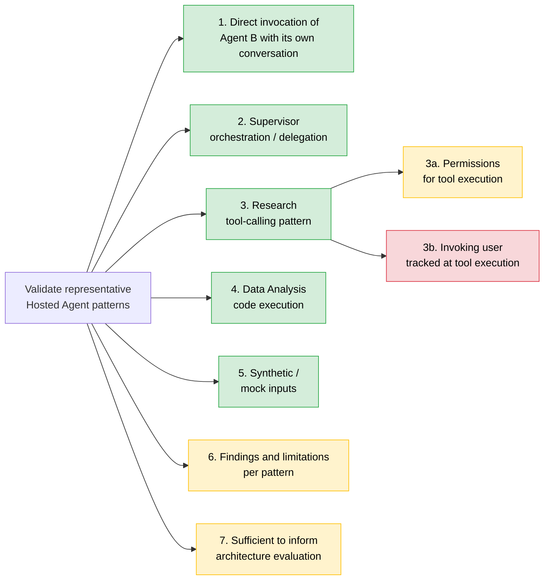

# Validate Representative Hosted Agent Patterns (#4)

> **Disclaimer**
>
> This document is provided "as is" for general informational purposes and reflects a point-in-time reading of public Microsoft documentation. It is not official Microsoft guidance, a warranty, or a commitment.
>
> Azure features and GA/preview status are subject to change; verify capabilities against [Microsoft Learn](https://learn.microsoft.com/) before making any technical or purchasing decision, and treat those sources as authoritative if they conflict with this document. Service availability is governed solely by the applicable [SLAs for Microsoft Online Services](https://www.microsoft.com/licensing/docs/view/Service-Level-Agreements-SLA-for-Online-Services); nothing here constitutes an SLA or contractual commitment. No liability is accepted for any action taken, or not taken, based on this content.

Status report: what works, what doesn't and why, and what to do next, for
each requirement of issue #4 (Story 4 tasks in this repository).

**Detailed HTML evidence report (2026-10-28):**
[View with HTML Preview](https://htmlpreview.github.io/?https://github.com/wxifaras/hosted-agents-poc/blob/feature/hosted-agents-enhancements/docs/reports/story-4/hosted-agent-patterns/2026-10-28/index.html).
The preview becomes available after this snapshot is committed and pushed to
`feature/hosted-agents-enhancements`. It covers six current-version runs and
50 recorded checks, with per-task flow diagrams. Code-defined flows are not
execution traces; identity-mode success is not user-delegation proof, and native
Supervisor analysis remains pending. The dated historical findings below are
retained separately and are not rewritten by this snapshot.

| Field | Value |
|---|---|
| Report date | 2026-10-26 (accuracy review 2026-10-27) |
| Environment evaluated | `hosted-agents-poc-dev-001` (northcentralus, model `gpt-5-mini`) |
| Earlier identity experiments | `hosted-agents-poc-dev`, 2026-10-21 (Supervisors 7-11, Research 6). Used for the nested-isolation, egress-audit, and two-user results, which are marked where cited |
| Agents when Story 4 ran | `supervisor-agent` v2, `research-agent` v2, `data-analysis-agent` v3 ([ADR-0001](adr/0001-hosted-agents-poc.md#planned-delegation-tests), 2026-10-26 entry) |
| Agents now | `supervisor-agent` v3, `research-agent` v3, `data-analysis-agent` v4 (Story 1 baseline, 2026-10-26 17:22 UTC) |
| Hosted agent configuration | Three separate hosted deployments of one image, each 0.5 vCPU / 1 GiB, 120 s session idle timeout ([azure.yaml](../azure.yaml)) |
| Delegation protocol tested | Stateless `POC_DELEGATE` / `POC_SUBTASK` ([orchestration.py](../src/backend/app/services/orchestration.py)). The stateful `POC_WORKFLOW` path is reported separately |
| Evidence | Summarized from the dated [ADR-0001](adr/0001-hosted-agents-poc.md) Story 4 and identity-experiment entries. Run reports stay local by design and aren't available for these runs (see [Evidence notes](#evidence-notes)) |

**Legend:** ✅ Works (tested on hosted agents) · ⚠️ Partial (works with
gaps, or documented but not tested) · ❌ Gap (not working or not
demonstrated)

## Status map

## Summary

| # | Requirement | Status | What works | What isn't working, and why | Next step |
|---|---|---|---|---|---|
| 1 | Client invokes Agent B directly through the Responses API with its own conversation | ✅ | Research answered on its own endpoint in its own conversation, recalled the earlier message in it, and the Supervisor wasn't called (Step 7, Met) | Direct calls bypass the Supervisor's allow-list and correlation. Any principal with an invoke-capable project role can call Research | Design RBAC if sub-agents must be callable only by the Supervisor |
| 2 | Supervisor demonstrates orchestration/delegation | ✅ | Supervisor model picks Research or Data Analysis; sync and background calls; sub-agent failures surfaced, not retried | The stateful multi-step `POC_WORKFLOW` path is blocked by the nested caller guard | Re-verify on current versions. Resolve the nested identity issue |
| 3 | Research demonstrates a representative tool-calling pattern | ✅ | Research called `microsoft_docs_search` through a Foundry toolbox (MCP) and cited Learn URLs | The MCP server is public and unauthenticated, so no authenticated or user-delegated tool call was tested | Add an authenticated MCP tool |
| 3a | Tracking permissions for tool execution | ⚠️ | Caller, target, required role, and trust boundary documented for each hop. Toolbox `allowed_tools` and the Supervisor allow-list both enforced | Required roles are documented, not checked per call. `x-ms-user-identity` without impersonation permission was accepted, not rejected with 403 | Reproduce the impersonation discrepancy for Microsoft support |
| 3b | Tracking the user who invoked the tool | ❌ | Supervisor sees the original user. A client correlation ID reaches every hop | Research saw **no user context** in all three identity modes. Tool calls run as Research's agent identity | Pick the identity model. Test OBO/OAuth passthrough or A2A with an authenticated tool |
| 4 | Data Analysis demonstrates code execution | ✅ | Code Interpreter analysis through the Supervisor, with outputs checked against a local calculation (Story 4 Step 6, Met) | Depends on Story 1 Step 2, which has no valid run on current versions | Rerun Story 1 Step 2, then Story 4 Step 6 |
| 5 | Synthetic/mock inputs and data | ✅ | Seeded synthetic CSVs, synthetic run tokens and markers, public Microsoft Learn queries | - | None |
| 6 | Findings and limitations per pattern | ⚠️ | Findings are summarized in the ADR, and each step's report is designed to include its own findings table | Agents were redeployed after the runs, so the findings aren't confirmed on the current versions | Rerun Story 4 Steps 1-7; record results in the ADR |
| 7 | Sufficient to inform the architecture evaluation | ⚠️ | Covers orchestration, sync/async, tool calling, code execution, identity paths, and direct invocation, using mock agents from one image | No identity architecture selected. Nested user isolation failed. A2A and authenticated tools not tested | Decide the identity model; run an A2A experiment |

---

## 1. Direct agent invocation without Agent A - ✅ Works

**Question (direct agent invocation):** Can a client directly invoke
Hosted Agent B (Research) through the Responses API, without going through
Agent A (Supervisor), using a separate conversation ID and receive a
response?

**Answer: yes.** Step 7 (AC7) was Met:

| Check | Result |
|---|---|
| Separate conversation IDs | Conversation A was created on the Supervisor's endpoint (no model call). Conversation B was created on Research's endpoint. The two are different |
| Direct response from Research | Research returned a completed Responses API reply without the Supervisor |
| Conversation continuity on Research | In conversation B, Research recalled the code word from the earlier message |
| Supervisor not invoked | Every model request in the step targeted Research only |

Separately, in the earlier `hosted-agents-poc-dev` environment (Research 6,
2026-10-21), two real Entra users calling Research directly were isolated
from each other (22/22 assertions passed):

- B's attempt to continue A's response chain got 404 `not_found`.
- B's attempt using A's session ID got 403 `session_not_accessible`.

**What isn't working and why**

- **Direct calls bypass the Supervisor.** The Supervisor's routing,
  allow-list, and correlation don't apply. Access is governed only by
  Foundry RBAC on Research, so any principal with an invoke-capable role on
  the project can call it (for example Foundry User; the two-user test used
  project-scoped Foundry Agent Consumer grants).
- **Not tested:** using a conversation created on one agent's endpoint on
  another agent's endpoint.

**Next steps**

1. If sub-agents must accept calls only from the Supervisor, design RBAC
   for that and test it. Whether invoke permissions can be scoped to one
   agent within a project isn't confirmed here (see Question 5).
2. Optionally test conversation reuse across agent endpoints.

## 2. Supervisor demonstrates orchestration/delegation - ✅ Works

**How it works**

- The client sends `POC_DELEGATE` to the Supervisor with `target: auto` or
  an allow-listed target. With `auto`, the Supervisor's model chooses by
  calling one of two agent-framework function tools:
  `delegate_to_research` or `delegate_to_data_analysis`.
- Supervisor code (not the model) then calls the chosen specialist's own
  Responses endpoint with `POC_SUBTASK`. The specialist returns a
  `poc-subtask-v1` report, and the Supervisor returns a `poc-delegation-v1`
  report to the user.
- Calls are either synchronous, or Responses background mode
  (`background=True, store=True`) polled with `responses.retrieve`.
- Unlisted targets are denied by the Supervisor's allow-list before any
  outbound call.

**What works (ADR, 2026-10-26)**

| Observation | Result |
|---|---|
| Model routing to Research and to Data Analysis; result delivered to Supervisor and user (Step 1, AC1) | Passed (both cases), Met |
| Sync and background delegation; simulated sub-agent failure surfaced, not retried (Step 2, AC2) | Passed; background polled `in_progress` → `completed`/`failed`. Met |
| Unlisted target `billing-agent` denied by the allow-list | Passed |

**What isn't working and why**

- **The stateful workflow is blocked.** `POC_WORKFLOW` calls Research and
  then Data Analysis, persisting state and history across turns. It stops at
  the nested caller guard: on the Supervisor → Research hop, the request
  carries no visible platform user ID. The guard is intentionally kept. See
  [ADR-0001: Authorization contract](adr/0001-hosted-agents-poc.md#authorization-contract-and-proposed-alignment).
- **Nested user isolation failed.** Diagnostic runs (Supervisors 7-11, in
  `hosted-agents-poc-dev`, 2026-10-21) used
  synthetic delegated labels. Delegated user B could read A's State Store
  marker and continue A's response history. The root cause is unknown.
- **Client-initiated background delegation is rejected.** A client
  background `POC_DELEGATE` is refused by the Supervisor (an application
  restriction). Background mode works only from the Supervisor to the
  specialist.

**Next steps**

1. Rerun **Agents: Story 4 - 1** (`verify`) and **Story 4 - 2** on the
   current versions (Supervisor 3, Research 3, Data Analysis 4). Step 1
   writes the Story 4 baseline that Steps 2-7 require.
2. Send Microsoft support a minimal reproduction of the nested-identity
   behavior, or run an approved A2A or toolbox-connection experiment (ADR
   next increment 1).

## 3. Research demonstrates a representative tool-calling pattern - ✅ Works

**How it works**

- Research has the Foundry toolbox `story4-research-mcp`. It exposes one
  tool, `microsoft_docs_search`, from the public Microsoft Learn MCP server
  (`allowed_tools: [microsoft_docs_search]`, `require_approval: never`).
- Research uses the toolbox only when its `TOOLBOX_ENDPOINT` setting is
  configured ([runtime.py](../src/backend/app/runtime.py)).
- Request path: user → Supervisor → Research → toolbox → Microsoft Learn
  MCP.

**What works (Step 3, AC3, Met)**

- The operator probed the toolbox directly: `tools/list` listed the tool,
  and a search returned `learn.microsoft.com` results.
- On the hosted path, Research called `microsoft_docs_search` successfully,
  cited a Learn URL, and the Supervisor delivered the answer with the run
  token.
- `allowed_tools` blocked the unlisted `microsoft_docs_fetch` tool (Step 5).

**What isn't working and why**

- The MCP server is public and unauthenticated. Calls with a key, an agent
  identity, or OAuth passthrough were not configured.
- Tool output is untrusted input to the model. No content filtering was
  added beyond the platform's.

**Next steps:** add an authenticated MCP or OpenAPI tool, for example one
that uses the agent identity or OAuth identity passthrough, so 3a and 3b
can be tested against a resource that enforces permissions.

### 3a. Tracking permissions for tool execution - ⚠️ Partial

**What works: the trust model is documented for each hop (Step 3)**

| Call type | Caller | Target | Required permissions | Trust boundary |
|---|---|---|---|---|
| Agent-to-agent | Supervisor container (its managed identity) | Research agent endpoint (Responses) | Entra token for `https://ai.azure.com`. Supervisor needs Foundry User. `x-ms-user-identity` also needs `UserIdentityImpersonation` | Foundry authenticates the Supervisor, not the end user. `x-agent-foundry-call-id` can forward the original call context |
| Agent-to-service | Research container (its agent identity via `FoundryToolbox`) | Foundry toolbox MCP endpoint | Entra token for `https://ai.azure.com`. Research needs Foundry User | `FoundryToolbox` forwards `x-agent-foundry-call-id`; whether Foundry uses it for authorization isn't visible to the client |
| MCP tool call | Foundry toolbox service, on behalf of Research | Public Microsoft Learn MCP server | None (public). `allowed_tools` limits which tools can be called | Foundry → public internet. Results are untrusted model input |

**Enforcement points tested (Step 5, AC5)**

| Case | Enforcing component | Result |
|---|---|---|
| Allowed traced request | Foundry agent endpoint and toolbox (Entra + RBAC) | Allowed |
| Unlisted target `billing-agent` | Supervisor allow-list (no outbound call) | Denied |
| `microsoft_docs_fetch` on the toolbox | Toolbox `allowed_tools` | Denied |
| `x-ms-user-identity` without impersonation permission | Foundry agent endpoint (documented: HTTP 403) | **Accepted (HTTP 200), reproduced twice** |
| User B reads user A's state/history | Foundry | From the 2026-10-21 experiments in `hosted-agents-poc-dev`, not Step 5. Direct native-Entra users: denied (22/22 assertions passed). Nested delegated labels: **not denied** |

**What isn't working and why**

- **Impersonation not enforced.** The Supervisor holds only Foundry User,
  yet `x-ms-user-identity` was accepted instead of rejected with the 403
  that Microsoft
  [documents](https://learn.microsoft.com/azure/foundry/agents/how-to/isolate-sessions-per-user)
  for callers without the `UserIdentityImpersonation` data action (which
  no built-in role includes). On the hosted-agent path, the header neither
  takes effect nor is rejected, so neither behavior can be relied on.
- **No per-call permission record.** Required roles are documented and
  read once (Step 4 checks for the `UserIdentityImpersonation` action), but
  nothing records which permissions were evaluated for each tool call.
- **User permissions at the toolbox can't be observed.** Microsoft
  documents that the platform resolves the caller's identity from the
  forwarded call ID, but whether the original user's permissions apply at
  the toolbox can't be seen with a public, unauthenticated MCP server.

**Next steps**

1. Send Microsoft support a reproduction of the impersonation discrepancy.
2. Once an authenticated tool exists, confirm which identity's permissions
   the target enforces, using Azure resource logs or the tool's own audit.

### 3b. Tracking the user who invoked the tool - ❌ Gap

**What works**

- The Supervisor sees the original user: a salted fingerprint of the
  caller matched the operator's identity.
- A client-generated correlation ID is sent in the body and in the
  `x-client-correlation-id` header, which the platform forwards. It
  reached every hop (Step 5).
- Identities never appear in evidence. Each hop reports presence flags and
  `sha256(correlation-id | identity)` fingerprints, compared in memory.

**What isn't working and why**

- **Research sees no user context** in any of the three identity modes:
  `agent`, `call-context` (`x-agent-foundry-call-id`), or `delegated-user`
  (`x-ms-user-identity`). The downstream hop authenticated only the
  Supervisor's agent identity, not the end user. This differs from the
  [runtime contract](https://learn.microsoft.com/azure/foundry/agents/concepts/hosted-agent-contract#platform-request-headers-container-protocol-200),
  which says that forwarding `x-agent-foundry-call-id` unchanged to other
  agents lets the platform resolve the original caller's identity.
- **Tool calls run as Research's agent identity**, so the end user isn't
  recorded at the tool.
- **The cause is not known.** An egress audit of 12 Supervisor → Research
  requests (Supervisor 9, `hosted-agents-poc-dev`, 2026-10-21) confirmed
  the correct endpoint, headers, and Supervisor principal. The difference
  happens after the application's HTTP layer (platform proxy, gateway, or
  runtime). In the same environment, the direct control (operator →
  Research with a delegated label, under a temporary approved impersonation
  grant) did show the user, and two real Entra users calling Research
  directly were isolated.
- **Partial trace export.** Only Data Analysis exports telemetry to
  Application Insights. W3C trace context across hops is not verified.

**Next steps**

1. Choose the target identity model. The candidates are listed in
   [ADR-0001: Identity mechanisms](adr/0001-hosted-agents-poc.md#identity-mechanisms-are-not-interchangeable):
   agent identity plus an audit trail, forwarded call context,
   `x-ms-user-identity`, or OAuth/OBO.
2. Run an approved experiment with the official A2A or toolbox connection
   pattern and its documented authentication mode.
3. Enable telemetry export on the Supervisor and Research, and verify
   end-to-end trace correlation in Foundry or Application Insights.

## 4. Data Analysis demonstrates code execution - ✅ Works

**What works**

- **Story 4 Step 6 (AC6, Met per ADR).** The Story 1 analysis request was
  sent through the Supervisor (`target: data_analysis`). The SHA-256, the
  filtered rows, and the aggregates matched the local calculation, and the
  three output files were downloaded and validated.
- **Story 1 runs on the current versions.** In `hosted-agents-poc-dev-001`,
  Code Interpreter (Step 1), the 1k/10k/100k analysis (Step 3), and the
  sandbox boundaries (Step 4) are all Met. See
  [Validate Hosted Agent Memory and Data Analysis Capacity (#1)](issue-1-validate-hosted-agent-memory-and-data-analysis-capacity.md).

**What isn't working and why**

- Step 6 links to Story 1 evidence and reports `BLOCKED` unless Story 1
  Steps 1 and 2 are Met. Story 1 Step 2 has no valid run on the current
  versions.
- Limits documented in Story 1 also apply here:
  - Sandbox memory is fixed at 2 GiB.
  - No network egress from the sandbox.
  - No per-user isolation of sandbox files.

**Next steps:** rerun Story 1 Step 2, then **Agents: Story 4 - 6**.

## 5. Synthetic/mock inputs and data - ✅ Works

**What works**

| Agent | Inputs |
|---|---|
| Supervisor | Synthetic tasks with run-unique tokens, plus a fixed calculation whose answer must contain `2870` |
| Research | Public Microsoft Learn queries. No customer data |
| Data Analysis | Seeded synthetic sales CSVs ([synthetic_data.py](../scripts/common/synthetic_data.py)) |
| Identity and isolation tests | Synthetic State Store markers with a one-hour TTL, run-scoped synthetic user labels, and salted identity fingerprints |

All three agents are mock role agents built from one image
([Dockerfile](../src/backend/Dockerfile)). The `POC_AGENT_NAME` setting
selects the role's instructions and behavior.

**What isn't working:** nothing for this requirement.

**Next steps:** none.

## 6. Findings and limitations per pattern - ⚠️ Partial

**What's documented (ADR, 2026-10-26)**

| Pattern | Key finding or limitation |
|---|---|
| Orchestration | Model-routed delegation works. Supervisor code, not the model, makes the call. Background delegation is polled with `responses.retrieve`. Failures surface as `sub_agent_failed`, not retried. Stateful workflow blocked by the nested caller guard |
| Tool calling | Toolbox MCP calls work, and `allowed_tools` is enforced. The public MCP server means no authenticated tool path |
| Identity | Supervisor sees the user; Research doesn't in any mode. `x-ms-user-identity` accepted without impersonation permission (documented as 403). Nested delegated-label isolation **failed**. Direct native-Entra-user isolation **passed** |
| Code execution | Works through the Supervisor. Story 1 sandbox limits apply |
| Direct invocation | Works. Bypasses Supervisor policy; access is governed only by Foundry RBAC on the sub-agent |

Each Story 4 step report is designed to include a findings table with
outcome, evidence type, ownership, and Microsoft documentation links.

**What isn't working and why**

- **Versions changed.** The agents were redeployed after the Story 4 runs
  (v2/v2/v3 → v3/v3/v4), so the findings aren't confirmed on the current
  versions.
- **No local reports for these runs.** Run reports stay local by design
  (ADR-0001), and none exist on this machine for the Story 4 runs. Only the
  ADR's summary remains.

**Next steps**

1. Rerun **Agents: Story 4 - 1** (`verify`) through **Story 4 - 7** on the
   current versions.
2. Record the summarized results, with environment, agent versions, and
   date, in the
   [ADR snapshot](adr/0001-hosted-agents-poc.md#implementation-and-evidence-snapshot).

## 7. Sufficient to inform the architecture evaluation - ⚠️ Partial

**What works**

- The scope is deliberately representative. One image provides three
  minimal role agents, with synthetic inputs and no production logic.
- It still covers the decisions an architecture review needs: delegation
  mechanism, sync vs async, failure handling, tool calling through
  toolboxes, managed code execution, the identity options, and direct
  sub-agent access.
- For each component, it records who controls delegation, who enforces
  each check (Foundry, toolbox, or application), and which behavior is
  Foundry-managed vs custom. That is the information needed to compare
  options.

**What isn't working and why**

- **No identity architecture is selected** (Step 4 records available and
  unavailable paths only). End-to-end user propagation is the main open
  architecture question.
- **Not tested:**
  - A2A as the agent-to-agent protocol.
  - Authenticated or user-delegated tools.
  - Recovery after process loss.
  - Two-user isolation on the stateless `POC_DELEGATE` path.
  - Telemetry correlation across all agents.
- **Out of scope by design:** production networking (private endpoints),
  scale, and load. This is consistent with not reproducing the production
  agents.

**Next steps**

1. Record an identity decision, or a decision to wait for Microsoft's
   answer, in the ADR.
2. Run an A2A experiment and a two-user test on `POC_DELEGATE`.
3. Summarize architecture recommendations from Stories 1 and 4 in one
   decision memo.

---

## Prioritized next steps

| Priority | Action | Closes | Effort / cost |
|---|---|---|---|
| 1 | Rerun **Story 4 - 1** (`verify`) to write the Story 4 baseline on current versions, then **Story 4 - 2, 3, 4, 5, 7** | 1, 2, 3, 3a, 6 | Paid hosted requests; no deployment |
| 2 | Rerun Story 1 Step 2, then **Story 4 - 6** | 4, 6 | Paid hosted requests |
| 3 | Record rerun results in the ADR snapshot (environment, versions, date) | 6 | Documentation |
| 4 | Send Microsoft support a minimal reproduction of: no nested user context, and `x-ms-user-identity` accepted without impersonation | 2, 3a, 3b | Support case |
| 5 | Choose the target identity model and record it in the ADR | 3b, 7 | Design decision |
| 6 | Add an authenticated tool (agent identity or OAuth passthrough) to Research and check which identity the target enforces | 3, 3a, 3b | New tool/connection |
| 7 | Approved A2A or toolbox-connection experiment for agent-to-agent identity | 2, 3b, 7 | Deployment; owner approval |
| 8 | Telemetry export on Supervisor and Research; verify cross-hop trace correlation | 3b | Deployment; role grant |
| 9 | RBAC design if sub-agents must be callable only by the Supervisor | 1 | Design and role changes |
| 10 | Two-user isolation test on the stateless `POC_DELEGATE` path | 7 | Paid hosted requests; two Entra users |

## Questions for Microsoft

1. Why does a hosted agent's call to another hosted agent arrive without a
   visible platform user ID, in `call-context` and `delegated-user` modes,
   when the runtime contract says the forwarded `x-agent-foundry-call-id`
   lets the platform resolve the caller's identity?
2. Why is `x-ms-user-identity` from a principal without
   `UserIdentityImpersonation` accepted (HTTP 200) instead of the
   documented 403?
3. On the nested hosted-agent path, why could a delegated user B read user
   A's State Store items and continue A's response history?
4. What is the supported pattern for passing the end user's identity from
   one hosted agent to another, and on to a tool (A2A, toolbox connection,
   or OBO)?
5. Can a hosted agent be restricted so that only a specific caller (the
   Supervisor's identity) can invoke it?

## Evidence notes

Per [ADR-0001](adr/0001-hosted-agents-poc.md#recovery-and-validation),
generated run reports stay local and sanitized, and this report doesn't
depend on them. No local reports exist for the Story 4 runs, so the status
above relies on the dated ADR entries:

| Source | Date | What it records |
|---|---|---|
| ADR "Story 4 representative patterns" | 2026-10-26 | AC1, AC2, AC3, AC6, AC7 Met; AC4 and AC5 Partially met (Supervisor 2, Research 2, Data Analysis 3) |
| ADR "Step-2/3 hosted findings", "Direct-control follow-up", "Hosted egress audit", "final-A", and "history-only" entries | 2026-10-21 | Nested delegated-label isolation failures (Supervisors 7-11, `hosted-agents-poc-dev`) |
| ADR "Genuine native-Entra-user Research control" | 2026-10-21 | Direct two-user isolation passed (22/22) on Research 6, `hosted-agents-poc-dev` |

Task procedures:
[Detailed task guide - Story 4](tasks-detailed.md#agents-story-4---1-demonstrate-supervisor-delegation).
Implementation: [story4_agent_patterns.py](../scripts/run_scenario/story4_agent_patterns.py),
[story4_identity.py](../scripts/run_scenario/story4_identity.py),
[orchestration.py](../src/backend/app/services/orchestration.py).
