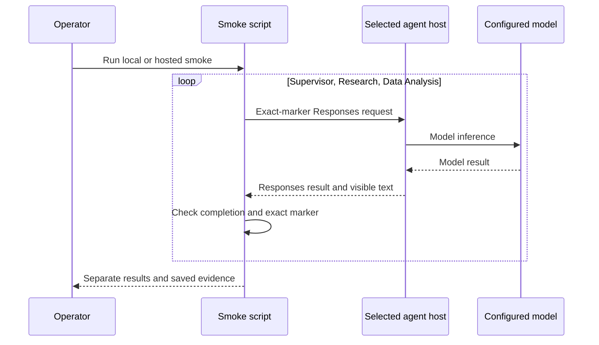
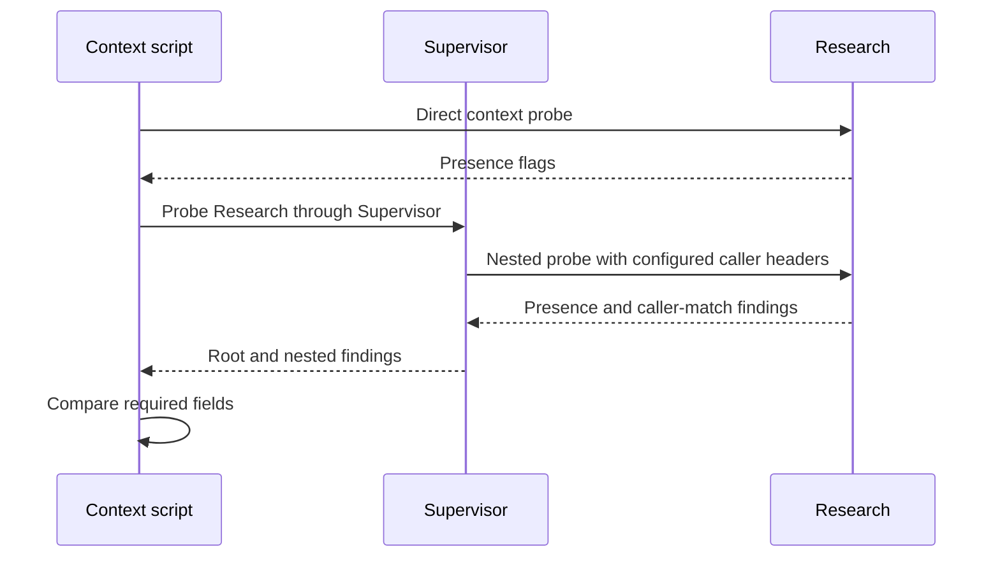
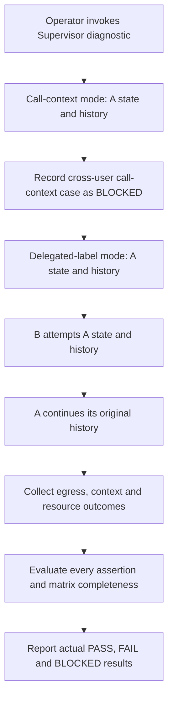
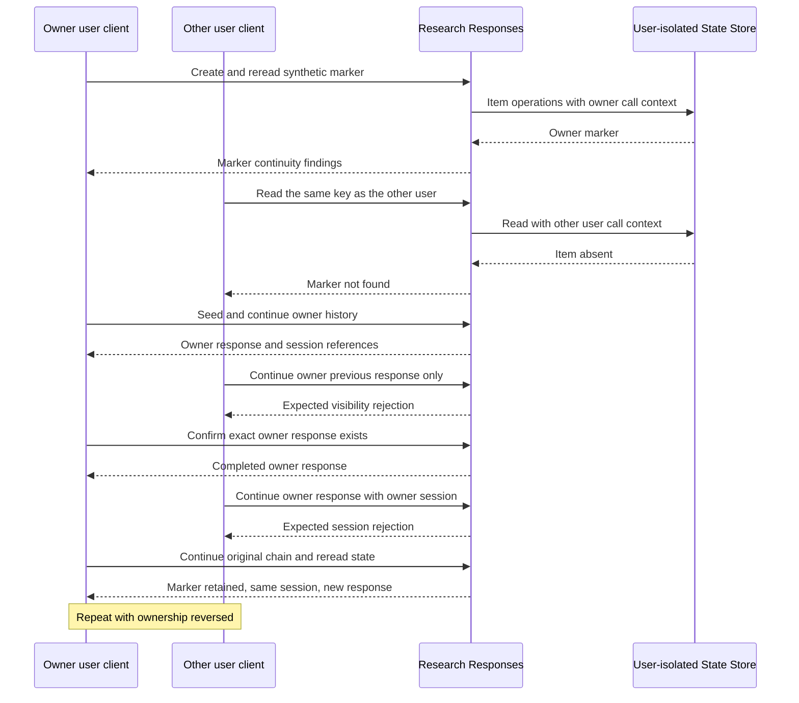
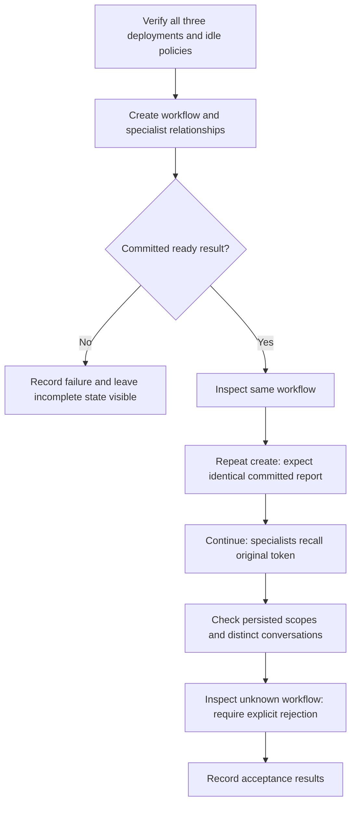
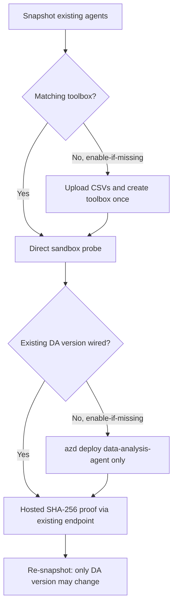
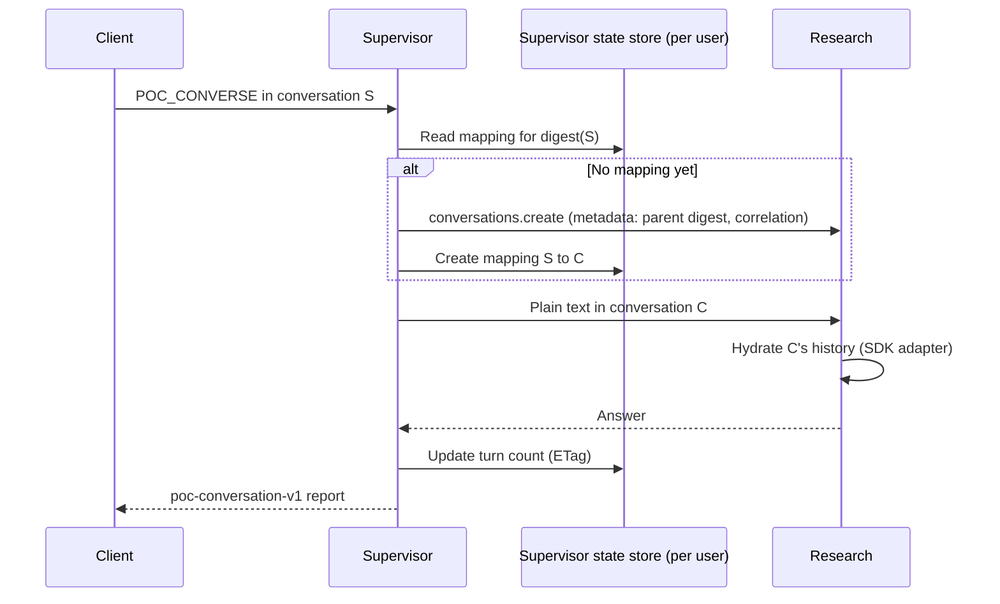
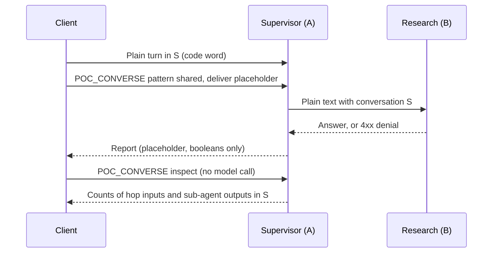
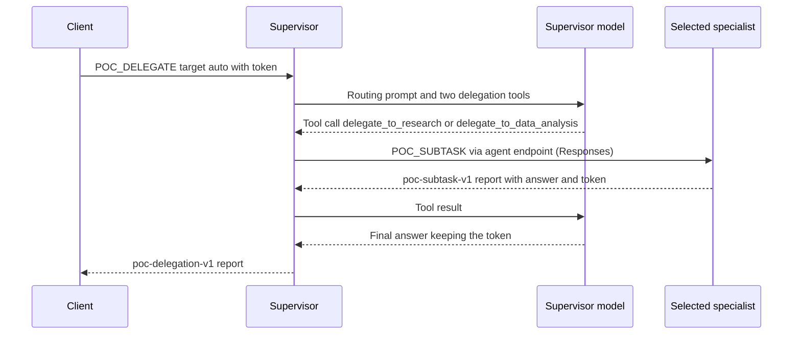

# VS Code tasks: detailed operator guide

This guide explains the tasks currently defined in
[tasks.json](../.vscode/tasks.json). Open **Terminal > Run Task**, then select the
exact label shown below. Sections group tasks by purpose; the labels themselves
are unchanged.
Diagrams use conservative Mermaid syntax for GitHub and Mermaid-capable VS Code
Markdown previews; no external links or callbacks are embedded in diagrams.

- [Setup](#setup): install dependencies, configure local settings, and prepare access.
- [Verify](#verify): check prerequisites, code, templates, plans, and deployment operations.
- [Tests](#tests): exercise specific behaviors and understand the evidence boundary.
- [Deployment](#deployment): explicitly create/update Azure resources or agent versions.
- [Debug](#debug): start the local Supervisor and open its Inspector.
- [Prompts and credentials](#prompts-and-credentials).
- [Reading results and demonstrating proof](#reading-results-and-demonstrating-proof).

For the overall run order, use the [README Quick start](../README.md#quick-start---run-in-this-order).
For CLI alternatives and caveats, use [Deployment reference](deployment.md).
For accepted decisions and dated findings, use [ADR-0001](adr/0001-hosted-agents-poc.md).

**Story 1 update:** the same five Story 1 tasks and Story 4 Step 6 now use the
[native validation flow](#native-story-1-validation-current-branch). The older
toolbox procedures below are retained as historical reference, not instructions
for the current task wiring. Existing live findings are not native validation
passes.

## Safety and evidence boundaries

| Activity | What it can establish | What it cannot establish by itself |
|---|---|---|
| Import, lint, type, and unit checks | Local code/configuration behavior | Hosted identity, isolation, or recovery |
| Bicep compile/validate/what-if | Template correctness and proposed changes | Successful provisioning, capacity, or data access |
| Independent model smoke | A particular host can execute a Responses/model request | Specialist orchestration or end-user isolation |
| Context diagnostic | Which verified context fields are visible | Whether a user can access another user's resources |
| State/history negative tests | The specific authorization/continuity boundary exercised | Untested agents, files, downstream APIs, or recovery |
| Role-assignment readback | An assignment exists at a scope | Effective data-plane access after propagation |

**Launching a task with paid or mutating effects is an explicit operator action.**
Review its inputs and scope first. Local inference can also incur charges because
the host uses a real Azure model. Diagnostic tasks request no model inference,
but hosted sessions, response records, and State Store operations can still incur
service usage.

No task currently proves crash recovery, filesystem restoration after idle,
CSV/XLSX analysis capacity, Blob artifact authorization, or OAuth OBO permissions.
Do not describe those as passing because another task completed.

When reporting **NOT SUPPORTED**, name the attempted operation, the documented
restriction or observed error, the affected configuration, and the practical
consequence. Distinguish a documented platform restriction from a failure in one
tested configuration. If the root cause is unknown, say so explicitly; an HTTP
error alone does not establish a platform-wide prohibition. Identify a verified
alternative when one exists, and keep untested behavior separate.

## Setup

### Setup: Sync dependencies

- **Purpose:** create/update the root virtual environment using the committed lock.
- **Execution:** `uv sync --frozen --group validation --inexact`.
- **Effect:** installs locked development/validation dependencies; `--inexact`
  preserves already installed optional extras. Requires access to the approved
  Microsoft package feed.
- **Boundary:** no provisioning, role changes, agent startup, or model requests.

### Setup: Sync dependencies with optional integrations

- **Purpose:** prepare a developer environment that also needs optional integrations.
- **Execution:** frozen uv sync with `--group validation --all-extras`.
- **Effect:** installs the optional packages as well as the normal dependencies.
- **Boundary:** installation does not configure App Configuration/telemetry or
  prove that those Azure integrations can be reached.

### Setup: Prepare local environment

- **Purpose:** convenient first-time local dependency/import preparation.
- **Composition, in order:**
  1. `Setup: Sync dependencies`
  2. `Setup: Check Python environment`
- **Boundary:** does not create `.env`, start hosts, sign users in, grant access,
  or deploy anything. It does not run the full unit/lint/type suite.

### Setup: Create .env from deployment

- **Purpose:** populate local configuration from an existing successful foundation deployment.
- **Implementation:** [generate_env.py](../scripts/deploy/generate_env.py).
- **Execution:** resolve the selected subscription/environment, discover its latest
  successful matching deployment, validate outputs, then create `.env` from the
  example with the mapped project/model/optional App Configuration values.
- **Safety:** refuses to overwrite an existing `.env`; use the update task instead.
  Does not provision or invoke models. Keep the resulting file private.

### Setup: Update .env from deployment

- **Purpose:** refresh mapped Azure configuration without losing local customization.
- **Execution:** the same generator with `--update`; preserves unrelated settings
  and checks for concurrent file modification before replacement.
- **Effect:** updates the three mapped configuration fields; can also create the
  file from the example if it does not yet exist.
- **Boundary:** file generation is configuration preparation, not live access proof.

### Access: Apply developer permissions

- **Purpose:** prepare the operator's own scoped access to the deployed POC resources.
- **Implementation:** [grant_local_rbac.py](../scripts/deploy/grant_local_rbac.py).
- **Prerequisites:** existing foundation, correct selected identity, and permission
  to create the displayed assignments. Review the developer-permission preview first.
- **Execution:** validates identity/tenant/deployment outputs, grants missing scoped
  roles, uploads/downloads/checksums a synthetic Blob, queries monitoring, and deletes
  its own synthetic Blob. Access propagation retries are bounded.
- **Boundary:** mutates RBAC and temporary Blob data. Does not test model inference,
  ACR push, hosted State Store isolation, or another user's permissions.

### Access: Apply hosted agent permissions

- **Purpose:** allow the deployed agent identities to access Foundry data/model capabilities.
- **Implementation:** [grant_agent_rbac.py](../scripts/deploy/grant_agent_rbac.py) with `--apply`.
- **Execution:** resolves each actual deployed instance principal, checks inherited
  assignments, and creates missing **Foundry User** assignments at the selected
  Foundry account scope. For **Data Analysis only**, it also creates a missing
  **Monitoring Metrics Publisher** assignment on the environment's Application
  Insights resource (`AZURE_APPLICATION_INSIGHTS_ID`, verified to be in the
  POC resource group). That resource disables local auth, so trace export uses
  the agent's Entra identity (`POC_APPLICATIONINSIGHTS_AUTH_MODE=entra`). It also
  ensures the **project managed identity** has **Monitoring Reader** on the same
  Application Insights resource so Foundry Insights can read the telemetry; Bicep
  creates that grant too, and this task repairs it without reprovisioning.
- **Boundary:** these are agent and project grants, not test-user grants. No Blob
  or impersonation permission is added in this mode, and Supervisor and
  Research get no telemetry role. A grant is not delegation proof.

### Access: Apply Supervisor impersonation permission

- **Purpose:** enable the explicitly approved trusted-service delegation experiment.
- **Execution:** the hosted-agent permission helper with `--delegation --apply`.
  It checks/creates the tightly validated custom impersonation role and assigns it
  only to Supervisor at the selected project.
- **Important:** this flag **extends** the ordinary agent-permission helper. The
  task also applies everything **Access: Apply hosted agent permissions** applies:
  missing Foundry User grants for the deployed agents, Monitoring Metrics
  Publisher for Data Analysis, and Monitoring Reader for the project identity
  on Application Insights.
- **Boundary:** no specialist impersonation grants, broad administrative grants,
  Blob grants, or user-token/OBO exchange. Permission does not prove user propagation.

### Access: Preview isolated user Consumer grants

- **Purpose:** repeatable read-only grant planning before preparing test users,
  including on another computer.
- **Implementation:** [auth_profiles.py](../scripts/common/auth_profiles.py)
  with `--rbac consumer`, without `--apply`.
- **Prompts:** environment and two full user sign-in names; run under the
  operator CLI identity.
- **Effect:** verifies the selected tenant/project, users, and built-in role;
  reports whether covering unconditional Consumer grants exist or are missing.
  No role writes, profile creation, sign-in, or agent/model calls.
- **Boundary:** this is grant planning, not a complete audit of every effective
  permission or proof of isolation. It does not revoke inherited/group roles.
- **Apply:** use **Access: Create isolated user auth profiles**, selecting
  `consumer`; no additional grant-only implementation is needed.

### Access: Create isolated user auth profiles

- **Purpose:** prepare genuinely different Entra callers without replacing the
  operator's Azure CLI profile.
- **Implementation:** [auth_profiles.py](../scripts/common/auth_profiles.py).
- **Prompts:** comma-separated full UPNs, environment, and optional `consumer`/`none` RBAC.
- **Execution:** if Consumer access is selected, the operator first validates all
  users, the tenant/project, and the invoke-only built-in role; missing project
  grants are created and read back. Microsoft sign-in then runs for each user in
  a separate local CLI directory, followed by user/tenant checks.
- **Safety:** password/MFA entry belongs only in Microsoft's UI. No password task
  input, credential copying, developer fallback, cache clearing, or agent invocation.
  Earlier grants/profiles remain if a later step fails.
- **Boundary:** this task includes `--apply`. It prepares authentication and optional
  assignments, not effective agent authorization or isolation. Run from the operator
  context when granting RBAC, not from a Consumer-only test profile.

## Verify

### Setup: Check Python environment

- **Purpose:** identify interpreter/import problems before starting any host.
- **Implementation:** [validate_environment.py](../scripts/common/validate_environment.py), local mode.
- **Execution:** checks Python 3.14 and imports the framework, hosting, storage,
  and three agent entry-point modules without starting servers.
- **Boundary:** no model call or hosted identity validation. The task does not
  select the helper's separate configured-settings mode.

### Quality: Check lint

- Runs Ruff checks over `src/backend/app`, `scripts`, and `tests`.
- Reports configured correctness/style violations; does not automatically fix them
  or contact Azure. Rules come from [pyproject.toml](../pyproject.toml).

### Quality: Check formatting

- Runs `ruff format --check` on the same source/script/test roots.
- Reports files that would be reformatted; it does not rewrite them.

### Quality: Check types

- Runs the repository's configured mypy checks.
- Detects static type/API inconsistencies in the configured application/script
  targets. It does not establish runtime service compatibility.

### Infrastructure: Compile Bicep

- Compiles [infra/main.bicep](../infra/main.bicep) with Azure CLI's Bicep tooling.
- Writes generated ARM JSON to `artifacts/infra-validation/main.json`.
- No deployment or model invocation. A first use may require Bicep tooling setup;
  compilation is not live Azure resource validation.

### Infrastructure: Validate template (Azure CLI)

- **Purpose:** request Azure-side validation without creating the proposed resources.
- Uses the chosen subscription and checked-in
  [preview parameters](../infra/preview.parameters.json), with deployment location
  `northcentralus` and the task's fixed preview deployment name.
- Reports provisioning-state/error/diagnostic fields from native CLI validation.
- **Boundary:** these preview inputs are not automatically the selected azd
  environment's values. Success does not prove capacity, RBAC propagation, or deployment.

### Infrastructure: Preview changes (Azure CLI)

- Runs subscription-level `what-if` for the template and checked-in preview inputs.
- Shows proposed changes with native verbose output; review before applying.
- Does not provision resources or grant roles. Unresolved/unevaluated changes,
  especially new identities, still require inspection.

### Infrastructure: Preview changes (azd)

- Runs `azd provision --preview` for the **currently selected azd environment**.
- The preprovision hook checks required subscription/environment/region inputs.
- No environment picker is wired into this task: select the intended environment
  first. Infrastructure preview is different from hosted-agent deployment preview.

### Infrastructure: Inspect deployment operations

- Reads subscription deployment operations for the entered **exact deployment name**.
- Use after a failed/partial deployment to locate the real failing operation.
- Does not retry or repair deployment. Nested resource-group operations may need
  separate inspection using the CLI guidance in [deployment.md](deployment.md).

### Access: Preview developer permissions

- Resolves the selected `az` or `azd` user, validates tenant/subscription and
  deployment outputs, and lists present/missing scoped developer roles.
- With `azd`, the helper also verifies that its user matches the Azure CLI user.
- No role writes or synthetic Blob access test in this task. Do not assume that
  a displayed plan means the operator has authority to apply it.

### Access: Preview hosted agent permissions

- Resolves actual deployed instance identities and checks their scoped Foundry
  User assignments; does not guess principals from agent or blueprint names.
- Also previews Data Analysis's Monitoring Metrics Publisher assignment and the
  project managed identity's Monitoring Reader assignment on Application Insights.
- Does not change roles or test actual inference/delegation.

### Access: Preview Supervisor impersonation permission

- Runs the agent-permission helper with `--delegation`, without `--apply`.
- Includes the full **Access: Preview hosted agent permissions** plan (Foundry
  User, Data Analysis telemetry, project Insights reader) plus the Supervisor-only
  project-scoped custom impersonation role/assignment plan.
- Validates an existing custom role's exact permissions before reuse; no role
  definitions/assignments are created by this preview.

### Agents: Preview hosted deployment (unsupported)

- Runs `azd deploy --all --preview` for the prompted environment.
- **Known limitation:** hosted-agent preview is unsupported/skipped in the current
  tooling. Exit code zero can mean nothing was previewed.
- Do not use this as a deployment plan, successful build, or hosted proof.

## Tests

These sections describe **expected passing behavior**, not a promise that the
current deployment satisfies every test. Consult the dated [ADR findings](adr/0001-hosted-agents-poc.md).
The native-user control passed on Research 6; that did not fix nested delegation.

### Quality: Run unit tests

**Use case:** catch local regressions quickly without paying for a hosted run.

1. Runs pytest over [tests/unit](../tests/unit).
2. Exercises settings, redaction, registry rules, request serialization, CLI/task
   wiring, diagnostic classifications, and related helpers.
3. Uses local fakes and in-memory HTTP transports where a service is involved.

**Pass means:** the selected local assertions passed. It is not proof that Foundry
enforces isolation or that a real cloud checkpoint survives process loss.
No model invocation, deployment, live grant, or fault experiment is requested.

### Quality: Run all local checks

**Use case:** the default build-quality gate before a commit or approved cloud experiment.

Runs these dependencies **sequentially**:

1. `Quality: Check lint`
2. `Quality: Check formatting`
3. `Quality: Check types`
4. `Quality: Run unit tests`

Fix a failing prerequisite rather than treating later stages as passed. This group
does not run the local-model smoke, hosted diagnostics, profile sign-in, or deployment.

### Agents: Smoke test all local agents

**Use case:** verify the three local HTTP hosts can each complete real model inference.

**Prerequisites:** configured model access and separately running Supervisor,
Research, and Data Analysis hosts, normally on ports 8088/8089/8090.

1. [run_scenarios.py](../scripts/run_scenario/run_scenarios.py) selects the only
   implemented scenario, local `smoke`.
2. Sends each host `Reply with exactly: HOSTED-AGENTS-POC-OK`, sequentially.
3. Requires completed responses with the exact visible marker and no protocol error.
4. Records safe HTTP details, visible text, available numeric usage, and timing.
   A missing host is a blocked prerequisite, not a model success.

**Effects:** real model usage, even though HTTP targets localhost.
**Does not prove:** hosted sandbox behavior, cross-user isolation, or any Supervisor
call to a specialist. The script independently invokes all three.

### Agents: Smoke test all hosted agents

**Use case:** distinguish an actual deployed inference success from build/readiness success.

**Prerequisites:** existing environment, operator metadata/invocation access, and
active agents with exclusive `@latest` endpoint routing.

1. [hosted_smoke.py](../scripts/run_scenario/hosted_smoke.py) reads deployment context.
2. Verifies active latest-version metadata/routing for each agent.
3. Uses the operator's Azure CLI credential and each agent-bound Responses endpoint.
4. Sends the same exact-marker prompt as local smoke, once per agent, with SDK
   request retries disabled.
5. Records each actual result separately; an HTTP response alone is insufficient.

**Effects:** real hosted/model usage and response/session records.
**Does not prove:** orchestration, user isolation, recovery, or artifact authorization.

The local and hosted smoke tasks differ in target, not in their independence:



### Agents: Diagnose hosted caller context

**Use case:** locate where context visibility changes between direct and nested calls.

1. [context_probe.py](../scripts/run_scenario/context_probe.py) verifies the active
   Supervisor/Research targets and their 120-second idle policy.
2. Invokes Research directly with `POC_CONTEXT`.
3. Invokes Supervisor, which makes one nested Research context probe.
4. Compares hosted/call/user/session/conversation presence and nested expected-caller
   equality. Missing required fields or mismatch produce non-success results.

**Effects:** hosted conversation/response/session metadata, but no requested model
inference or application State Store writes. No grants or deployment.
**Does not prove:** authorization from a visible user/call field alone.



### Agents: Test hosted identity variants and isolation

**Use case:** investigate delegated-user boundaries separately from normal workflow guards.

**Prerequisites:** explicit approval, active Supervisor/Research versions, metadata
access, diagnostic opt-in on both, and appropriate Supervisor delegation permission.

1. [identity_matrix.py](../scripts/run_scenario/identity_matrix.py) invokes Supervisor's
   `POC_IDENTITY` comparison.
2. The default task tests **two mechanisms separately**: original call context
   only, then synthetic delegated application-user labels only.
3. Each mode tests A's state/history continuity. The delegated-label mode also
   attempts B reads/continuations and verifies final A continuation.
4. Checks safe actual egress metadata and reports context observations separately.
5. Requires a complete, nonduplicate assertion matrix. Unexpected B success remains
   FAIL even if A's final request succeeds. Unrelated 5xx/transport errors are not denials.

**Effects:** real hosted calls, synthetic markers in a separate user-isolated store
with a verified one-hour TTL, and platform history records. No model requests,
normal registry resets, guard relaxation, role changes, or automatic request retries.

**Identity boundary:** synthetic A/B labels share the authenticated Supervisor
principal. They are not two independently authenticated Entra users. This matrix's
cross-user original-call-context case remains BLOCKED; the separate native-user
task does not provide a second caller inside this single Supervisor request.

**CLI-only variations:** `--response-chains` removes explicit conversation creation;
`--history-only` also omits A's session only from B's history attempt;
`--direct-control` skips Supervisor and requires the operator's separately approved
impersonation permission. These switches are not prompts on this task.



### Agents: Test native Entra user isolation

**Use case:** demonstrate that two actual users cannot inherit each other's Research
state/history and can return to their own conversation afterward.

**Prerequisites:** exactly two full UPNs, independently signed-in isolated CLI
profiles, suitable Consumer access, and Research's existing diagnostic opt-in.
Use the profile setup task first. Do not replace missing users with labels.
Keep test identities least-privileged: broader inherited roles can affect what
management APIs intentionally allow. The operator handles deployment metadata;
do not grant test users Foundry User merely to satisfy that preflight.

1. [native_user_isolation.py](../scripts/run_scenario/native_user_isolation.py) verifies
   each CLI account/tenant and Graph `/me`; requires distinct Entra object IDs.
2. The operator credential reads active Research routing/version/idle metadata only.
3. Actual diagnostic requests use each user's own profile-bound credential, without
   a developer fallback or `x-ms-user-identity`.
4. In each direction, both callers must have valid native hosted context.
5. The owner creates/reads a state marker and continues a response chain.
6. The other user attempts the owner's state key and history references:
   - state marker must be absent;
   - previous-response-only continuation must receive a recognized visibility denial;
   - continuation with the owner's session must also be denied.
7. For generic `404/not_found`, the owner must retrieve the exact completed response.
8. The owner continues again: marker retained, original session, new response.
   Its state must remain unchanged.
9. Repeats with the users' roles reversed and audits outgoing native-header absence.

**Expected evidence:** the observed passing control had 22 assertions, including
404 `not_found` and 403 `session_not_accessible` in both directions. That is a
dated result, not a guarantee for a future run.

**Presentation:** choose **Verbose** or **Not verbose**. Verbose shows sanitized
REQUEST/RESPONSE panels, actual HTTP metadata, timings, bindings, and deterministic
diagnostic JSON, not model-generated answers. Compact mode retains request labels
and assertions; both save sanitized exchange events and assertion evidence.

**Effects:** real Research calls and dedicated synthetic one-hour state/history.
No login, role changes, deployment, models, ordinary workflow creation, or retries.
**Does not prove:** hosted Supervisor propagation, Data Analysis, normal registry
ownership, files/artifacts, downstream user permissions, or crash recovery.

The diagram shows expected passing behavior; the task evaluates actual outcomes:



### Agents: Test hosted workflow state and delegation

**Use case:** validate the complete normal Supervisor/specialist workflow, not just
the diagnostic or independent smoke surfaces.

**Prerequisites:** all three active targets, verified 120-second idle policy,
model permissions, and working specialist caller context. This path remains
unvalidated because the normal nested-user guard has blocked it.

1. [hosted_workflow.py](../scripts/run_scenario/hosted_workflow.py) creates a Supervisor
   conversation and fresh workflow ID.
2. Creation requests both specialist conversations and asks each to remember
   `ALPHA-POC-7`.
3. Inspects the persisted root workflow and repeats the same creation command;
   both must return the same committed report, not mint new scope.
4. Continues without repeating the token. Both specialists must recall it.
5. Requires ready progress, three distinct conversations, unchanged random
   owner/session mappings and child bindings, and new specialist response IDs.
6. Inspects an unknown workflow and requires explicit rejection without initialization.

**Effects:** real model inference and normal workflow-registry writes if creation
can proceed. A failed/interrupted workflow can remain `progress: running`;
do not reset it or automatically replay side effects to force the test green.
**Does not prove:** two-user isolation, idle/restart continuity, crash recovery,
or Blob authorization. The application's `Workflow` model is not a MAF
`WorkflowBuilder` graph.



### Native Story 1 validation (current branch)

The existing `data-analysis-agent` uses native managed Code Interpreter for a
fixed seeded CSV workload. No new agent, custom sandbox, certificate service,
or toolbox is required. Research's separate documentation toolbox is unchanged.
Generated Python runs only in the managed interpreter.

The five Story 1 task labels are unchanged. `preview` is the default and does not
load Azure configuration, create clients, authenticate, or make paid calls.
`run` is a separately approved service operation, not a deployment step.
Use the reviewed existing agent version and existing permissions; tasks do not
repair RBAC, deploy, retry, or delete remote resources.

| Existing task | Native behavior and boundary |
|---|---|
| Story 1 Step 1 | Verify all three active agents, native-only Data Analysis configuration, one analytical execution, authorized original outputs, and a distinct native baseline. |
| Story 1 Step 2 | One model-written analysis, exact independent row/cell/group checks, original CSV/PNG files, and separate hash-bound chart review. |
| Story 1 Step 3 | Baseline 1k/10k/100k or optional pressure 250k/500k/1M rows, one submission per case, measured interpreter memory, stop at first failure/unavailable metric or 75% target. Pressure must also be enabled in the backend before deployment. |
| Story 1 Step 4 | Two real existing isolated user profiles, own analytical controls, cross-user workflow/file denials, and a clean-session check. Not universal native-file isolation. |
| Story 1 Step 5 | `skip`: required Blob reconstruction; `observe`: Blob then Hosted; `only`: zero-analysis Hosted lifecycle observation. Independent SDK state is read before attempting resume. No local Blob fallback, forced stop, or deletion. |
| Story 4 Step 6 | Optional bounded stateless Supervisor compatibility probe, reusing reviewed native Story 1 evidence. Unsupported trusted-context contracts remain blocked. |

The existing Data Analysis deployment sets `STORY1_NATIVE_ENABLED=true`.
The runtime/local-example default for `STORY1_NATIVE_PRESSURE_ENABLED` is `false`.
The POC deployment manifest now explicitly enables it for the sponsor-approved
bounded pressure release. This does not start tests automatically: the task still
defaults to `preview` and the `baseline` profile.

#### Pressure testing with the existing tasks

No additional validation task is needed:

1. Review the backend pressure flag in [azure.yaml](../azure.yaml). To enable
   pressure on a deployment that still has it disabled, use **Agents: Deploy all
   hosted agents** for the existing environment. This redeploys the same agents,
   not the infrastructure. Skip redeployment when the intended version already
   has the approved configuration.
2. Run **Agents: Story 1 - 1 Enable Code Interpreter on existing Data Analysis
   agent**, selecting `run`, to refresh the native version-bound baseline after
   deployment.
3. Run **Agents: Story 1 - 3 Evaluate dataset sizes**, selecting `run` and
   `pressure`. The fixed ladder is 250k, 500k, and 1M rows, one analysis per size.
4. Stop at 75% of the observed interpreter limit, the first failure/ambiguity, or
   an unavailable required metric. Do not retry, raise ceilings, or add cases.
   If the last case remains below target, retain that gap rather than claiming
   a platform maximum.

The approved batch permits at most four analyses including Step 1, with a
300-second request timeout and a 1,800-second pressure-run bound. Existing caps
remain: 64 MiB input, 16 MiB combined runner downloads, 8,000 native output tokens,
and one interpreter tool call per analysis. The deployed backend output ceiling
remains 50 MiB; the runner's lower ceiling still applies. Synthetic fixture sizes
are 14,250,540 / 28,613,347 / 57,340,679 bytes respectively, all below 64 MiB.

Disabling pressure later is an explicit backend configuration/redeployment,
not an automatic hidden cleanup operation or an increase to any runtime limit.

**Current POC acceptance:** on 2026-10-27 the sponsor accepted the measured
1M-row envelope and 39.34% process-memory reading as sufficient. No further
pressure escalation is required for this scope. The 75% diagnostic threshold
and original Not evaluated report are not rewritten; acceptance of a tested
envelope is not evidence that the threshold or platform maximum was reached.
See the [recorded decision](issue-1-validate-hosted-agent-memory-and-data-analysis-capacity.md#poc-capacity-acceptance-decision-2026-10-27).

#### Repeat the tests on another computer

1. Use the same implementation revision and configure the existing POC azd
   environment/project. Do not provision another project just to rerun tests.
   Run **Setup: Prepare local environment** to install the locked application.
2. Sign in as the operator for the correct tenant/subscription, then run
   **Access: Preview isolated user Consumer grants** with the two intended
   test-user sign-in names.
3. Run **Access: Create isolated user auth profiles**. Choose `consumer` if
   missing project grants should be created under the operator identity; existing
   covering grants are reused. Choose `none` for sign-in only when access is
   already prepared. Operator role-assignment rights are needed only for grants.
4. Each user completes Microsoft's sign-in/MFA UI on that computer. Never copy
   token caches or profiles from another computer, share passwords, or substitute
   the developer identity. The task isolates each user's local CLI cache.
5. Run native **Story 1 Step 1** to create a fresh version-bound baseline, then
   use the same Story 1 Steps 2-5. For Step 4 enter the same two verified users.
   Chart review and service findings must refer to the current run's originals.

Azure role assignments belong to the users/project and persist across computers;
they normally do not need re-creating. Local sign-in caches, Python installation,
baselines, and run evidence do need preparing on the new computer. The additional
task is an **Access preview**, not another validation task or an automatic setup
dependency. Broader effective grants must still be reviewed before claiming a
Consumer-only threat model; the preview does not remove them.

#### Preview and approved execution

Run from the root using the existing environment:

```powershell
uv run --frozen --no-sync --group validation python -m scripts.run_scenario.story1_native --step 1 --execution preview
```

After local checks, deployment approval, named-user access verification, and
approval of the bounded live budget:

```powershell
uv run --frozen --no-sync --group validation python -m scripts.run_scenario.story1_native --step 1 --environment <environment> --execution run
uv run --frozen --no-sync --group validation python -m scripts.run_scenario.story1_native --step 2 --environment <environment> --execution run
```

Do not run these commands automatically during setup or unit tests. A fresh
native baseline is required after agent version/configuration changes; the
historical toolbox baseline cannot satisfy it. Existing evidence is retained.

Each analysis uses one native model submission plus fixed preparation/metadata/
session-file operations. Step 4 uses two analyses; Blob reconstruction uses two.
The default per-request timeout is 300 seconds, bounded by an overall
1,800-second run limit. These are maximums, not permission to consume the budget;
approve the actual profile and calls before selecting `run`.

#### Offline chart review

Step 2 retains `outputs\revenue_by_category.png` and
`chart-review-template.json`. Inspect the original chart's labels and grouped
revenue values, then copy the template to a separate review receipt and set
`accepted` to `true` only if correct. Keep its exact PNG hash and data.

```powershell
uv run --frozen --no-sync --group validation python -m scripts.run_scenario.story1_native --step 2 --environment <environment> --review-run <original-run-folder> --chart-review <review-receipt.json>
```

This rechecks retained original hashes and the independent oracle without another
model request. A valid PNG signature alone does not establish chart meaning.

#### Metadata-only Hosted lifecycle evidence

Use the existing **Agents: Story 1 - 5 Assess state continuity** task with
`story1HostedIdle = only`. The default remains `skip`, which runs the existing
Blob reconstruction track. `observe` runs Blob reconstruction followed by the
Hosted observation; it still includes the two Blob-track analyses.

The `only` option creates one owned Hosted session, prepares a fixed synthetic
fixture, and uses `observe` commands without submitting a native analysis or
writing a Blob checkpoint. Hosted sessions, state, and response records can still
incur service usage; zero model analyses does not mean zero service calls.

```powershell
uv run --frozen --no-sync --group validation python -m scripts.run_scenario.story1_native --step 5 --hosted-idle only --execution preview
uv run --frozen --no-sync --group validation python -m scripts.run_scenario.story1_native --step 5 --hosted-idle only --environment <environment> --execution run --timeout 300 --max-seconds 900
```

Keep the computer awake for about nine minutes. The test uses a 300-second
minimum quiet interval, then at most six read-only platform metadata checks,
30 seconds apart, with a hard 480-second quiet-wait cap. The test records:

1. Process/HOME markers, then authoritative platform session state `active`.
2. No agent requests for at least 300 seconds.
3. SDK state `idle` and a new `stopped_at` timestamp, read **before** any resume
   request. Pending `active` samples are saved without being declared a failure
   while the bounded metadata checks continue. Exhausting the cap, stale/missing
   stop data, or a different session/version leaves the test blocked instead of
   manufacturing a lifecycle witness.
4. An authorized `observe` on the same workflow/session, followed by platform
   state `active`, a changed process marker, and the original HOME sentinel.

The report records actual quiet duration and ordered server metadata without raw
session IDs; `hosted-lifecycle-metadata.jsonl` retains every safe snapshot even if
a later call is interrupted. A client interruption/timeout is not a platform idle event.
No forced stop/delete, automatic retry, redeployment, or new agent is involved.
The `native-hosted-only` report variant is separate from the Blob recovery result.
It can demonstrate platform-reported idle/resume and scoped HOME continuity, not
interpreter RAM survival, VM implementation, or an unexposed internal stop reason.

The five-minute observation allows for the measured platform reconciliation delay:
one deployed v9 session with a 120-second idle setting remained active at the
184-second sample and was subsequently reported stopped 203 seconds after its
recorded activity. The setting is not treated as an exact stop-event deadline.
That shorter partial run is retained rather than upgraded retrospectively.
The subsequent five-minute run also read `active`, while a later SDK read
reported `idle` with a stop timestamp earlier than that sample. The final state
is therefore awaited as a condition, not assumed at an exact timer deadline.
Only platform metadata is polled; no agent request keeps the observed session
warm, and no retry of analysis or forced lifecycle command is involved.

#### Isolation, capacity, and recovery

- Use the existing **Access: Create isolated user auth profiles** task only when
  setup is needed and separately approved. Step 4 accepts exactly two genuine
  existing profiles; it never simulates users with headers or grants broad roles.
- Capacity's pressure profile is finite and opt-in. Measure the interpreter's
  observed limit, not the Hosted agent's configured 1 GiB or a historical toolbox
  limit. A classified early failure is useful evidence but not a pressure pass.
- Blob uses authenticated public endpoints and existing storage permissions,
  with normal TLS verification. The runner performs the checkpoint round trip;
  that is not autonomous Hosted recovery or private-network placement.
- Hosted idle observation is best effort. A quiet interval alone is not a
  lifecycle witness: the controller also requires SDK active/idle/active state
  and a fresh stop timestamp, plus the marker/HOME checks. It does not prove
  interpreter expiry, and no resource stop/delete is implied.
- If an optional probe fails, retain the blocker and propose the smallest
  redesign, its cost/impact, and revised test budget. Implement it only after
  explicit user approval; do not silently weaken identity checks.

Results use existing per-step folders and indexes under `artifacts\story-1` and
`artifacts\story-4`. `native-agents-baseline.json` and reviewed native analytical
evidence are distinct from the historical toolbox evidence.

### Agents: Story 1 - 1 Enable Code Interpreter on existing Data Analysis agent

**Historical toolbox procedure.** For current task execution use
[native validation](#native-story-1-validation-current-branch).

**Use case:** Story #1 AC1. Enables Microsoft-managed Code Interpreter on the
**already-deployed** `data-analysis-agent`, then proves it executes in the
managed sandbox. It never creates an agent, and Supervisor and Research are
not changed.

**Prerequisites:** complete the repository's
[setup and deployment steps](../README.md#quick-start---run-in-this-order).
The selected environment must have all three existing agents active, and the
operator must be signed in with access to the Foundry project. The hosted
Data Analysis agent needs permission to call its toolbox. On a permission
failure, follow the reported access task; this task does not grant roles.

**Run in VS Code:**

1. Choose **Terminal > Run Task...**.
2. Select **Agents: Story 1 - 1 Enable Code Interpreter on existing Data Analysis agent**.
3. Select the deployed environment.
4. Select `enable-if-missing` for initial wiring, or `verify` for an
   already-configured deployment.
5. Review the terminal verdict and open the linked Markdown report.

**Inputs:** environment (`hosted-agents-poc-dev` by default) and mode:

- `verify` (default): read-only checks plus paid sandbox and model calls.
  Reports `BLOCKED` if the toolbox or agent wiring is missing.
- `enable-if-missing`: only when missing, uploads three synthetic CSVs
  (1k/10k/100k rows) project-scoped, creates toolbox `story1-data-analysis-ci`
  once, and runs `azd deploy data-analysis-agent`. That deploy moves the same
  agent to a new version with `TOOLBOX_ENDPOINT`. Reruns detect both and do
  not redeploy.

**Steps:** [story1_data_analysis.py](../scripts/run_scenario/story1_data_analysis.py)

1. Reads environment/configuration and snapshots all three existing agents:
   version, status, instance principal, and routing.
2. Generates the three synthetic CSVs locally in memory and computes their
   expected SHA-256 checksums.
3. Reuses the matching toolbox or, in `enable-if-missing` only, uploads the
   CSVs and creates its version, matched by dataset SHA-256 in metadata.
4. Probes the toolbox directly as the operator. The sandbox hashes each
   mounted CSV and generates a PNG. The local runner lists and downloads the
   PNG through the container files API and checks its PNG signature in memory.
5. Reuses the existing agent wiring or, in `enable-if-missing` only, updates
   the environment's toolbox endpoint and deploys just Data Analysis.
6. Asks the existing Data Analysis endpoint for the 1k file's SHA-256 and
   Python version, comparing the returned hash with the local value. The answer must also
   carry a `poc-artifacts-v1` container reference that exists in the project.
7. Re-snapshots the agents. Supervisor and Research must be unchanged and the
   Data Analysis identity the same. On success, it writes
   `artifacts\story-1\agents-baseline.json` for Steps 2-5.
8. Renders the Markdown report, appends its link and verdict to the evidence
   index, and prints the evidence path and exit status.

#### Where Step 1 runs

| Location | Work performed |
|---|---|
| Local computer running the VS Code task | Test runner, authentication/API calls, synthetic CSV generation, expected checksums and comparisons, PNG signature check, reports, and optional deployment commands |
| Deployed Foundry hosted agent | Agent orchestration, model calls, and toolbox calls for the hosted execution proof |
| Managed Code Interpreter sandbox | Executes the supplied probe Python and agent-requested analysis Python, reads mounted inputs, computes hashes, and generates `story1-probe.png` |

The direct operator probe and the hosted-agent proof are separate calls;
they do not imply the same sandbox container. The implementation observed a
fresh container per tool call with the current preloaded-file configuration.
`verify` avoids deployment/configuration changes, but still makes paid
sandbox/model calls and writes local evidence. There is no local `exec` or
subprocess fallback for analysis.

#### Step 1 output files

Every Story 1, Story 3, and Story 4 step uses the same naming convention:

```text
artifacts\story-<n>\
  index.md                      one line per run: UTC time, step label, verdict, link
  agents-baseline.json          written by Step 1; the reuse guard for later steps
  step-<NN>-<slug>\             one folder per step; groups all reruns of that step
    <YYYYMMDDTHHMMSSZ>-<id8>\   one folder per run; sorts chronologically
      report.md
      manifest.json
      events.jsonl
      results.jsonl
      outputs\                  downloaded files, when the step has any
```

Step 1 runs are under `step-01-code-interpreter\`, for example
`artifacts\story-1\step-01-code-interpreter\20261023T120408Z-a1b2c3d4\report.md`.
The timestamp is the UTC start time and the suffix is the first eight
characters of the run ID. The mode (`verify` or `enable-if-missing`) is
recorded as `variant` in `manifest.json` and in the index label, for example
`Step 1 (code interpreter, verify)`. Runs written before this convention keep
their original folder names and index links.

| File inside each run folder | Contents |
|---|---|
| `report.md` | Main report: checks, expected/observed results, findings, and acceptance verdict |
| `manifest.json` | Full run ID, start time, scenario/mode, step folder, variant, platform, and Python/SDK versions |
| `events.jsonl` | Incrementally written, sanitized check observations; one JSON record per line |
| `results.jsonl` | The same check records as `events.jsonl`, for machine processing |

| Shared file under `artifacts\story-1\` | When written |
|---|---|
| `index.md` | Created if missing, then appended with each run's report link, timestamp, and verdict when report finalization is reached |
| `agents-baseline.json` | Created or replaced only after successful validation; stores the environment, run ID, toolbox configuration, and agent snapshots for the Steps 2-5 reuse guard |

Failed or blocked runs keep evidence already written and do not replace the
baseline. An interrupted process can leave a partial report without a new
index entry. Start with [the index](../artifacts/story-1/index.md), open a
linked report, and press `Ctrl+Shift+V` for Markdown Preview. The report is
also rendered in the task terminal.

#### Report layout (all Story 1 and Story 4 steps)

Every Story 1, Story 3, and Story 4 report opens, directly under the title,
with **How to read this report**: a key for the verdicts, finding outcomes,
check-status icons, evidence types, and owners used everywhere below it. The
**Summary** follows. It contains:

1. **Acceptance verdict** and a one-line conclusion: `Met`, `Met, with ...`
   (satisfied with a stated caveat), `Partially met`, `Not met`, or
   `Not evaluated` (blocked before evidence existed).
2. **Key results:** plain-language measurements from the run.
3. **Findings:** an outcome count line, then one row per finding with:
   - **Outcome**, one of:

     | Outcome | Meaning |
     |---|---|
     | ✅ PASS | Tested in this run and worked as expected |
     | ❌ FAIL | Tested in this run and did not work as expected |
     | 🟡 PARTIAL | Some parts worked and some did not |
     | ⛔ BLOCKED | A prerequisite or guard stopped the test; the finding says why |
     | 🚫 NOT SUPPORTED | The platform doesn't provide it (documented by Microsoft, confirmed by the run, or both) |
     | ⚠️ LIMITATION | Works, with a platform constraint to design around |
     | 📄 DOCUMENTED | Stated by Microsoft, not tested in this run |
     | ⏭️ NOT RUN | Testable, but not run this time |

     Outcomes that depend on the run come from the actual check results, not
     from fixed text.
   - **What was found**, in plain language.
   - **Evidence** (Tested, Observed, Documented, or Unverified), and **Owner**
     (Foundry-managed, Agent Framework / SDK-managed, Custom implementation
     (Dev Team), or Not supported).
   - **Microsoft documentation** links. *Not supported* findings always link to
     the Microsoft page that states the limitation. Where Microsoft doesn't
     document a behavior (for example, this repository's own allow-list), the
     report says "No official Microsoft documentation found" instead of
     linking a page that doesn't support it.
4. **Gaps and follow-ups.** References to GitHub issues are written as
   "GitHub issue #N" so they aren't confused with finding numbers.
5. **Microsoft documentation referenced:** for each quote, the linked page, the
   verbatim excerpt, what it means for this POC, and the numbers of the
   findings it supports.

Detailed check tables and raw evidence follow below the summary. Each check's
status is shown as an icon: ✅ passed, ❌ failed, ⛔ blocked (a prerequisite was
missing; nothing was bypassed), or ⏭️ skipped (not run). The same icons are used
in the key results and the file, access-case, and delivery-path tables. The
run's `results.jsonl` keeps the words `PASS`, `FAIL`, `BLOCKED`, and `SKIP`.
The documentation sources live in
[findings.py](../scripts/common/findings.py). Every link, section anchor, and
quote was last checked against the live page on 2026-10-26.

**Story 1 Step 1 remote files, not local output files:**

- `story1-sales-1000.csv`, `story1-sales-10000.csv`, and
  `story1-sales-100000.csv` are generated locally in memory and uploaded to
  the project-scoped Files API only when setup needs them. Existing matching
  toolbox inputs are reused.
- `story1-probe.png` is created inside a managed sandbox. The runner
  downloads its bytes into memory to verify delivery; Step 1 does not save a
  local PNG or local CSV copies. Story 1 Step 2 and Story 4 Step 6 do save
  their downloaded analysis outputs under `outputs\` (see their output tables).
- Sandbox files are temporary; this test does not persist them to Blob
  Storage or embed the PNG in the Step 1 report.

#### Cloud-only execution (proposed, not implemented)

There is **no existing task or flag** that runs the complete validation
without local execution or local evidence files. For that requirement, a
possible future design is:

1. Run the validation client in a cloud-hosted runner, such as an Azure
   Container Apps Job, with an appropriately authorized managed identity.
2. Have that runner call the existing deployed Foundry agent and toolbox.
3. Persist reports, JSONL evidence, index, and baseline in Azure storage,
   such as Blob Storage, rather than on the developer's computer.

This moves the test runner to Azure; it does **not** move the runner or hosted
agent orchestration into Code Interpreter. Generating datasets inside the
sandbox would require a further test redesign while preserving an
independent expected-result check. Cloud-runner infrastructure, identity,
remote evidence storage, and a launch task are not implemented here; these
are design considerations, not runnable setup instructions.

#### Viewing Step 1 traces in Foundry

Step 1's hosted proof and trace ingestion are separate checks. A `Met` report
proves the implemented execution/reuse checks passed; it does not by itself
prove that telemetry reached Foundry.

1. Identify the Application Insights resource in the selected Foundry
   project's `application-insights` connection. For this deployment,
   `AZURE_APPLICATION_INSIGHTS_ID` in the azd environment identifies that
   resource. Reuse it; do not provision another monitoring resource.
2. Retrieve its connection string and set
   `APPLICATIONINSIGHTS_CONNECTION_STRING` in the selected azd environment.
   Do not put the value in source control, task arguments, or reports.
   [azure.yaml](../azure.yaml) maps this value into Data Analysis only as
   `POC_APPLICATIONINSIGHTS_CONNECTION_STRING`: Foundry rejects the standard
   name as a user-supplied agent environment variable because it is reserved.
   Settings prefer this application-owned alias while retaining the standard
   name for local configuration.
3. Deploy **only** `data-analysis-agent` in that environment. Do not run the
   all-agents deployment task. A new immutable Data Analysis version is
   expected; Supervisor/Research versions and agent identities must stay
   unchanged. No foundation provisioning is needed.
4. Startup passes the connection to the hosting SDK's public
   `configure_observability` (the `microsoft-opentelemetry` distro is a
   locked dependency of the agent server; the [Dockerfile](../src/backend/Dockerfile)
   checks it imports). That path adds the Foundry enrichment processor, which
   stamps `gen_ai.agent.name`/version and project ID on every span, exports to
   Azure Monitor, and enables Agent Framework instrumentation. A custom Azure
   Monitor setup would bypass the enrichment, so traces would not be
   attributed to the agent in Foundry. Prompt/tool-content capture is forced
   off regardless of the SDK's default. If no application setting is present,
   a platform-supplied connection is used. Startup logs
   `Telemetry export configured` once.
5. The POC Application Insights resource disables local (instrumentation-key)
   authentication, so connection-string-only export is rejected as
   `Unauthorized`. [azure.yaml](../azure.yaml) therefore sets
   `POC_APPLICATIONINSIGHTS_AUTH_MODE=entra` for Data Analysis. Foundry rejects
   the SDK's own `APPLICATIONINSIGHTS_AUTH_MODE` name in agent definitions as
   platform-reserved, so startup sets that process variable just before
   configuring export; the SDK then authenticates with the agent's managed
   identity. Startup logs `auth_mode: entra`. Run
   **Access: Apply hosted agent permissions** so that identity holds
   **Monitoring Metrics Publisher** on the Application Insights resource.
   Role propagation can take several minutes.
   This publish role does not grant Foundry Insights read access. The
   **project managed identity** and the interactive Insights user also need
   **Monitoring Reader** on the connected Application Insights resource.
   The foundation's project-access module grants the project identity this
   role; existing environments must apply that grant separately or through
   a reviewed infrastructure update. **Access: Apply hosted agent permissions**
   also checks and applies the project read role, and runs automatically in
   **Agents: Deploy and smoke test all hosted agents**. Bare `azd deploy`
   does not run the access task or update infrastructure RBAC.
6. Rerun Step 1 in `verify` mode. In Foundry, select the same project and
   Data Analysis agent, and a time range covering the run's UTC timestamp.
   Allow for telemetry ingestion delay and refresh the trace view. The
   hosted proof's response/session IDs are recorded in the Markdown/JSONL
   evidence for correlation.
7. If the view is empty, check the agent's console log for
   `Retryable server-side error: Unauthorized` (missing role or propagation)
   and inspect the linked Application Insights `requests`
   and `dependencies` tables. Hosted request spans identify the agent using
   `gen_ai.agent.name` or `azure.ai.agentserver.agent_name`; join downstream
   spans by `operation_Id`. Confirm ingestion and attribution rather than
   assuming that a successful model response proves tracing works.

If the container fails at `settings.require_model()`, check the deployed
model configuration before diagnosing telemetry: the manifest must map
`AZURE_AI_MODEL_DEPLOYMENT_NAME` to `${AZURE_AI_MODEL_DEPLOYMENT_NAME}`.
A missing or misspelled substitution leaves the model unset even when the
selected azd environment contains a valid deployment name. Correct it and
redeploy Data Analysis; existing immutable versions retain the old value.
`FOUNDRY_PROJECT_ENDPOINT` is platform-supplied and must also be present.

Only the hosted-agent proof traverses Data Analysis. The direct operator MCP
probes call the toolbox independently and are not expected under its agent
trace. Enabling telemetry affects future invocations; earlier unexported
traces cannot be backfilled. Telemetry incurs monitoring ingestion/storage
charges in addition to model and sandbox usage.

**Does not prove:** filter/group/visualization correctness (Step 2), capacity
(Step 3), sandbox boundaries (Step 4), or continuity (Step 5). With toolbox +
hosted agent, the documented behavior is that users in a project share
sandbox context.



### Agents: Story 1 - 2 Analyze data and deliver outputs

**Historical toolbox procedure.** Current tasks use
[native validation](#native-story-1-validation-current-branch).

**Use case:** Story #1 AC2. Asks the existing `data-analysis-agent` to filter,
group, summarize, and chart the 1k-row synthetic input with model-written
pandas/matplotlib code in the managed sandbox. It then shows how the summary,
aggregates, CSVs, and chart reach the user. It also records the existing
Supervisor workflow path.

**Prerequisites and guard:** the same as Step 3. A successful Step 1 run for
the same environment must have written `artifacts\story-1\agents-baseline.json`.
The agents and the toolbox inputs must still match it, otherwise the task
reports `BLOCKED: run Task 1` (or `FAIL` for unexpected agent changes).

**Run in VS Code:** choose **Terminal > Run Task...**, select
**Agents: Story 1 - 2 Analyze data and deliver outputs**, then select the
environment.

**Effects:** no deployment, upload, toolbox, or agent change. Makes two paid
hosted requests: one to Data Analysis and one `POC_WORKFLOW create` through
the existing Supervisor, which writes that command's normal workflow state.

**Steps:** [story1_data_analysis.py](../scripts/run_scenario/story1_data_analysis.py) `--step 2`

1. Runs the reuse guard against the Step 1 baseline.
2. Sends the recorded analysis request to the existing Data Analysis
   endpoint. The request has a 300 s client timeout and no retries. It filters
   `status == 'completed' and region == 'West'`, groups by category, and saves
   `filtered.csv`, `by_category.csv`, and `revenue_by_category.png`. It then
   prints the input SHA-256, filtered row count, per-category totals, and
   overall totals as JSON.
3. Quotes the plain-language summary from the answer. It compares the printed
   JSON exactly with an independent local calculation in integer cents.
4. Follows the answer's `poc-artifacts-v1` container reference, downloads the
   three files through the authenticated container files API, and validates
   them by content:
   - `filtered.csv`: columns, exact row IDs, filter values, and revenue total.
   - `by_category.csv`: every group.
   - The chart: PNG signature and dimensions.

   It then saves local copies for the report.
5. Sends the same task through the Supervisor's existing `POC_WORKFLOW create`
   path, unchanged. The nested caller guard (ADR-0001) currently stops it at
   the Research hop; that is recorded as `BLOCKED` and is never bypassed.
6. When the Supervisor path completes, reads the `containers` field of the
   Supervisor's `poc-workflow-v1` report. Data Analysis fills it from its own
   tool results only, and the Supervisor forwards it from its child reports.
   The task downloads the three files from that container with the operator's
   own identity, saves them under `outputs\supervisor\`, and validates them
   with the same content checks as step 4. While the Supervisor path is
   `BLOCKED`, this check is `BLOCKED` too and no download is attempted.
7. Re-snapshots the agents, then writes the delivery paths, findings,
   limitations, and verdict.

**Verdict:** AC2 accepts delivery to the supervisor **or** the user, so the
user path decides it. `Met` means every user-path check passed. `Partially
met` means the request completed but a check failed. `Not met` means the
request failed or an agent changed. `Not evaluated` means the run was blocked.
The Supervisor path is reported as a limitation. A `BLOCKED` Supervisor path
also makes the task exit with code 2, even when the verdict is `Met`.

#### Step 2 output files

Run folders are under `step-02-analysis-and-outputs\` and follow the
[Step 1 naming convention](#step-1-output-files).

| File inside each run folder | Contents |
|---|---|
| `report.md` | Main report: summary, expected-versus-observed tables, file checks, chart, delivery paths, findings, and verdict |
| `outputs\` | Downloaded `filtered.csv`, `by_category.csv`, and `revenue_by_category.png` |
| `outputs\supervisor\` | The same three files, downloaded from the container IDs the Supervisor forwarded (only when the Supervisor path completes) |
| `manifest.json`, `events.jsonl`, `results.jsonl` | Same evidence format as Step 1 |

Container forwarding through the Supervisor needs agent code that is newer than
the agents deployed before 2026-10-26. Redeploy all three agents together, because
`poc-workflow-v1` reports reject unknown fields. Then rerun
**Agents: Story 1 - 1** (`verify`) to refresh the baseline before this task.

**Does not prove:** durable file storage (forwarded container IDs expire with
the sandbox), per-user file isolation (documented as not supported), or larger
inputs (Step 3). Forwarding through the Supervisor is demonstrated only once
the nested caller guard lets the Supervisor path complete.

### Agents: Story 1 - 3 Evaluate dataset sizes

**Historical toolbox procedure.** Current tasks use
[native validation](#native-story-1-validation-current-branch).

**Use case:** Story #1 AC3. Runs the same filter, group, summarize, and
visualize workload on the 1k, 10k, and 100k-row synthetic inputs already
mounted by the Step 1 toolbox. It records sandbox measurements, limits, and
failures, then writes a viability conclusion scoped to the tested sizes.

**Prerequisites:** a successful Step 1 run for the same environment, which
writes `artifacts\story-1\agents-baseline.json`. The three existing agents
must still match that baseline, and the toolbox version must still record the
same input checksums. Otherwise the task reports `BLOCKED: run Task 1`, or
`FAIL` if an agent changed unexpectedly. It never repairs anything. Step 2
uses the same guard.

**Run in VS Code:** choose **Terminal > Run Task...**, select
**Agents: Story 1 - 3 Evaluate dataset sizes**, then select the environment.

**Effects:** read-only. No deployment, upload, toolbox, or agent change. Each
size is one paid hosted request plus one sandbox execution.

**Steps:** [story1_data_analysis.py](../scripts/run_scenario/story1_data_analysis.py) `--step 3`

1. Loads the Step 1 baseline, snapshots the three agents, and checks that the
   toolbox version still records the local datasets' SHA-256 checksums.
2. For each size in ascending order, sends one request in a fresh conversation
   to the existing `data-analysis-agent`. Each request has a 300 s client
   timeout, `max_retries=0`, and no concurrency. The request asks the agent to
   run fixed Python verbatim, so data size is the only variable; only the
   file name changes. Rows never pass through the prompt.
3. In the sandbox, the workload filters, groups, writes `filtered.csv`,
   `by_category.csv`, and `revenue_by_category.png`, and records:
   - Per-phase wall times.
   - Peak RSS.
   - `os.cpu_count()` and `MemTotal`.
   - Enforced cgroup memory and CPU limits.
   - Free disk space.
   - Python and pandas versions.

   It writes these to `story1-step3-result.json`.
4. The runner downloads that file and the outputs through the authenticated
   container files API. It compares them with an independent local
   calculation: the input SHA-256, filtered row IDs, and exact integer-cent
   aggregates. It also checks that the PNG is valid. Numbers in the model's
   answer are compared for information only.
5. Escalation stops at the first platform failure: timeout, resource, quota,
   service, connection, permission, or a failed agent response. Remaining
   sizes are reported as `SKIP (not run after failure)`. A completed response
   with wrong or missing outputs is a correctness `FAIL`, and the next size
   still runs. The task does not search for a crash limit.
6. Re-snapshots the agents, which must be unchanged. It then writes the
   capacity summary, sandbox observations, findings, and verdict. A partial
   report is written even when the run stops early.

**Verdict:**

- `Met`: every size passed.
- `Met, with an observed limit`: a platform failure occurred after at least
  one size passed.
- `Partially met`: a correctness failure occurred, or a size was not reached.
- `Not evaluated`: the run was blocked.

Timings are observations, not an SLA, because none was agreed.

#### Step 3 output files

Run folders are under `step-03-dataset-sizes\` and follow the
[Step 1 naming convention](#step-1-output-files).

| File inside each run folder | Contents |
|---|---|
| `report.md` | Main report: per-size checks, capacity summary, sandbox observations, findings, and verdict |
| `outputs\<rows>\` | Downloaded `filtered.csv`, `by_category.csv`, `revenue_by_category.png`, and `story1-step3-result.json` for each completed size |
| `manifest.json`, `events.jsonl`, `results.jsonl` | Same evidence format as Step 1 |

**Does not prove:** the platform maximum input size, non-default
`memory_limit` values, upload size limits, concurrency, or model-written
analysis code (Step 2).

### Agents: Story 1 - 4 Assess sandbox boundaries

**Historical toolbox procedure.** Current tasks use
[native validation](#native-story-1-validation-current-branch).

**Use case:** Story #1 AC4. Documents the sandbox's security boundaries,
session lifetime, network restrictions, and configuration options from
benign, targeted probes. It writes a documented-versus-observed matrix. It
doesn't scan, attempt escapes, or read secrets; environment variables are
recorded by name only.

**Prerequisites and guard:** the same as Steps 2 and 3. A successful Step 1
run must have written `agents-baseline.json`; the run never changes the
agents or the Step 1 toolbox.

**Run in VS Code:** **Agents: Story 1 - 4 Assess sandbox boundaries**, then
choose:

- **Options toolbox:** `probe` (default) creates a separate probe-only toolbox
  that no agent uses. It tests toolbox-level `memory_limit` and
  `network_policy`, then deletes the toolbox. `document` records the schema
  and per-call results only.
- **Idle wait:** `skip` (default) records the container expiry policy. `wait`
  also idles about 21 minutes and checks that the container expired.

**Steps:** [story1_sandbox.py](../scripts/run_scenario/story1_sandbox.py) via `--step 4`

1. Runs the reuse guard. Reads the tool schema (`tools/list`), the per-call
   `_meta` options, and the Step 1 toolbox definition.
2. Calls the Step 1 toolbox directly twice with a fixed probe. The probe
   records:
   - User, uid, capabilities, `NoNewPrivs`, and seccomp mode.
   - Which paths are writable.
   - Visible processes, cgroup limits, and runtime versions.
   - Network outcomes for a public host, its IP address, and the customer
     storage endpoint.

   It also checks whether a file written by one call is visible to the next.
3. Sends per-call `_meta` options: `memory_limit` 4g, a network allowlist,
   and reuse of the first call's container. A 100-second execution is checked
   against the documented 90-second limit.
4. With `probe`, creates four versions of the probe-only toolbox: default,
   `memory_limit` 4g, network disabled, and a network allowlist. It probes each
   one and always deletes the toolbox, then confirms the read-back returns 404.
5. Asks the existing agent to run the same probe, and compares its boundaries
   with the direct probe. Downloading the agent's sandbox output with the
   operator's identity shows that sandbox files are readable by another
   principal.
6. Reads the container expiry policy. With `wait`, idles past it and reads
   the container's status again.
7. Deletes only the sandbox containers its own direct probes created, checks
   the agents again, and writes the boundary matrix and verdict.

Run folders are under `step-04-sandbox-boundaries\` and follow the
[Step 1 naming convention](#step-1-output-files).

| File inside each run folder | Contents |
|---|---|
| `report.md` | Configuration surface, probe results, per-call and toolbox-level options, lifetime, the boundary matrix, and the highlighted multi-tenant limitation |
| `outputs\hosted\` | The hosted probe's result file |
| `manifest.json`, `events.jsonl`, `results.jsonl` | Same evidence format as Step 1 |

**Does not prove:** the underlying isolation technology (Hyper-V or Azure
Container Apps), the internal escape resistance, or limits above the observed
defaults.

### Agents: Story 1 - 5 Assess state continuity

**Historical toolbox procedure.** Current tasks use
[native validation](#native-story-1-validation-current-branch).

**Use case:** Story #1 AC5. Tests state continuity across requests and
rehydration after the sandbox is recreated. It also assesses which state
layers can live in the customer's network.

**Prerequisites and guard:** the same as Step 4. Writing the Blob checkpoint
needs the developer data role from **Access: Apply developer permissions**;
without it the Blob check is `BLOCKED` and no roles are granted.

**Run in VS Code:** **Agents: Story 1 - 5 Assess state continuity**.

**Steps:** [story1_sandbox.py](../scripts/run_scenario/story1_sandbox.py) via `--step 5`

1. R1, in a new conversation C1: fixed Python loads the 10k-row input,
   computes exact aggregates, sets `story1_state` with a run nonce, and writes
   a marker file. It also checks whether the sandbox can reach the customer
   storage endpoint.
2. R2, in the same conversation C1, and R3, in a new conversation C2: fixed
   Python that doesn't contain the nonce checks for the variable, the marker,
   the sandbox fingerprint, and the mounted inputs. The model must also say
   whether it can recall the nonce from earlier in the conversation.
3. Builds a small, versioned, SHA-256-sealed checkpoint from R1's validated
   result. The checkpoint holds the dataset ID and checksum, the transform
   spec, and the aggregates, but no data rows. It's saved in the run folder as
   `checkpoint.json`. When the environment provides a Blob endpoint and
   container, it's then written to and read back from
   `artifacts/story1/checkpoints/<run-id>.json` in the existing Blob container
   (container `artifacts`). The task always uses the default
   `--blob-checkpoint write`; the CLI-only `--blob-checkpoint skip` omits the
   Blob step.
4. Recreates the sandbox by deleting R1's container through the containers
   API, and confirms the container and its files return 404. The agent itself
   isn't touched.
5. R4, in a new conversation C3: rehydrates from the Blob checkpoint when the
   Blob write and read-back passed, otherwise from the local `checkpoint.json`.
   Before R4 is sent, the runner rejects the checkpoint if it's missing,
   corrupt, a different schema, or stale. Otherwise R4 reloads the re-mounted
   input, verifies its SHA-256, and rebuilds the state, which must match the
   checkpoint and the local calculation exactly.
6. Deletes the Blob checkpoint (only when it was written successfully) and
   checks the agents again. Writes:
   - The request-by-request continuity table.
   - What survived, was lost, or was rebuilt.
   - The rehydration comparison.
   - The customer-network placement matrix for the sandbox, uploaded files,
     conversations, hosted workflow state, and the custom checkpoint.

Run folders are under `step-05-state-continuity\` and follow the
[Step 1 naming convention](#step-1-output-files).

| File inside each run folder | Contents |
|---|---|
| `report.md` | Continuity, checkpoint, recreation, inventory, rehydration, placement matrix, findings, and verdict |
| `checkpoint.json` | The local sealed checkpoint; used for rehydration unless the Blob copy passed write and read-back |
| `outputs\r1\` ... `outputs\r4\` | The sandbox result file for each request |

**Does not prove:** BYO storage for files or conversations (documented for
the Standard agent setup; this POC uses Basic), private-endpoint residency
(the POC storage uses a network security perimeter), or process-loss
recovery (#7).

### Agents: Story 3 - 1 Demonstrate separate conversations

**Use case:** Story #3 AC1. Demonstrates a Supervisor conversation and a
separate sub-agent (Research) conversation, and identifies who owns and stores
their mapping. Reuses the three existing agents; it never creates an agent.

**Inputs:** environment and mode.

- `verify` (default): changes nothing. Reports `BLOCKED` if the Supervisor
  doesn't accept `POC_CONVERSE`.
- `prepare-if-missing`: only when missing, runs `azd deploy supervisor-agent`.
  Only the Supervisor needs the Story 3 code: specialists already hydrate
  history from the conversation they are called with. The Supervisor's
  identity is preserved and checked, and Research must keep its version.
  Afterwards, rerun **Agents: Story 4 - 1** and **Agents: Story 1 - 1** in
  `verify` mode before the later steps of those stories, because both
  baselines record the Supervisor's version.

**Steps:** [story3_conversations.py](../scripts/run_scenario/story3_conversations.py) `--step 1`

1. Snapshots the agents and probes protocol support without a model call: a
   `POC_CONVERSE` request without a conversation must be rejected by the
   Supervisor.
2. The client creates conversation S on the Supervisor endpoint and sends
   `POC_CONVERSE` (pattern `separate`) with a code word.
3. The Supervisor creates conversation C on Research's endpoint with its own
   agent identity, writes the mapping S -> C to its state store, and sends
   Research the plain message (prefixed `[via supervisor-agent]`) in C.
4. A model-free `inspect` re-reads the mapping, lists C, and reads C's
   metadata (parent-conversation digest and correlation ID).
5. Writes the "who owns and stores what" table and, when preparation succeeded
   and the agents are unchanged, `artifacts\story-3\agents-baseline.json`.



**Verdict:** `Met` when the Supervisor turn, separate conversation, mapping
write, and mapping re-read all pass; `Met, with no Foundry-stored parent link`
when only the conversation-metadata check fails.

#### Story 3 output files

Run folders are under `artifacts\story-3\step-<NN>-<slug>\` and follow the
[Story 1 naming convention](#step-1-output-files): `step-01-separate-conversations`,
`step-02-follow-up-history`, `step-03-ownership-and-access`,
`step-04-shared-conversation-id`, and `step-05-shared-vs-separate`. Every report
uses the [shared report layout](#report-layout-all-story-1-and-story-4-steps),
with a **Requests sent** table and a **Reproduction** section. `index.md` links
each run with its verdict; `agents-baseline.json` is the reuse guard for Steps
2-5.

The Supervisor reports conversation contents only as counts by origin: client
inputs, `hop inputs` (messages starting with `[via supervisor-agent]`, which
can only be a sub-agent's input), Supervisor `poc-conversation-v1` replies, and
other assistant messages (a sub-agent's output). Probe results are reported as
positional booleans and counts, so they never echo the tokens themselves. Only
`result` delivery copies the sub-agent's answer, and any token in it, into the
Supervisor's reply; `reply_token_hits` counts exactly that.

### Agents: Story 3 - 2 Verify sub-agent follow-up history

**Use case:** Story #3 AC2. Read-only reuse of the Step 1 baseline.

1. Turn 1 through the Supervisor: "remember this code word". The Supervisor
   creates and maps a Research conversation.
2. Turn 2 through the Supervisor: "what code word?". The forwarded message
   doesn't contain it. The Supervisor must reuse the mapped conversation, which
   must already hold turn 1 (item counts before and after), and Research must
   answer with the code word.
3. The Supervisor's own hydrated history must contain no sub-agent turns.
4. Control: a new Supervisor conversation has no mapping (model-free inspect).

**Verdict:** `Met` when every check passes; `Partially met` when Research
recalled the code word but another check failed.

### Agents: Story 3 - 3 Assess conversation ownership and access

**Use case:** Story #3 AC3. Reads role assignments (never grants), creates
one Supervisor-mapped Research conversation with one paid turn, then runs
model-free access cases:

| Case | Invocation | Expected | Enforced by |
|---|---|---|---|
| Operator lists its Supervisor conversation | client-to-agent | Allowed | Foundry |
| Operator lists its Supervisor conversation through Research's endpoint | client-to-agent | Recorded (endpoint scope) | Foundry |
| Operator lists the Supervisor-created Research conversation | client-to-agent | Denied (another principal's conversation) | Foundry |
| Supervisor lists it, `agent` identity | agent-to-agent | Allowed | Foundry |
| Supervisor lists it, `call-context` identity (forwarded call ID) | agent-to-agent | Recorded (which principal Foundry binds) | Foundry |
| Client supplies an unmapped Research conversation ID | client-to-agent | Denied, no outbound call | Supervisor application |
| Another Supervisor conversation claims the Research conversation | client-to-agent | Denied | Supervisor application |
| `POC_CONVERSE` without a Supervisor conversation | client-to-agent | Rejected | Supervisor application |

It also checks that the Supervisor sees the operator as the platform user
(salted fingerprint) and that the client's `x-client-correlation-id` reached
the Supervisor and was recorded in the mapping, then writes the permissions,
ownership/binding, and custom-correlation tables.

**Boundary:** no second Entra user. Cross-user conversation and response
denial on Research was established separately by **Agents: Test native Entra
user isolation**.

### Agents: Story 3 - 4 Evaluate shared conversation ID

**Use case:** Story #3 AC4. Agent A is the Supervisor and Agent B is Research.

1. The client seeds A's conversation S with a code word (plain Supervisor turn).
2. For `agent` and then `call-context` identity, A calls B with
   `conversation = S` and delivers only a placeholder, so any B content found
   in S was written by B's own turn. Records whether B's call was allowed or
   denied (HTTP status), whether B answered with the code word (read), and
   whether B's input (`[via supervisor-agent]`) and output were appended to S
   (client listing of S before and after).
3. A model-free Supervisor `inspect` in S counts what A now hydrates: whether a
   later A invocation sees B's messages.
4. Control: the client calls Research directly with S (same principal), which
   separates cross-endpoint scope from cross-principal ownership.



**Verdict:** `Met` when both identity modes produce an explicit outcome
(completed or a 4xx) and the later inspect ran. This criterion is an
evaluation: denial is a valid recorded answer.

### Agents: Story 3 - 5 Compare shared and separate conversations

**Use case:** Story #3 AC5. Four variants, each in a new Supervisor
conversation, each followed by a model-free inspect:

| Variant | Supervisor ends up with (expected) |
|---|---|
| separate, deliver result | The sub-agent's **result** in its own reply |
| separate, deliver placeholder | A **placeholder** reference only |
| shared, deliver placeholder, `agent` | Recorded: **full history** if B's turn lands in S, otherwise a placeholder or nothing |
| shared, deliver placeholder, `call-context` | Recorded as above |

The classification comes from what the Supervisor conversation actually holds,
not from the requested delivery mode. `result` means the sub-agent's token is in
a Supervisor reply; `placeholder` means it isn't; `full history` means the
sub-agent's own input and output items are in the Supervisor conversation.
The comparison table shows the sub-agent call outcome, what the Supervisor
received in the call, what persisted in the Supervisor conversation, and where
the sub-agent history lives. **Verdict:** `Met` when each separate variant
received the sub-agent's answer in the call and stored exactly what its mode
requires, and the shared variants produce an explicit outcome (completed or a
4xx; a 5xx is an error, never a denial).

**Observed outcome (2026-10-27, run `a17b8f9067364b8c8c3067fdcc4a2a46`):**
the [Step 5 report](../artifacts/story-3/step-05-shared-vs-separate/20261027T211427Z-a17b8f90/report.md)
records:

| Variant | Observed outcome | Why / consequence |
|---|---|---|
| separate, deliver result | Worked | The sub-agent call completed; the Supervisor stored the result in its own reply. Sub-agent turns stayed in the separate conversation. |
| separate, deliver placeholder | Worked | The sub-agent call completed; the Supervisor stored only a reference, not the result or sub-agent history. |
| shared, deliver placeholder, `agent` | Did not work in the tested configuration | Reusing the Supervisor's conversation ID for the sub-agent call returned HTTP 404 (`not_found`). No sub-agent result or history was delivered. |
| shared, deliver placeholder, `call-context` | Did not work in the tested configuration | The same operation returned HTTP 404 (`not_found`), with no sub-agent result or history delivered. |

**Why shared-ID reuse is labeled NOT SUPPORTED in that report:** neither tested
identity mode completed the sub-agent call with the Supervisor's conversation
ID. This label is scoped to the tested agents, identities, SDK versions, and
synchronous calls, not every possible Foundry configuration. The recorded 404
does not distinguish an unavailable conversation from one hidden by access or
identity isolation; the underlying cause was **not established**. Documentation
on conversation hydration and per-user isolation provides context, but does not
by itself prove the cause of these errors or a universal ban on shared-ID reuse.

**Verified alternative:** use separate sub-agent conversation IDs and explicitly
deliver a result or placeholder to the Supervisor. Copying full sub-agent
history by this alternative was not tested. Streaming, background delivery, and
Data Analysis container artifacts in a shared conversation were also not tested.

**Reading the verdict:** `Met` and passing shared-variant checks mean the
comparison recorded and classified the outcomes. They do **not** mean shared-ID
reuse succeeded. The Supervisor's outer requests completed and stored their own
replies even though the nested sub-agent calls returned 404.

### Agents: Story 4 - 1 Demonstrate Supervisor delegation

**Use case:** Story #4 AC1. Demonstrates user -> Supervisor -> sub-agent ->
Supervisor -> user result delivery and identifies the routing decision,
invocation mechanism, and component controlling delegation. Reuses the three
existing agents; it never creates an agent.

**Inputs:** environment and mode.

- `verify` (default): changes nothing. Reports `BLOCKED` if the Story 4 code or
  the Research toolbox wiring is missing.
- `prepare-if-missing`: only when missing, creates the Foundry toolbox
  `story4-research-mcp` (one MCP tool: the public Microsoft Learn MCP server,
  `allowed_tools: [microsoft_docs_search]`, `require_approval: never`), sets
  `RESEARCH_TOOLBOX_ENDPOINT` in the azd environment, and runs
  `azd deploy --all`. All three agents share one image, so the new protocol
  needs all three. Identities are preserved and checked; Data Analysis keeps
  its Story 1 toolbox. Afterwards, rerun **Agents: Story 1 - 1** in `verify`
  mode before Story 1 Steps 2-5, because Data Analysis has a new version.

**Steps:** [story4_agent_patterns.py](../scripts/run_scenario/story4_agent_patterns.py) `--step 1`

1. Snapshots the three agents and reuses or (in `prepare-if-missing`) creates
   the Research toolbox, matched by its metadata.
2. Probes protocol support without model calls: a `POC_DELEGATE` to an
   unlisted target must be denied by the Supervisor allow-list, and a
   `POC_SUBTASK` with `simulate_failure` must fail on Research and Data
   Analysis before any model call. Older code answers these as plain chat.
3. Deploys only if needed, then re-probes and confirms identities are unchanged.
4. Sends two tasks to the Supervisor with `target: auto`: a research question
   and a calculation. The Supervisor model chooses `delegate_to_research` or
   `delegate_to_data_analysis` (MAF function tools); Supervisor code calls the
   chosen specialist's agent endpoint with a `POC_SUBTASK`. Each task carries a
   run-unique token, which must appear in the sub-agent answer (delivered to
   the Supervisor) and in the Supervisor's final answer (delivered to the user).
   The calculation answer must also contain `2870`.
5. Writes the delegation-flow and "who controls delegation" tables, re-checks
   the agents, and writes `artifacts\story-4\agents-baseline.json` when
   preparation succeeded and the agents are unchanged.



**Verdict:** `Met` when both routing cases pass every check, `Partially met`
when one does, `Not met` otherwise, `Not evaluated` when blocked.

#### Story 4 output files

Run folders are under `artifacts\story-4\step-<NN>-<slug>\` and follow the
[Story 1 naming convention](#step-1-output-files): `step-01-supervisor-delegation`,
`step-02-sync-async-and-failure`, `step-03-research-tool-call`,
`step-04-identity-paths`, `step-05-trace-and-access`, `step-06-data-analysis`,
and `step-07-direct-invocation`. Every
report uses the [shared report layout](#report-layout-all-story-1-and-story-4-steps):
summary first, with each finding's outcome (PASS, FAIL, PARTIAL, BLOCKED, NOT
SUPPORTED, LIMITATION, DOCUMENTED, or NOT RUN), evidence, ownership, and
verified Microsoft documentation links with plain-language explanations. A
**Requests sent** table lists every hosted request, and a **Reproduction**
section shows the exact command.

| File | Contents |
|---|---|
| `report.md` | Main report of each step |
| `manifest.json`, `events.jsonl`, `results.jsonl` | Same evidence format as Story 1 |
| `outputs\` (Step 6 only) | Downloaded `filtered.csv`, `by_category.csv`, and `revenue_by_category.png` |
| `..\..\index.md` | Each run's link, UTC time, and verdict |
| `..\..\agents-baseline.json` | Written by Step 1; the reuse guard for Steps 2-7 |

Identities never appear in evidence. Each hop returns presence flags and
`sha256(correlation-id | identity)` fingerprints; the runner compares them in
memory with candidates derived from the operator's token claims and the
Supervisor's instance identity.

### Agents: Story 4 - 2 Assess sync and async delegation

**Use case:** Story #4 AC2. Read-only reuse of the Step 1 baseline.

1. Supervisor -> Research synchronously: success, then a simulated sub-agent
   failure (`simulate_failure`, no model call).
2. The same two cases with `invocation: background`: the Supervisor calls
   `responses.create(background=True, store=True)` and polls
   `responses.retrieve` until a terminal status. The first status must be
   `queued` or `in_progress`.
3. A direct client background request to Research (no Supervisor), polled to
   completion, and a client background `POC_DELEGATE`, which the Supervisor
   application rejects (a recorded application restriction).
4. Writes the ownership table (task creation, status, completion, failure
   handling, result retrieval), restrictions, and untested alternatives.

The Supervisor never retries; a failure becomes a `sub_agent_failed` report
with the failure's stage, code, and message. The runner also disables client
SDK retries for every hosted request. Background work is polled inside the
Supervisor's own synchronous request, so its 240 s client timeout bounds it.
**Verdict:** `Met` when both
modes pass success and failure; `Partially met` when one mode does.

### Agents: Story 4 - 3 Demonstrate Research tool call

**Use case:** Story #4 AC3. Reads the toolbox definition, probes the toolbox
MCP endpoint directly as the operator (`tools/list`, one search), then sends a
research task through the Supervisor. Research must call
`microsoft_docs_search` successfully, cite a `learn.microsoft.com` URL, and the
Supervisor must deliver the token. Writes the caller, target resource,
required permissions, and trust boundary for agent-to-agent, agent-to-service,
and MCP tool calls.

**Boundary:** the MCP server is public and unauthenticated; authenticated MCP
servers and user-delegated MCP access are not configured.

### Agents: Story 4 - 4 Evaluate identity paths

**Use case:** Story #4 AC4. Reads (never grants) whether the Supervisor holds
the exact `UserIdentityImpersonation` data action; Microsoft documents that
`Microsoft.CognitiveServices/*` no longer grants it. Then calls Research
through the Supervisor in each identity mode:

| Mode | Headers the Supervisor sends | Expected |
|---|---|---|
| `agent` | Correlation header only | Allowed (Supervisor agent identity) |
| `call-context` | `x-agent-foundry-call-id` | Allowed |
| `delegated-user` | `x-ms-user-identity` (label derived from the verified user) | Allowed if impersonation is granted; otherwise HTTP 403 |

It also runs one agent-owned Research -> toolbox tool call and writes the
combination matrix (agent or service target x agent-owned, forwarded call
context, delegated user, OAuth/on-behalf-of). Untested combinations are listed
with the documented option and why it was not configured. No final identity
architecture is selected.

### Agents: Story 4 - 5 Trace identity and access

**Use case:** Story #4 AC5. One traced request (client -> Supervisor ->
Research -> toolbox -> Microsoft Learn MCP) with a client-generated
correlation ID in the body and the `x-client-correlation-id` header (the
platform forwards `x-client-*` headers). The trace table shows, per hop, the
authenticated caller, the user context the target sees, call-context
forwarding, correlation, project roles (read-only), enforcing component, and
outcome. Then exercises:

| Case | Enforcing component |
|---|---|
| Allowed traced request | Foundry agent endpoint and toolbox (Entra + RBAC) |
| Supervisor sends `x-ms-user-identity` | Foundry agent endpoint (expected HTTP 403 without impersonation, allowed with it; `BLOCKED` if the grant can't be read) |
| Unlisted target `billing-agent` | Supervisor application allow-list (no outbound call) |
| Operator calls `microsoft_docs_fetch` directly on the toolbox MCP endpoint (`tools/list` must not list it; `tools/call` must be rejected) | Foundry toolbox `allowed_tools` |
| User B reads user A's state/history | Not run by this step; the report cross-references **Agents: Test native Entra user isolation** |

### Agents: Story 4 - 6 Demonstrate Data Analysis via Supervisor

**Historical toolbox procedure.** Current tasks use the bounded best-effort
[native Supervisor probe](#native-story-1-validation-current-branch).

**Use case:** Story #4 AC6. Links the latest Story 1 Step 1-5 reports from
`artifacts\story-1\index.md` (`BLOCKED` if Step 1 and Step 2 are not `Met`),
checks that Data Analysis is wired to the Story 1 Code Interpreter toolbox,
then sends the Story 1 Step 2 analysis request through the Supervisor
(`target: data_analysis`). The printed SHA-256, filtered rows, and aggregates
must match the Story 1 local oracle; the three output files are downloaded with
the operator's identity and validated.

**Verdict:** `Met` when the live checks pass and Story 1 evidence is found;
`Partially met` when the live checks pass without Story 1 evidence.

### Agents: Story 4 - 7 Invoke Research directly

**Use case:** Story #4 AC7. Creates one conversation on the Supervisor's
endpoint (A, no model call) and one on Research's endpoint (B), then sends two
requests only to Research in conversation B: store a code word, then recall it.
Checks that the conversations differ, the reply completes, history continues,
and the Supervisor received no request.

**Does not prove (Steps 1-7):** two-user isolation of the stateless path,
A2A, crash recovery, W3C trace propagation, or user-delegated downstream
access.

## Deployment

### Infrastructure: Apply changes (azd)

- Runs `azd provision` against the **currently selected** environment.
- **Mutates Azure and can incur charges.** Review the appropriate preview and
  required owner inputs first; do not confuse the environment with a timestamped
  deployment operation name.
- Runs the existing preprovision input gate. Does not automatically grant local-user
  access or prove data-plane permissions.

### Agents: Deploy all hosted agents

- Runs `azd deploy --all` for the prompted environment, reusing the foundation.
- Remote ACR builds/registers immutable hosted versions for all three services.
- **Mutates Azure and can incur build/hosting charges.** Does not run inference,
  grant missing instance roles, or prove successful endpoint behavior.
- Inspect native failures. Build/log retrieval failure and actual build status
  can differ; do not blindly submit duplicate builds.

### Agents: Deploy and smoke test all hosted agents

Sequential composite:

1. `Agents: Deploy all hosted agents`
2. `Access: Apply hosted agent permissions`
3. `Agents: Smoke test all hosted agents`

**Use case:** package/deploy plus agent-role setup plus independent real inference.
**Effects:** paid builds/hosting/model calls and scoped agent RBAC.
**Prompts:** each step asks for the environment; enter the same name every time.
**Boundary:** not delegation, native-user isolation, recovery, or foundation provisioning.
**Next:** on a new environment, run **Agents: Story 1 - 1 Enable Code Interpreter
on existing Data Analysis agent** with `enable-if-missing`. For the full order,
see the [complete task sequence](deployment.md#complete-task-sequence-after-provisioning);
for `Project not found`, see
[troubleshooting](deployment.md#troubleshooting-project-not-found).

### Agents: Deploy and test hosted delegation

Sequential composite:

1. `Agents: Deploy all hosted agents`
2. `Access: Apply hosted agent permissions`
3. `Agents: Smoke test all hosted agents`
4. `Agents: Test hosted workflow state and delegation`

**Use case:** attempt normal workflow acceptance from a fresh deployment.
**Effects:** deployment/RBAC/model/state side effects of all dependencies.
**Current limitation:** nested caller context still blocks normal delegation.
This group does **not** include the separate Supervisor impersonation-grant task,
nor does it bypass the workflow guard. It does not reprovision the foundation.

## Debug

### Debug: Check Supervisor ports

- Uses the installed Foundry Toolkit task integration to check ports 5679 and 8088.
- A prerequisite for the Inspector startup chain, not a functional agent test.
- Does not start an agent, authenticate users, provision, or invoke a model.

### Debug: Start Supervisor for Inspector

- Starts the root virtual environment's `debugpy` listener on loopback port 5679
  and the Supervisor HTTP host on development port 8088.
- Depends on `Debug: Check Supervisor ports`; remains running in the background.
  The task's ready pattern means the local HTTP listener started, not that model
  access or hosted isolation passed.
- Requires local configuration. Startup can load explicitly configured integrations;
  submitting messages can invoke real models. No cloud deployment/RBAC step occurs.

### Debug: Open Supervisor Inspector

- Depends on the Supervisor background startup task.
- Resolving its command input asks Foundry Toolkit to open the Inspector for port
  8088; the subsequent Python command only prints an acknowledgement.
- Used by **Supervisor + Foundry Agent Inspector** in
  [launch.json](../.vscode/launch.json). The other F5 host configurations start
  individual local agents separately.
- Interactive Inspector responses are local-host observations, not hosted proof.

## Prompts and credentials

| Task input | Meaning / caution |
|---|---|
| `infraEnvironment` | Named azd environment used by the task/helper; default is `hosted-agents-poc-dev`. Type your actual environment name (for example `hosted-agents-poc-dev-001`) when it differs. Provisioning tasks without this argument use the already selected environment (`azd env select`). |
| `infraSubscription` | Explicit Azure subscription name or ID for native infrastructure/developer-access tasks; default is `lz-app1`, so enter your own subscription when it differs. |
| `infraDeployment` | Exact subscription deployment operation name for inspection, not the environment name. |
| `infraCredential` | `az` or `azd` for developer grants; the helper verifies matching users when azd is selected. |
| `authProfileUsers` | Comma-separated full user UPNs; native isolation requires exactly two distinct authenticated users. Never enter passwords. |
| `authProfileRbac` | `consumer` or `none`; Consumer grants happen under the operator identity before isolated sign-in. |
| `nativeIsolationVerbosity` | `--verbose` or `--no-verbose`; changes presentation, not assertions, credentials, or request count. |
| `openSupervisorInspector` | Extension command that opens the local Inspector, not a user-supplied URL or password. |

Do not change global/developer authentication to switch test users. The profile
helper prints per-terminal configuration assignments; the native harness uses
separate child-process environments. Profiles contain authentication material
and must remain private. Neither profile setup nor test execution disables MFA
or Conditional Access.

## Reading results and demonstrating proof

Rich Python validation helpers normally save ignored evidence under
`artifacts/<run-id>/`:

- `manifest.json`: scenario, execution mode, timestamps, and package/runtime context.
- `results.jsonl`: assertion results, expected versus observed.
- `events.jsonl`: structured events; native tests also record sanitized request/response pairs.

Native CLI/tool tasks use their own terminal output; do not assume every task
creates this evidence format.

Shared validation outcomes are:

- **PASS:** that named check met its requirement; it does not promote the whole POC.
- **FAIL:** an assertion or operation failed. Any required failure prevents success.
- **BLOCKED:** prerequisites or a required case are unavailable; not a passing test.
- **SKIP:** not successful evidence.

The shared Rich reporter returns 0 for all-pass, 1 for failures/skips, or 2 for
blocked prerequisites when there is no failure. Native CLI processes have their
own exit semantics. In particular, unsupported hosted preview can exit zero
without producing a useful preview.

For a customer demonstration of the **currently verified direct native-user
Research boundary**, prepare the two profiles, run the native isolation task,
select Verbose, show both denial variants and owner continuation, then open the
new run's saved results. Clearly identify the tested agent/version and date.
Do not present a recorded run as a new live execution or a local mock as hosted proof.

Keep the claims separate: model smoke, direct native-user isolation,
trusted-service delegated labels, hosted-to-hosted originating-user propagation,
and downstream OAuth/OBO permissions are different tests. The passing native
control does not erase the failed nested-delegation findings.
