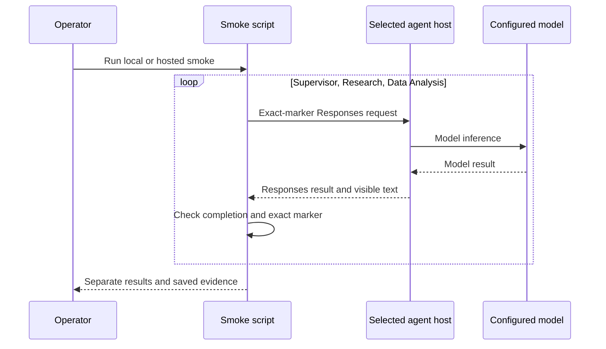
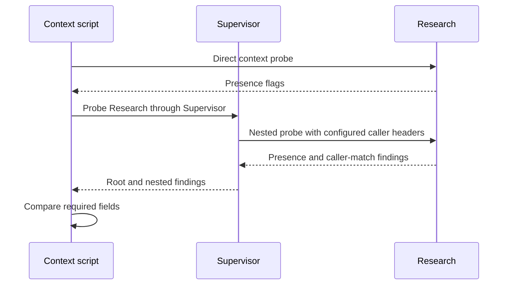
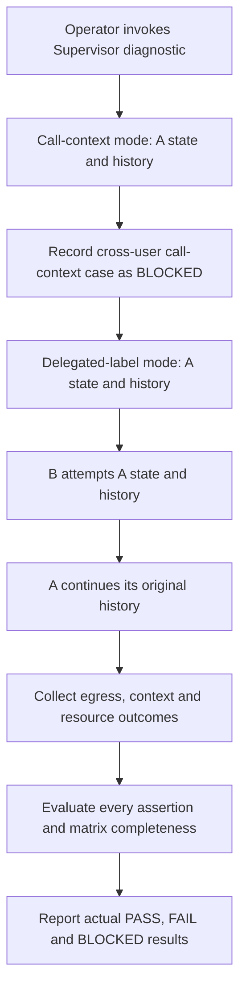
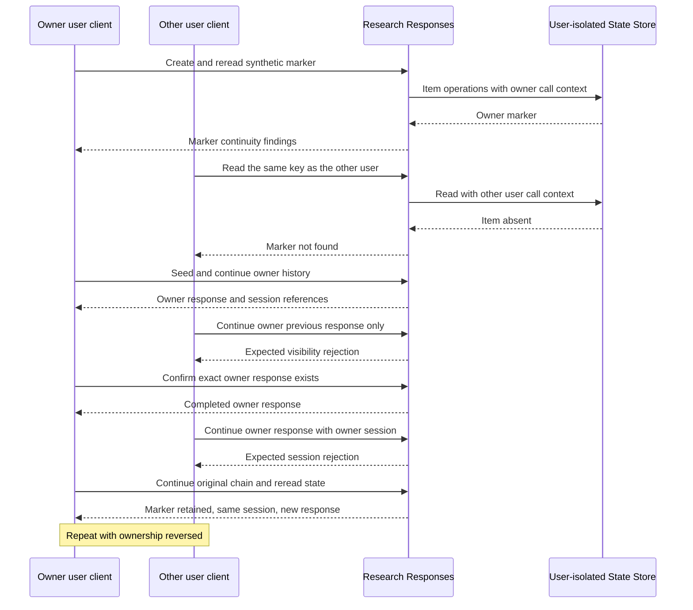
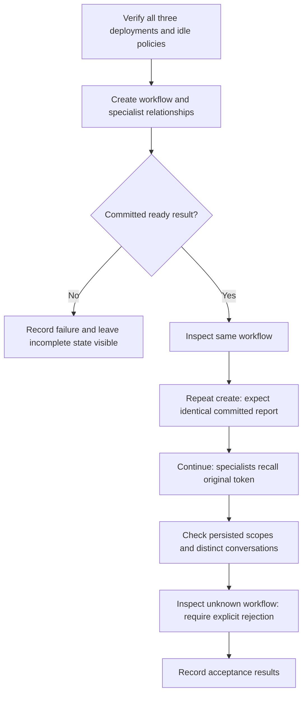

# VS Code tasks: detailed operator guide

This guide explains the tasks currently defined in
[tasks.json](../.vscode/tasks.json). Open **Terminal > Run Task**, then select the
exact label shown below. Sections group tasks by purpose; the labels themselves
are unchanged.
Diagrams use conservative Mermaid syntax for GitHub and Mermaid-capable VS Code
Markdown previews; no external links or callbacks are embedded in diagrams.

- [Setup](#setup): install dependencies, configure local settings, and prepare access.
- [Verify](#verify): check prerequisites, code, templates, plans, and deployment operations.
- [Tests](#tests): exercise specific behaviors and understand the evidence boundary.
- [Deployment](#deployment): explicitly create/update Azure resources or agent versions.
- [Debug](#debug): start the local Supervisor and open its Inspector.
- [Prompts and credentials](#prompts-and-credentials).
- [Reading results and demonstrating proof](#reading-results-and-demonstrating-proof).

For the overall run order, use the [README Quick start](../README.md#quick-start---run-in-this-order).
For CLI alternatives and caveats, use [Deployment reference](deployment.md).
For accepted decisions and dated findings, use [ADR-0001](adr/0001-hosted-agents-poc.md).

## Safety and evidence boundaries

| Activity | What it can establish | What it cannot establish by itself |
|---|---|---|
| Import, lint, type, and unit checks | Local code/configuration behavior | Hosted identity, isolation, or recovery |
| Bicep compile/validate/what-if | Template correctness and proposed changes | Successful provisioning, capacity, or data access |
| Independent model smoke | A particular host can execute a Responses/model request | Specialist orchestration or end-user isolation |
| Context diagnostic | Which verified context fields are visible | Whether a user can access another user's resources |
| State/history negative tests | The specific authorization/continuity boundary exercised | Untested agents, files, downstream APIs, or recovery |
| Role-assignment readback | An assignment exists at a scope | Effective data-plane access after propagation |

**Launching a task with paid or mutating effects is an explicit operator action.**
Review its inputs and scope first. Local inference can also incur charges because
the host uses a real Azure model. Diagnostic tasks request no model inference,
but hosted sessions, response records, and State Store operations can still incur
service usage.

No task currently proves crash recovery, filesystem restoration after idle,
CSV/XLSX analysis capacity, Blob artifact authorization, or OAuth OBO permissions.
Do not describe those as passing because another task completed.

## Setup

### Setup: Sync dependencies

- **Purpose:** create/update the root virtual environment using the committed lock.
- **Execution:** `uv sync --frozen --group validation --inexact`.
- **Effect:** installs locked development/validation dependencies; `--inexact`
  preserves already installed optional extras. Requires access to the approved
  Microsoft package feed.
- **Boundary:** no provisioning, role changes, agent startup, or model requests.

### Setup: Sync dependencies with optional integrations

- **Purpose:** prepare a developer environment that also needs optional integrations.
- **Execution:** frozen uv sync with `--group validation --all-extras`.
- **Effect:** installs the optional packages as well as the normal dependencies.
- **Boundary:** installation does not configure App Configuration/telemetry or
  prove that those Azure integrations can be reached.

### Setup: Prepare local environment

- **Purpose:** convenient first-time local dependency/import preparation.
- **Composition, in order:**
  1. `Setup: Sync dependencies`
  2. `Setup: Check Python environment`
- **Boundary:** does not create `.env`, start hosts, sign users in, grant access,
  or deploy anything. It does not run the full unit/lint/type suite.

### Setup: Create .env from deployment

- **Purpose:** populate local configuration from an existing successful foundation deployment.
- **Implementation:** [generate_env.py](../scripts/deploy/generate_env.py).
- **Execution:** resolve the selected subscription/environment, discover its latest
  successful matching deployment, validate outputs, then create `.env` from the
  example with the mapped project/model/optional App Configuration values.
- **Safety:** refuses to overwrite an existing `.env`; use the update task instead.
  Does not provision or invoke models. Keep the resulting file private.

### Setup: Update .env from deployment

- **Purpose:** refresh mapped Azure configuration without losing local customization.
- **Execution:** the same generator with `--update`; preserves unrelated settings
  and checks for concurrent file modification before replacement.
- **Effect:** updates the three mapped configuration fields; can also create the
  file from the example if it does not yet exist.
- **Boundary:** file generation is configuration preparation, not live access proof.

### Access: Apply developer permissions

- **Purpose:** prepare the operator's own scoped access to the deployed POC resources.
- **Implementation:** [grant_local_rbac.py](../scripts/deploy/grant_local_rbac.py).
- **Prerequisites:** existing foundation, correct selected identity, and permission
  to create the displayed assignments. Review the developer-permission preview first.
- **Execution:** validates identity/tenant/deployment outputs, grants missing scoped
  roles, uploads/downloads/checksums a synthetic Blob, queries monitoring, and deletes
  its own synthetic Blob. Access propagation retries are bounded.
- **Boundary:** mutates RBAC and temporary Blob data. Does not test model inference,
  ACR push, hosted State Store isolation, or another user's permissions.

### Access: Apply hosted agent permissions

- **Purpose:** allow the deployed agent identities to access Foundry data/model capabilities.
- **Implementation:** [grant_agent_rbac.py](../scripts/deploy/grant_agent_rbac.py) with `--apply`.
- **Execution:** resolves each actual deployed instance principal, checks inherited
  assignments, and creates missing **Foundry User** assignments at the selected
  Foundry account scope.
- **Boundary:** these are agent grants, not test-user grants. No Blob, telemetry,
  or impersonation permission is added in this mode. A grant is not delegation proof.

### Access: Apply Supervisor impersonation permission

- **Purpose:** enable the explicitly approved trusted-service delegation experiment.
- **Execution:** the hosted-agent permission helper with `--delegation --apply`.
  It checks/creates the tightly validated custom impersonation role and assigns it
  only to Supervisor at the selected project.
- **Important:** this flag **extends** the ordinary agent-permission helper. The
  task can also apply its missing Foundry User grants for the deployed agents.
- **Boundary:** no specialist impersonation grants, broad administrative grants,
  Blob grants, or user-token/OBO exchange. Permission does not prove user propagation.

### Access: Create isolated user auth profiles

- **Purpose:** prepare genuinely different Entra callers without replacing the
  operator's Azure CLI profile.
- **Implementation:** [auth_profiles.py](../scripts/common/auth_profiles.py).
- **Prompts:** comma-separated full UPNs, environment, and optional `consumer`/`none` RBAC.
- **Execution:** if Consumer access is selected, the operator first validates all
  users, the tenant/project, and the invoke-only built-in role; missing project
  grants are created and read back. Microsoft sign-in then runs for each user in
  a separate local CLI directory, followed by user/tenant checks.
- **Safety:** password/MFA entry belongs only in Microsoft's UI. No password task
  input, credential copying, developer fallback, cache clearing, or agent invocation.
  Earlier grants/profiles remain if a later step fails.
- **Boundary:** this task includes `--apply`. It prepares authentication and optional
  assignments, not effective agent authorization or isolation. Run from the operator
  context when granting RBAC, not from a Consumer-only test profile.

## Verify

### Setup: Check Python environment

- **Purpose:** identify interpreter/import problems before starting any host.
- **Implementation:** [validate_environment.py](../scripts/common/validate_environment.py), local mode.
- **Execution:** checks Python 3.14 and imports the framework, hosting, storage,
  and three agent entry-point modules without starting servers.
- **Boundary:** no model call or hosted identity validation. The task does not
  select the helper's separate configured-settings mode.

### Quality: Check lint

- Runs Ruff checks over `src/backend/app`, `scripts`, and `tests`.
- Reports configured correctness/style violations; does not automatically fix them
  or contact Azure. Rules come from [pyproject.toml](../pyproject.toml).

### Quality: Check formatting

- Runs `ruff format --check` on the same source/script/test roots.
- Reports files that would be reformatted; it does not rewrite them.

### Quality: Check types

- Runs the repository's configured mypy checks.
- Detects static type/API inconsistencies in the configured application/script
  targets. It does not establish runtime service compatibility.

### Infrastructure: Compile Bicep

- Compiles [infra/main.bicep](../infra/main.bicep) with Azure CLI's Bicep tooling.
- Writes generated ARM JSON to `artifacts/infra-validation/main.json`.
- No deployment or model invocation. A first use may require Bicep tooling setup;
  compilation is not live Azure resource validation.

### Infrastructure: Validate template (Azure CLI)

- **Purpose:** request Azure-side validation without creating the proposed resources.
- Uses the chosen subscription and checked-in
  [preview parameters](../infra/preview.parameters.json), with deployment location
  `northcentralus` and the task's fixed preview deployment name.
- Reports provisioning-state/error/diagnostic fields from native CLI validation.
- **Boundary:** these preview inputs are not automatically the selected azd
  environment's values. Success does not prove capacity, RBAC propagation, or deployment.

### Infrastructure: Preview changes (Azure CLI)

- Runs subscription-level `what-if` for the template and checked-in preview inputs.
- Shows proposed changes with native verbose output; review before applying.
- Does not provision resources or grant roles. Unresolved/unevaluated changes,
  especially new identities, still require inspection.

### Infrastructure: Preview changes (azd)

- Runs `azd provision --preview` for the **currently selected azd environment**.
- The preprovision hook checks required subscription/environment/region inputs.
- No environment picker is wired into this task: select the intended environment
  first. Infrastructure preview is different from hosted-agent deployment preview.

### Infrastructure: Inspect deployment operations

- Reads subscription deployment operations for the entered **exact deployment name**.
- Use after a failed/partial deployment to locate the real failing operation.
- Does not retry or repair deployment. Nested resource-group operations may need
  separate inspection using the CLI guidance in [deployment.md](deployment.md).

### Access: Preview developer permissions

- Resolves the selected `az` or `azd` user, validates tenant/subscription and
  deployment outputs, and lists present/missing scoped developer roles.
- With `azd`, the helper also verifies that its user matches the Azure CLI user.
- No role writes or synthetic Blob access test in this task. Do not assume that
  a displayed plan means the operator has authority to apply it.

### Access: Preview hosted agent permissions

- Resolves actual deployed instance identities and checks their scoped Foundry
  User assignments; does not guess principals from agent or blueprint names.
- Does not change roles or test actual inference/delegation.

### Access: Preview Supervisor impersonation permission

- Runs the agent-permission helper with `--delegation`, without `--apply`.
- Includes the normal hosted-agent Foundry User plan plus the Supervisor-only
  project-scoped custom impersonation role/assignment plan.
- Validates an existing custom role's exact permissions before reuse; no role
  definitions/assignments are created by this preview.

### Agents: Preview hosted deployment (unsupported)

- Runs `azd deploy --all --preview` for the prompted environment.
- **Known limitation:** hosted-agent preview is unsupported/skipped in the current
  tooling. Exit code zero can mean nothing was previewed.
- Do not use this as a deployment plan, successful build, or hosted proof.

## Tests

These sections describe **expected passing behavior**, not a promise that the
current deployment satisfies every test. Consult the dated [ADR findings](adr/0001-hosted-agents-poc.md).
The native-user control passed on Research 6; that did not fix nested delegation.

### Quality: Run unit tests

**Use case:** catch local regressions quickly without paying for a hosted run.

1. Runs pytest over [tests/unit](../tests/unit).
2. Exercises settings, redaction, registry rules, request serialization, CLI/task
   wiring, diagnostic classifications, and related helpers.
3. Uses local fakes and in-memory HTTP transports where a service is involved.

**Pass means:** the selected local assertions passed. It is not proof that Foundry
enforces isolation or that a real cloud checkpoint survives process loss.
No model invocation, deployment, live grant, or fault experiment is requested.

### Quality: Run all local checks

**Use case:** the default build-quality gate before a commit or approved cloud experiment.

Runs these dependencies **sequentially**:

1. `Quality: Check lint`
2. `Quality: Check formatting`
3. `Quality: Check types`
4. `Quality: Run unit tests`

Fix a failing prerequisite rather than treating later stages as passed. This group
does not run the local-model smoke, hosted diagnostics, profile sign-in, or deployment.

### Agents: Smoke test all local agents

**Use case:** verify the three local HTTP hosts can each complete real model inference.

**Prerequisites:** configured model access and separately running Supervisor,
Research, and Data Analysis hosts, normally on ports 8088/8089/8090.

1. [run_scenarios.py](../scripts/run_scenario/run_scenarios.py) selects the only
   implemented scenario, local `smoke`.
2. Sends each host `Reply with exactly: HOSTED-AGENTS-POC-OK`, sequentially.
3. Requires completed responses with the exact visible marker and no protocol error.
4. Records safe HTTP details, visible text, available numeric usage, and timing.
   A missing host is a blocked prerequisite, not a model success.

**Effects:** real model usage, even though HTTP targets localhost.
**Does not prove:** hosted sandbox behavior, cross-user isolation, or any Supervisor
call to a specialist. The script independently invokes all three.

### Agents: Smoke test all hosted agents

**Use case:** distinguish an actual deployed inference success from build/readiness success.

**Prerequisites:** existing environment, operator metadata/invocation access, and
active agents with exclusive `@latest` endpoint routing.

1. [hosted_smoke.py](../scripts/run_scenario/hosted_smoke.py) reads deployment context.
2. Verifies active latest-version metadata/routing for each agent.
3. Uses the operator's Azure CLI credential and each agent-bound Responses endpoint.
4. Sends the same exact-marker prompt as local smoke, once per agent, with SDK
   request retries disabled.
5. Records each actual result separately; an HTTP response alone is insufficient.

**Effects:** real hosted/model usage and response/session records.
**Does not prove:** orchestration, user isolation, recovery, or artifact authorization.

The local and hosted smoke tasks differ in target, not in their independence:

### Agents: Diagnose hosted caller context

**Use case:** locate where context visibility changes between direct and nested calls.

1. [context_probe.py](../scripts/run_scenario/context_probe.py) verifies the active
   Supervisor/Research targets and their 120-second idle policy.
2. Invokes Research directly with `POC_CONTEXT`.
3. Invokes Supervisor, which makes one nested Research context probe.
4. Compares hosted/call/user/session/conversation presence and nested expected-caller
   equality. Missing required fields or mismatch produce non-success results.

**Effects:** hosted conversation/response/session metadata, but no requested model
inference or application State Store writes. No grants or deployment.
**Does not prove:** authorization from a visible user/call field alone.

### Agents: Test hosted identity variants and isolation

**Use case:** investigate delegated-user boundaries separately from normal workflow guards.

**Prerequisites:** explicit approval, active Supervisor/Research versions, metadata
access, diagnostic opt-in on both, and appropriate Supervisor delegation permission.

1. [identity_matrix.py](../scripts/run_scenario/identity_matrix.py) invokes Supervisor's
   `POC_IDENTITY` comparison.
2. The default task tests **two mechanisms separately**: original call context
   only, then synthetic delegated application-user labels only.
3. Each mode tests A's state/history continuity. The delegated-label mode also
   attempts B reads/continuations and verifies final A continuation.
4. Checks safe actual egress metadata and reports context observations separately.
5. Requires a complete, nonduplicate assertion matrix. Unexpected B success remains
   FAIL even if A's final request succeeds. Unrelated 5xx/transport errors are not denials.

**Effects:** real hosted calls, synthetic markers in a separate user-isolated store
with a verified one-hour TTL, and platform history records. No model requests,
normal registry resets, guard relaxation, role changes, or automatic request retries.

**Identity boundary:** synthetic A/B labels share the authenticated Supervisor
principal. They are not two independently authenticated Entra users. This matrix's
cross-user original-call-context case remains BLOCKED; the separate native-user
task does not provide a second caller inside this single Supervisor request.

**CLI-only variations:** `--response-chains` removes explicit conversation creation;
`--history-only` also omits A's session only from B's history attempt;
`--direct-control` skips Supervisor and requires the operator's separately approved
impersonation permission. These switches are not prompts on this task.

### Agents: Test native Entra user isolation

**Use case:** demonstrate that two actual users cannot inherit each other's Research
state/history and can return to their own conversation afterward.

**Prerequisites:** exactly two full UPNs, independently signed-in isolated CLI
profiles, suitable Consumer access, and Research's existing diagnostic opt-in.
Use the profile setup task first. Do not replace missing users with labels.
Keep test identities least-privileged: broader inherited roles can affect what
management APIs intentionally allow. The operator handles deployment metadata;
do not grant test users Foundry User merely to satisfy that preflight.

1. [native_user_isolation.py](../scripts/run_scenario/native_user_isolation.py) verifies
   each CLI account/tenant and Graph `/me`; requires distinct Entra object IDs.
2. The operator credential reads active Research routing/version/idle metadata only.
3. Actual diagnostic requests use each user's own profile-bound credential, without
   a developer fallback or `x-ms-user-identity`.
4. In each direction, both callers must have valid native hosted context.
5. The owner creates/reads a state marker and continues a response chain.
6. The other user attempts the owner's state key and history references:
   - state marker must be absent;
   - previous-response-only continuation must receive a recognized visibility denial;
   - continuation with the owner's session must also be denied.
7. For generic `404/not_found`, the owner must retrieve the exact completed response.
8. The owner continues again: marker retained, original session, new response.
   Its state must remain unchanged.
9. Repeats with the users' roles reversed and audits outgoing native-header absence.

**Expected evidence:** the observed passing control had 22 assertions, including
404 `not_found` and 403 `session_not_accessible` in both directions. That is a
dated result, not a guarantee for a future run.

**Presentation:** choose **Verbose** or **Not verbose**. Verbose shows sanitized
REQUEST/RESPONSE panels, actual HTTP metadata, timings, bindings, and deterministic
diagnostic JSON, not model-generated answers. Compact mode retains request labels
and assertions; both save sanitized exchange events and assertion evidence.

**Effects:** real Research calls and dedicated synthetic one-hour state/history.
No login, role changes, deployment, models, ordinary workflow creation, or retries.
**Does not prove:** hosted Supervisor propagation, Data Analysis, normal registry
ownership, files/artifacts, downstream user permissions, or crash recovery.

The diagram shows expected passing behavior; the task evaluates actual outcomes:

### Agents: Test hosted workflow state and delegation

**Use case:** validate the complete normal Supervisor/specialist workflow, not just
the diagnostic or independent smoke surfaces.

**Prerequisites:** all three active targets, verified 120-second idle policy,
model permissions, and working specialist caller context. This path remains
unvalidated because the normal nested-user guard has blocked it.

1. [hosted_workflow.py](../scripts/run_scenario/hosted_workflow.py) creates a Supervisor
   conversation and fresh workflow ID.
2. Creation requests both specialist conversations and asks each to remember
   `ALPHA-POC-7`.
3. Inspects the persisted root workflow and repeats the same creation command;
   both must return the same committed report, not mint new scope.
4. Continues without repeating the token. Both specialists must recall it.
5. Requires ready progress, three distinct conversations, unchanged random
   owner/session mappings and child bindings, and new specialist response IDs.
6. Inspects an unknown workflow and requires explicit rejection without initialization.

**Effects:** real model inference and normal workflow-registry writes if creation
can proceed. A failed/interrupted workflow can remain `progress: running`;
do not reset it or automatically replay side effects to force the test green.
**Does not prove:** two-user isolation, idle/restart continuity, crash recovery,
or Blob authorization. The application's `Workflow` model is not a MAF
`WorkflowBuilder` graph.

## Deployment

### Infrastructure: Apply changes (azd)

- Runs `azd provision` against the **currently selected** environment.
- **Mutates Azure and can incur charges.** Review the appropriate preview and
  required owner inputs first; do not confuse the environment with a timestamped
  deployment operation name.
- Runs the existing preprovision input gate. Does not automatically grant local-user
  access or prove data-plane permissions.

### Agents: Deploy all hosted agents

- Runs `azd deploy --all` for the prompted environment, reusing the foundation.
- Remote ACR builds/registers immutable hosted versions for all three services.
- **Mutates Azure and can incur build/hosting charges.** Does not run inference,
  grant missing instance roles, or prove successful endpoint behavior.
- Inspect native failures. Build/log retrieval failure and actual build status
  can differ; do not blindly submit duplicate builds.

### Agents: Deploy and smoke test all hosted agents

Sequential composite:

1. `Agents: Deploy all hosted agents`
2. `Access: Apply hosted agent permissions`
3. `Agents: Smoke test all hosted agents`

**Use case:** package/deploy plus agent-role setup plus independent real inference.
**Effects:** paid builds/hosting/model calls and scoped agent RBAC.
**Boundary:** not delegation, native-user isolation, recovery, or foundation provisioning.

### Agents: Deploy and test hosted delegation

Sequential composite:

1. `Agents: Deploy all hosted agents`
2. `Access: Apply hosted agent permissions`
3. `Agents: Smoke test all hosted agents`
4. `Agents: Test hosted workflow state and delegation`

**Use case:** attempt normal workflow acceptance from a fresh deployment.
**Effects:** deployment/RBAC/model/state side effects of all dependencies.
**Current limitation:** nested caller context still blocks normal delegation.
This group does **not** include the separate Supervisor impersonation-grant task,
nor does it bypass the workflow guard. It does not reprovision the foundation.

## Debug

### Debug: Check Supervisor ports

- Uses the installed Foundry Toolkit task integration to check ports 5679 and 8088.
- A prerequisite for the Inspector startup chain, not a functional agent test.
- Does not start an agent, authenticate users, provision, or invoke a model.

### Debug: Start Supervisor for Inspector

- Starts the root virtual environment's `debugpy` listener on loopback port 5679
  and the Supervisor HTTP host on development port 8088.
- Depends on `Debug: Check Supervisor ports`; remains running in the background.
  The task's ready pattern means the local HTTP listener started, not that model
  access or hosted isolation passed.
- Requires local configuration. Startup can load explicitly configured integrations;
  submitting messages can invoke real models. No cloud deployment/RBAC step occurs.

### Debug: Open Supervisor Inspector

- Depends on the Supervisor background startup task.
- Resolving its command input asks Foundry Toolkit to open the Inspector for port
  8088; the subsequent Python command only prints an acknowledgement.
- Used by **Supervisor + Foundry Agent Inspector** in
  [launch.json](../.vscode/launch.json). The other F5 host configurations start
  individual local agents separately.
- Interactive Inspector responses are local-host observations, not hosted proof.

## Prompts and credentials

| Task input | Meaning / caution |
|---|---|
| `infraEnvironment` | Named azd environment used by the task/helper; default is `hosted-agents-poc-dev`. Provisioning tasks without this argument use the already selected environment. |
| `infraSubscription` | Explicit Azure subscription name or ID for native infrastructure/developer-access tasks. |
| `infraDeployment` | Exact subscription deployment operation name for inspection, not the environment name. |
| `infraCredential` | `az` or `azd` for developer grants; the helper verifies matching users when azd is selected. |
| `authProfileUsers` | Comma-separated full user UPNs; native isolation requires exactly two distinct authenticated users. Never enter passwords. |
| `authProfileRbac` | `consumer` or `none`; Consumer grants happen under the operator identity before isolated sign-in. |
| `nativeIsolationVerbosity` | `--verbose` or `--no-verbose`; changes presentation, not assertions, credentials, or request count. |
| `openSupervisorInspector` | Extension command that opens the local Inspector, not a user-supplied URL or password. |

Do not change global/developer authentication to switch test users. The profile
helper prints per-terminal configuration assignments; the native harness uses
separate child-process environments. Profiles contain authentication material
and must remain private. Neither profile setup nor test execution disables MFA
or Conditional Access.

## Reading results and demonstrating proof

Rich Python validation helpers normally save ignored evidence under
`artifacts/<run-id>/`:

- `manifest.json`: scenario, execution mode, timestamps, and package/runtime context.
- `results.jsonl`: assertion results, expected versus observed.
- `events.jsonl`: structured events; native tests also record sanitized request/response pairs.

Native CLI/tool tasks use their own terminal output; do not assume every task
creates this evidence format.

Shared validation outcomes are:

- **PASS:** that named check met its requirement; it does not promote the whole POC.
- **FAIL:** an assertion or operation failed. Any required failure prevents success.
- **BLOCKED:** prerequisites or a required case are unavailable; not a passing test.
- **SKIP:** not successful evidence.

The shared Rich reporter returns 0 for all-pass, 1 for failures/skips, or 2 for
blocked prerequisites when there is no failure. Native CLI processes have their
own exit semantics. In particular, unsupported hosted preview can exit zero
without producing a useful preview.

For a customer demonstration of the **currently verified direct native-user
Research boundary**, prepare the two profiles, run the native isolation task,
select Verbose, show both denial variants and owner continuation, then open the
new run's saved results. Clearly identify the tested agent/version and date.
Do not present a recorded run as a new live execution or a local mock as hosted proof.

Keep the claims separate: model smoke, direct native-user isolation,
trusted-service delegated labels, hosted-to-hosted originating-user propagation,
and downstream OAuth/OBO permissions are different tests. The passing native
control does not erase the failed nested-delegation findings.
